# Admin guide

This guide is for Admins, the people who run iCARE++ accounts and keep the system working. Admins
do no teaching. They create accounts for Deans, Program Chairs, Instructors and Students, answer
the messages people send from Help & Support, send announcements, and keep an eye on the system's
health, speed and tests. All of this happens in the Admin portal on the web, at
`https://www.i-care.dev/admin`. For the parts every web user shares, such as signing in,
notifications and settings, see [Common tasks in the web portal](common-tasks.md).

**In this guide**

- [What the Admin does](#what-the-admin-does)
- [Before you start](#before-you-start)
- [Check system status](#check-system-status)
- [Manage accounts](#manage-accounts)
- [Send an announcement](#send-an-announcement)
- [Answer support requests](#answer-support-requests)
- [Read the Activity Log](#read-the-activity-log)
- [Watch system performance](#watch-system-performance)
- [Run and read system tests](#run-and-read-system-tests)
- [Turn the student web app on or off](#turn-the-student-web-app-on-or-off)
- [Your settings](#your-settings)

## What the Admin does

The Admin portal is labelled "System Administration" under the logo (see
[Names you will see on screen](README.md#names-you-will-see-on-screen)). Its sidebar has nine
links, grouped under the headings **General**, **Accounts**, **System**, **Account** and
**Support**.

| Sidebar link | Page title | What you do there |
|---|---|---|
| **Dashboard** | System Dashboard | See at a glance whether anything is broken, with traffic, AI usage and accounts |
| **Users** | Users | Create, edit, change the role of, reset the password of and delete any account. Create institutions |
| **Announcements** | Announcements | Send a message to everyone, to whole roles or to chosen people |
| **Activity Log** | Audit Trail | Read the record of every action by every role |
| **System Performance** | System Performance | Watch response time, throughput and reliability |
| **System Tests** | System Tests | Run health checks and benchmarks, and read test results and the ML models' figures |
| **Student Web App** | Student Web App | Turn the backup browser version of the student app on or off |
| **Settings** | Settings | Your own profile, photo, email, password, Google sign-in and theme |
| **Support Requests** | Support Requests | Read and answer the messages people send from Help & Support |

The **Notifications** page has no sidebar link. Open it with **See all notifications** in the
bell (see [See all notifications](common-tasks.md#see-all-notifications)).

## Before you start

- **Your account.** Another Admin creates it (see [Create an account](#create-an-account)). Your
  welcome email holds a temporary password, which you replace the first time you sign in. See
  [Sign in to the web portal for the first time](setup-1-getting-started.md#sign-in-to-the-web-portal-for-the-first-time).
  On a new installation the technical team sets up the first Admin (see
  [Create the first Admin](setup-2-technical.md#create-the-first-admin)).
- **Signing in.** Sign in at `https://www.i-care.dev/login` as described in
  [Sign in](common-tasks.md#sign-in). You land on the **Dashboard**. An Admin account works only in
  the Admin portal: if you open a Dean or Instructor page, you are sent back to the Dashboard.
- **No Help & Support page.** Admins are the people who answer Help & Support, so the Admin portal
  has **Support Requests** instead (see [Answer support requests](#answer-support-requests)).
- **The iCARE++ app.** The app is for Students and Instructors. If you sign in to it with an Admin
  account, it shows "Use the web portal", with **Open the web portal** and **Sign out**.
- **What reaches your bell.** Account requests from the sign-up page (titled "Account request
  from" and the person's name), Help & Support messages ("Support request from" and the name), and
  announcements you are in the audience for. A new one also appears as a message in the corner of
  whatever page you are on. See [Read new notifications](common-tasks.md#read-new-notifications).
- **"Migration … isn't applied yet".** If a page or card shows this, the database is missing an
  update. Tell the technical team (see
  [Apply the database schema and migrations](setup-2-technical.md#apply-the-database-schema-and-migrations)).

## Check system status

The **Dashboard** answers one question first: is anything wrong? It opens when you sign in, and
**Dashboard** in the sidebar brings you back to it. The page title is **System Dashboard**.

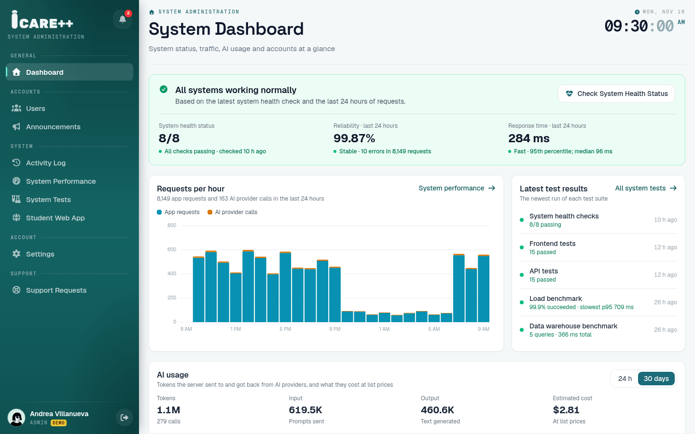

*Figure 1. The System Dashboard, with the status banner at the top and the requests per hour chart and latest test results below it.*

If the page can't load, it shows "Couldn't load the dashboard." Reload the page to try again.

### Read the status banner

The status banner is the coloured box at the top of the Dashboard. Its colour and headline follow
the worst of its three readings.

| Headline | Colour and icon | What it means |
|---|---|---|
| "All systems working normally" | Green, tick in a circle | The latest health check passed, and the last 24 hours of requests were fast and reliable |
| "Some systems need attention" | Amber, warning triangle | A check gave a warning, or requests were slower or less reliable than they should be |
| "A system is failing" | Red, X in a circle | A check failed, or requests were very slow or unreliable |
| "No system status yet" | Grey, question mark | No health check has run and there are no requests to measure |

The line under the headline says how fresh the status is:

- "Based on the latest system health check and the last 24 hours of requests." The status is
  current.
- "The last system health check ran 2 days ago. Check again for the current status." The health
  check is more than a day old. [Run a system health check](#run-a-system-health-check).
- "No system health check has run yet. Run one to test every connected service."

Under that are the three readings:

| Reading | What it shows | Words beside it |
|---|---|---|
| **System health status** | Checks passed out of the total, for example 8/8 | "All checks passing" and when it was checked, how many checks are failing or gave warnings, or "Never checked" |
| **Reliability · last 24 hours** | The share of requests answered without an error | "Stable" (99.5% and up), "Needs watching" (99% to 99.5%) or "Unstable" (under 99%), with the number of errors and requests |
| **Response time · last 24 hours** | The 95th percentile: 19 requests in 20 were faster than this | "Fast" (under 0.8 s), "Okay" (under 2.5 s) or "Slow", with the median |

With fewer than 100 requests in the last 24 hours, a "Slow" reading turns the banner amber, not
red.

### Run a system health check

Run a health check when the banner says the status is old, or when something seems wrong. It tests
whether the database, the data warehouse, the ML service, the AI providers, email and sign-in
sessions are reachable and set up correctly.

To run a health check from the Dashboard:

1. In the sidebar, select **Dashboard**.
2. In the status banner, select **Check System Health Status** (the heart with a pulse line). The
   button reads "Checking system health…" while the checks run.

   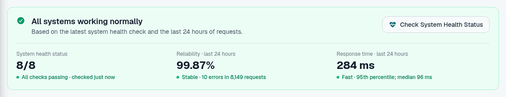

   *Figure 2. The status banner after a health check, with the health, reliability and response time readings under the headline.*

**Result:** The headline and the **System health status** reading update. If the check can't run at
all, the banner shows "The system health check could not run".

**Who is notified:** Nobody is notified.

**What happens next:** To see the result of each check, go to **System Tests** (see
[System health checks](#system-health-checks)). The Dashboard runs the same checks.

### Read traffic, AI usage and accounts

Below the status banner, the Dashboard has four cards:

- **Requests per hour.** A bar chart of the last 24 hours of requests from the web portal, with AI
  provider calls beside them. The line under the title gives the totals, for example "1,240 app
  requests and 36 AI provider calls in the last 24 hours". Select **System performance** for the
  detail (see [Watch system performance](#watch-system-performance)).
- **Latest test results.** "The newest run of each test suite": **System health checks**,
  **Frontend tests**, **API tests**, **Load benchmark** and **Data warehouse benchmark**. Each row
  has a coloured dot, a verdict such as "8/8 passing", "2 failing" or "Not run yet", and how long
  ago it ran. Select a row to open that section of **System Tests**, or select **All system
  tests**.
- **AI usage.** The tokens the server sent to and got back from the AI providers, and what they
  cost at list prices. Choose **24 h** or **30 days**; it starts on **30 days**. Totals show under
  **Tokens**, **Input**, **Output** and **Estimated cost**, and a table lists each model with
  **Calls**, **Input**, **Output**, **Rate per 1M · in / out** and **Est. cost**. Failed calls show
  in red beside the count, for example "2 failed". The cost is an estimate from list prices; the
  provider's bill is what counts. Gemini and OpenRouter run on free plans, so they cost nothing.
- **Accounts.** "Everyone who can sign in, by role": **Total accounts**, **Active users · last 7
  days** with its share of the total, a bar split into Students, Instructors, Deans, Program Chairs
  and Admins, and **New accounts** per week for the last 8 weeks. Select **Manage users** to open
  **Users**.

## Manage accounts

Every account in iCARE++, whatever its role, is on the **Users** page. This section covers finding,
creating, changing and deleting accounts, and the account requests people send from the sign-up
page.

### Find an account

Use the **Users** page to find an account before you edit it, reset its password or delete it.

To find an account:

1. In the sidebar, select **Users**. The **Users** page opens with **All accounts** selected.

   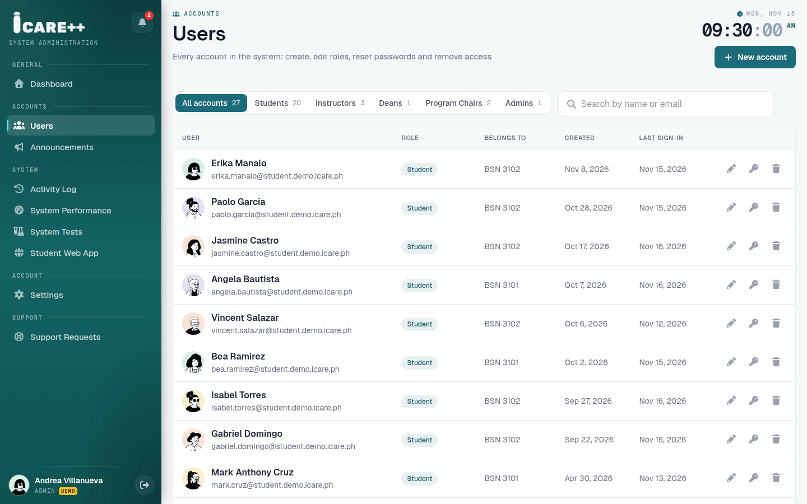

   *Figure 3. The Users page, with the role filter and search box above the table of accounts.*

2. Optional: Select a role to see only those accounts: **Students**, **Instructors**, **Deans**,
   **Program Chairs** or **Admins**. Each shows how many accounts it has.
3. Optional: In the search box, enter part of a name or email address. The list narrows as you
   type.

**Result:** Each row shows the person's name and email, and the columns **Role**, **Belongs to**,
**Created** and **Last sign-in**. Your own row is marked "(you)". "Never" under **Last sign-in**
means the person hasn't signed in yet. A new account shows "temporary password" beside its role
until the person sets their own password.

**Belongs to** depends on the role:

| Role | Belongs to |
|---|---|
| Student | Their section and the Dean or Program Chair it belongs to, or "No section" |
| Instructor | Their Dean or Program Chair, or "No dean" |
| Program Chair | Their institution and their Dean, or "No dean" |
| Dean | Their institution, or "No institution" |
| Admin | "—" |

At the end of each row are three buttons: **Edit account** (a pencil), **Reset password** (a key)
and **Delete account** (a bin). On a phone the table becomes a list of cards with the same
buttons.

> [!NOTE]
> If the page can't load the accounts, it shows "No accounts match", just as it does for a search
> with no results. If the list is empty when it shouldn't be, reload the page before you act on it.

### Create an account

Create an account for a new Admin, Dean, Program Chair, Instructor or Student. Deans, Program
Chairs and Instructors can also create some accounts themselves (see
[Get an account](setup-1-getting-started.md#get-an-account)).

**Before you start**

- For a Student: their section should already exist. The Dean creates sections (see
  [Create a section](dean.md#create-a-section)).
- For an Instructor or a Program Chair: their Dean's account should already exist.
- For a Dean or a Program Chair: know which institution they belong to (see
  [Institutions](#institutions)).

To create an account:

1. In the sidebar, select **Users**.
2. Select **New account**. The **New account** dialog opens. (On a phone, the button shows only a
   plus sign; its name is **Create a new account**.)
3. In the **Full name** box, enter the person's name.
4. In the **Email** box, enter their email address.
5. In the **Role** list, choose **Student**, **Instructor**, **Dean**, **Program Chair** or
   **Admin**.

> [!IMPORTANT]
> The **Role** list starts on **Student**, even when the form opens from an account request. Choose
> the right role before you select **Create account**, or you create a Student account.

6. In the **Sex** list, choose **Female (Ms.)**, **Male (Mr.)** or **Not specified**.
7. Fill in the field that appears for the role, as described in the table after these steps.

   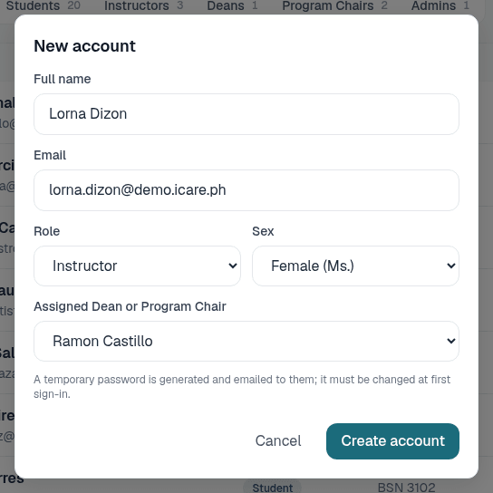

   *Figure 4. The New account dialog for an Instructor, with the Assigned Dean or Program Chair list under the Role and Sex lists.*

8. Read the note "A temporary password is generated and emailed to them; it must be changed at
   first sign-in."
9. Select **Create account**. The button reads "Saving…" while it works.

| Role | Field | What to choose |
|---|---|---|
| Student | **Section** | The student's section, listed under the Dean or Program Chair it belongs to, or **No section**. The student belongs to the Dean or Program Chair whose section it is |
| Instructor | **Assigned Dean or Program Chair** | The Dean or Program Chair the Instructor works under, or **None**. Each choice shows the name, "Program Chair" where it applies, and the institution |
| Dean | **Institution** | An institution, **New institution…** to add one, or **No institution** (see [Institutions](#institutions)) |
| Program Chair | **Institution** and **Dean** | See [Set up a Program Chair](#set-up-a-program-chair) |
| Admin | No extra field | |

**Result:** The dialog closes, and a banner above the list reads, for example, "Account created. The
temporary password was emailed to lorna.dizon@demo.icare.ph." The new account shows "temporary
password" beside its role.

> [!IMPORTANT]
> If the welcome email can't be sent, the **Temporary password** dialog appears instead of the
> banner. It shows the email address, the password and **Copy password**, with the note "The
> welcome email could not be sent. Share the temporary password manually." The password is shown
> only this once: "It won't be shown again." Copy it before you select **Done**, and pass it to the
> person yourself.

If the account can't be created, the banner shows why:

| Message | What to do |
|---|---|
| "Name is required" | Enter the person's name |
| "Enter a valid email address" | Correct the email address |
| "A user with this email already exists" | Find the existing account instead (see [Find an account](#find-an-account)) |
| "Name the new institution" | Enter a name in the **Institution name** box |
| "Institution name is too long (max 120 characters)" | Shorten the institution's name |

**Who is notified:** The new person gets the email "Welcome to iCARE++ – Your Account Has Been
Created", with their temporary password. Staff get a link to sign in on the web; Students get a
link to download the app.

**What happens next:** The person signs in and sets their own password (see
[Get an account](setup-1-getting-started.md#get-an-account)). A new Dean then sets up their program
in the Dean portal, starting with [Set up a new term](dean.md#set-up-a-new-term).

### Accept an account request

People without an account can ask for one with **Contact us** on the sign-up page. Each request
reaches every Admin. Accepting it opens the **New account** form, filled in from the request.

> [!NOTE]
> Each Admin gets their own copy of a request at the moment it is sent, so an Admin added later
> doesn't see requests sent before they joined. If you select **Cancel** in the form, the request
> stays pending. It has left the bell by then, so select **See all notifications** in the bell and
> select **Accept** on it again.

To accept an account request:

1. In the sidebar, select the bell. An account request is titled "Account request from" and the
   person's name. It shows their email, sex, subject and message, with **Accept** and **Decline**.
   A **Google** tag means they sent it with their Google account.

   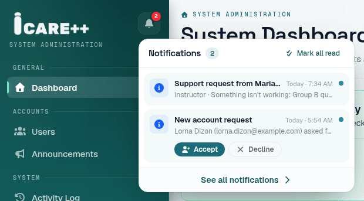

   *Figure 5. An account request in the notifications popover, with Accept and Decline under the request.*

2. Select **Accept**, or the request itself. The **Users** page opens with the **New account**
   dialog filled in with the person's name, email and sex. A note above the form reads "From an
   account request. Check the details and pick a role; the request is marked accepted once the
   account is created."

   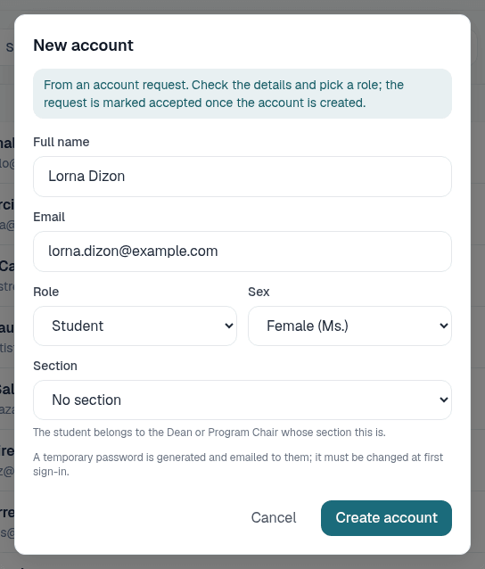

   *Figure 6. The New account dialog filled in from an account request, with the request note above the form.*

3. Make sure the name and email are right.
4. In the **Role** list, choose the person's role. It starts on **Student**, as in
   [Create an account](#create-an-account).
5. Fill in the field that appears for the role, as in [Create an account](#create-an-account).
6. Select **Create account**.

**Result:** The account is created as in [Create an account](#create-an-account), and the request
is marked accepted. Every other Admin sees "Accepted by" and your name on their copy.

- If the request was sent with Google, the note above the form adds "It was sent with Google, so
  the account will sign in with that Google account too." The new account can sign in with Google
  straight away. If that Google account already belongs to someone else, the banner adds "The
  Google account on this request is already connected to another user, so it was not linked."
- If the account is created but the request can't be marked, the banner reads "Account created,
  but the request could not be marked accepted:" followed by the reason.

**Who is notified:** The person gets the welcome email, as in
[Create an account](#create-an-account).

**What happens next:** The person signs in for the first time (see
[Get an account](setup-1-getting-started.md#get-an-account)).

### Decline an account request

Decline a request when the person shouldn't have an account.

To decline an account request:

1. In the sidebar, select the bell, or open the **Notifications** page with **See all
   notifications**.
2. On the request, select **Decline**. A confirmation box asks, for example, "Decline Paulo
   Medina's account request? They will be emailed that it was declined."
3. Select **OK**. The button reads "Declining…" while it works.

**Result:** The request shows "Declined by" and your name, for every Admin. If another Admin has
already handled it, the message reads "This request was already accepted." or "This request was
already declined."

**Who is notified:** The person gets the email "About your iCARE++ account request".

### Edit an account or change its role

Change a person's name, role or sex, or move them to another section, Dean or institution.

To edit an account:

1. In the sidebar, select **Users**.
2. Find the account (see [Find an account](#find-an-account)), and select **Edit account** (the
   pencil) on its row. The **Edit account** dialog opens. The email address shows as text, with
   **Change email** beside it for every role except Student.

   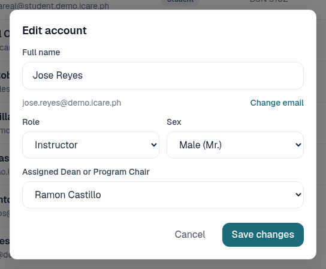

   *Figure 7. The Edit account dialog for an Instructor, with Change email beside the email address.*

3. Change what you need: **Full name**, **Role**, **Sex**, and the fields for the role, as in
   [Create an account](#create-an-account). The **Role** list is greyed out on your own account,
   because you can't change your own role.
4. Select **Save changes**.

> [!IMPORTANT]
> Changing the role, for example from Instructor to Dean, signs the person out on every device. It
> also removes what belonged to the old role:
>
> - An Instructor who changes role leaves their sections and groups. Those groups have no
>   instructor until their Dean gives them one.
> - A Dean who changes role no longer owns their instructors, students and Program Chairs. Those
>   accounts are left with no Dean.
> - Anyone who stops being a Student leaves their section and group.
>
> Changing between Dean and Program Chair is different: both keep the same access, so the person
> isn't signed out, nothing is cleaned up, and the banner reads "Account saved".
>
> The page doesn't say if this clean-up fails. Afterwards, look at **Belongs to** for the old
> links: a former Dean's instructors should read "No dean". If any old links remain, open the
> account again and select **Save changes**, which repeats the clean-up.

**Result:** The banner reads "Account saved". If you changed the role, it reads "Account updated.
The new role applies at their next sign-in." The banner shows an error instead in these cases:

- "You cannot change your own role"
- "The last admin cannot be demoted": there must always be at least one Admin.
- "Only students can be placed in a section"

**Who is notified:** Nobody is notified. A person whose role changed is signed out and must sign in
again, so tell them.

### Institutions

An institution is a school or campus. Each Dean and Program Chair belongs to one, and their
instructors and students take the same institution. Each Dean and Program Chair sees only their own
instructors, students and records, even when another Dean or Program Chair belongs to the same
institution.

There is no page for institutions. You create one while you create or edit a Dean or a Program
Chair.

To add an institution:

1. Open the **New account** or **Edit account** dialog for a Dean or a Program Chair.
2. In the **Institution** list, choose **New institution…**. A box appears under the list.
3. In the **Institution name** box, enter the institution's name, up to 120 characters.
4. Select **Create account** or **Save changes**.

**Result:** The institution is created, and the account belongs to it. If an institution with the
same name already exists, whatever its capital letters, that one is used instead of a new one.

Institutions can't be renamed or removed in the portal. When you move a Dean to another
institution, their instructors and students move with them.

### Reset a password

Give someone a new temporary password when they can't sign in. People can also reset a forgotten
password themselves (see [Reset a forgotten password](common-tasks.md#reset-a-forgotten-password)).

To reset a password:

1. In the sidebar, select **Users**.
2. Find the account (see [Find an account](#find-an-account)), and select **Reset password** (the
   key) on its row. A confirmation box asks, for example, "Issue a new temporary password for Jose
   Reyes? It is emailed to jose.reyes@demo.icare.ph, and their current password stops working."
3. Select **OK**.

**Result:** The banner reads "Password reset. The new temporary password was emailed to" and the
address. Their old password stops working, and they are signed out on every device. If the email
can't be sent, the **Temporary password** dialog appears instead, noting "They will be asked to
choose a new password when they sign in." Copy the password before you select **Done**, because
it won't be shown again, and pass it to the person yourself.

**Who is notified:** The person gets the email "Your iCARE++ password was reset", with the
temporary password. Staff get a link to sign in on the web; Students get a link to download the
app.

**What happens next:** The person signs in with the temporary password and chooses a new one.

### Change the email of an account

Change the email address someone signs in with. To change your own, see
[Change your email](common-tasks.md#change-your-email).

**Before you start**

- Have the account holder ready to read you a code from the new inbox, for example on a call.

To change the email of an account:

1. In the sidebar, select **Users**.
2. Find the account, and select **Edit account** (the pencil).
3. Select **Change email**. The **Change their email** dialog opens, showing the current address.
4. In the **New email** box, enter the new address.
5. Select **Send code**. A 6-digit code goes to the new address.
6. Ask the account holder to read you the code from that inbox, and enter it in the box labelled
   **Code sent to** and the new address. To start again with another address, select **Use a
   different email**.
7. Select **Confirm change**.

**Result:** The banner reads "Email changed to" and the new address, then "The old address was
notified."

> [!NOTE]
> A Student's address can't be changed, so their **Edit account** dialog has no **Change email**.
> Changing an email also disconnects the account's Google sign-in.

**Who is notified:** The old address gets the email "Your iCARE++ sign-in email was changed".

### Delete an account

Delete an account to remove someone's access for good.

To delete an account:

1. In the sidebar, select **Users**.
2. Find the account (see [Find an account](#find-an-account)), and select **Delete account** (the
   bin) on its row. It is greyed out on your own account. A confirmation box asks, for example,
   "Delete Jose Reyes (jose.reyes@demo.icare.ph)? This cannot be undone."

> [!IMPORTANT]
> Deleting an Instructor here also deletes their Library materials, and their students lose them.
> To keep the materials, ask the Instructor's Dean to delete the account from the Dean's
> **Instructors** page instead, which hands the materials to the Dean. See
> [Delete an instructor account](dean.md#delete-an-instructor-account).

3. Select **OK**.

**Result:** The banner reads "Account deleted". The banner shows an error instead in these cases:

- "You cannot delete your own account"
- "The last admin cannot be deleted"
- "This account still has records that block deletion": other records still depend on this
  account, so it can't be deleted.

**Who is notified:** Nobody is notified.

### Set up a Program Chair

A Program Chair runs their own part of a program with the Dean's tools, under a Dean. A Dean can
add their own Program Chairs (see [Add a Program Chair](dean.md#add-a-program-chair)). As an
Admin, you can create one directly or turn an existing account into one.

**Before you start**

- The Program Chair's Dean already has an account.

To set up a Program Chair:

1. In the sidebar, select **Users**.
2. Select **New account**, or select **Edit account** on an existing account.
3. For a new account, enter the **Full name** and **Email**, as in
   [Create an account](#create-an-account).
4. In the **Role** list, choose **Program Chair**.
5. In the **Institution** list, choose their institution.
6. In the **Dean** list, choose their Dean. The hint reads "They appear on this Dean's Program
   Chairs page and take the Dean's institution."

> [!NOTE]
> A Program Chair takes their Dean's institution, whatever is picked under **Institution**. (If the
> Dean has no institution, the one you pick stays.) A Program Chair whose Dean is **None** appears
> on no Dean's **Program Chairs** page.

7. Select **Create account** or **Save changes**.

**Result:** The account is saved as a Program Chair, and it appears on the Dean's **Program
Chairs** page.

**Who is notified:** A new Program Chair gets the welcome email, as in
[Create an account](#create-an-account).

**What happens next:** The Program Chair signs in to the Dean portal, titled "Program Chair
Portal". See the [Program Chair guide](program-chair.md).

## Send an announcement

An announcement is a message from the Admins to everyone in iCARE++, to whole roles, or to people
you pick. It arrives in their notifications, marked with a bullhorn, as a notification on their
phone if they use the app, and by email if you choose. Use it for news such as planned
maintenance.

### Choose who gets it

To choose who gets an announcement:

1. In the sidebar, select **Announcements**.
2. Under **Send to**, select one of these:
   - **Everyone**: every account in iCARE++. The page says how many people that is.
   - **By Role**: then select one or more of **Students**, **Instructors**, **Deans and Program
     Chairs** and **Admins**. Each shows how many people it has.
   - **Specific People**: then pick the people, as in the steps below.

To pick specific people:

1. Under **Send to**, select **Specific People**.
2. In the search box, enter a name, email, section or institution. Optional: In the role list,
   choose a role instead of **All roles**.
3. Select the box beside each person you want. The people you pick appear as chips above the
   search box, under a count such as "3 people picked".
4. Optional: To pick every match at once, select **Pick All** and the number of matches. It
   appears once you have searched or chosen a role.
5. Optional: To remove someone, select the X on their chip. To start again, select **Clear All**.

The list shows up to 100 people at a time ("Showing 100 of 412. Search to narrow it down."). You
can pick up to 2,000 people. If nobody matches, the list reads "Nobody matches that search."

### Write and send it

To write and send the announcement:

1. In the **Title** box, enter a short title, up to 120 characters.
2. In the **Message** box, enter the message, up to 2,000 characters. The counters above each box
   show how much you have used.
3. Optional: To send it in the app only, clear **Also send it by email**. When it is selected, each
   person gets their own copy from the iCARE++ address, and any replies go to the iCARE++ team's
   contact address.

   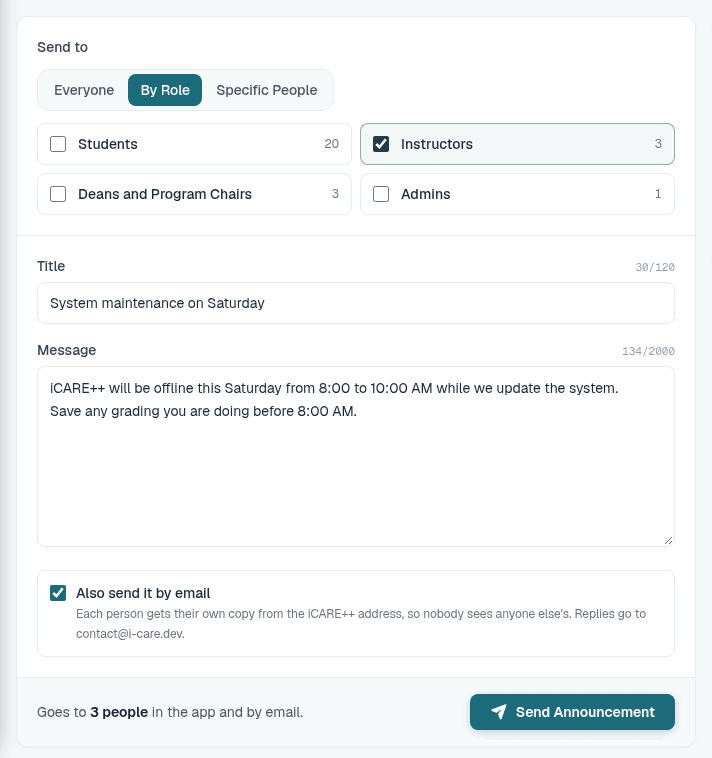

   *Figure 8. An announcement to Instructors, with a title and message filled in and Also send it by email selected.*

4. Read the line at the foot of the card. It says how many people the announcement goes to, for
   example "Goes to 3 people in the app and by email." If something is missing, it says what:
   "Pick at least one role.", "Pick at least one person.", "Add a title." or "Write the message."

> [!IMPORTANT]
> An announcement can't be taken back once it's sent. **Also send it by email** is selected from
> the start, so clear it first if you don't want emails to go out.

5. Select **Send Announcement**. The **Send this announcement?** dialog opens. It names who gets the
   announcement and how many people that is, and shows the title and message.

   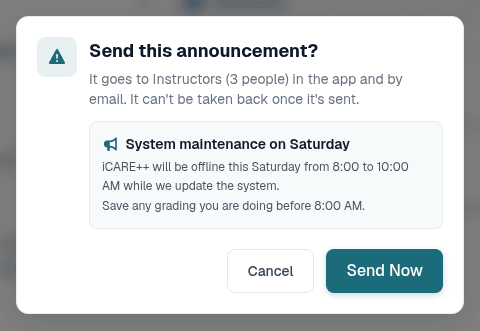

   *Figure 9. The Send this announcement? dialog, with a preview of the title and message above Send Now and Cancel.*

6. Select **Send Now**. To change something first, select **Cancel**.

**Result:** The dialog closes, the form clears, and a message appears in the corner:

- "Sent to 3 people and emailed." Everyone got it.
- "Sent to 3 people." The same, sent in the app only.
- "Sent to 3 people, but only 2 of the emails went out." Some emails failed.
- "Only 2 of 3 got it. Check the Activity Log before sending again." Some people didn't get it.

If nothing went out, the dialog stays open and shows "The announcement could not be sent."

**Who is notified:** Everyone in the audience gets a notification in the portal or the app, and a
phone notification if they use the app. With email selected, each also gets an email whose subject
is the announcement's title. If you are in the audience, you get it too.

### See what was sent

The **Sent** card beside the form lists the last 30 announcements, newest first. Each shows its
title, when it was sent, the audience, the number of people, "Read by" and the number who have
read it, and "Emailed" when the emails went out. Select an announcement to read the whole message
and see who sent it ("Sent by" and the name).

With nothing sent yet, the card reads "Nothing sent yet". Each announcement is also recorded in
the Activity Log as `announcement.sent` (see [Read the Activity Log](#read-the-activity-log)).

## Answer support requests

Instructors, Deans and Program Chairs send messages from **Help & Support** in the web portal (see
[Send a message to the iCARE++ team](common-tasks.md#send-a-message-to-the-icare-team)), and
Students from **Help & Support** in the app (see
[Help and Support](student.md#help-and-support)). Each message reaches every Admin: in the bell,
titled "Support request from" and the person's name, and on the **Support Requests** page. Your
reply goes to the person by email.

### Find a request

To find a request:

1. In the sidebar, select **Support Requests**. The page opens with **Needs Reply** selected.
   Selecting a support request in the bell opens it directly.
2. Optional: Select a filter: **Needs Reply**, **Answered**, **Resolved** or **All**. Each shows
   how many requests it has.
3. Select a request in the list. It opens beside the list; on a phone it replaces the list, and
   **Back to Requests** returns to it.

**Result:** The request shows its subject, status ("Needs reply", "Answered" or "Resolved") and
topic; the sender's name, role and email; their section and where they sent it from; and the
message with any images. Select an image to see it larger, and **Open Original** to open it in a
new tab. Earlier replies follow, each marked "replied by email". Opening a request marks it read
for you.

Each row in the list shows a dot while the request is unread, the person's name and role, the
date, the subject, the start of the message, its status and topic, and how many images and replies
it has. A filter with nothing in it shows "All clear", for example with "Nothing is waiting on a
reply."

> [!NOTE]
> If the page can't load the requests, the list shows "All clear", as if there were none. If you
> expect requests and see none, reload the page before you act on it.

### Reply to a request

To reply to a request:

1. Open the request (see [Find a request](#find-a-request)).
2. In the reply box, labelled **Reply to** and the person's first name, enter your answer, up to
   4,000 characters.
3. Optional: Select **Add Image** to attach up to 4 screenshots that show the fix or where to find
   something. You can also paste a screenshot into the reply.
4. Optional: Select **Mark as resolved after sending** to close the request with this reply.

   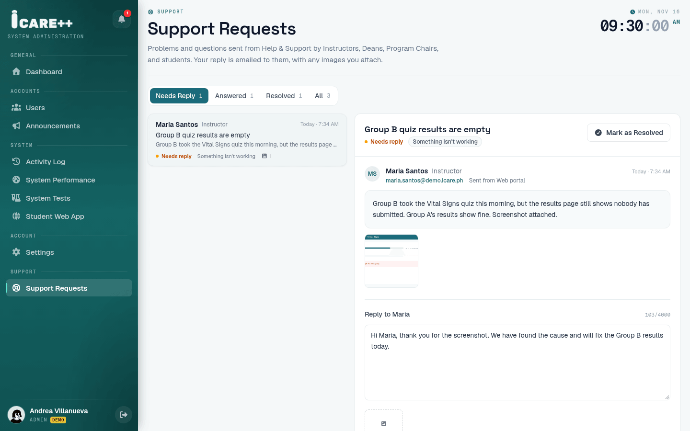

   *Figure 10. Support Requests, with the list on the left and an open request with a reply being written on the right.*

5. Select **Send Reply**. The button reads "Uploading images…" while images upload, then
   "Sending…".

**Result:** The message "Reply emailed to" and the person's address appears. The reply shows under
the message, and the request moves to **Answered**, or to **Resolved** if you selected **Mark as
resolved after sending**. Replying to a resolved request reopens it as answered.

If the reply fails, a message says what happened:

- "The reply could not be emailed to", the address, then "so nothing was saved." Try again.
- "The reply was emailed to", the address, then "but it couldn't be saved on the request." The
  person has your reply. The box is cleared so that you don't send it twice.
- "One of your images didn't finish uploading. Remove it, attach it again, and resend."

**Who is notified:** The person gets an email with the subject "Re:" and their subject, holding your
reply and images. They also get a notification titled "Support replied:" and their subject, which
says the full reply is in their email.

> [!NOTE]
> Your reply comes from the iCARE++ address. If the person answers the email, their answer goes to
> the iCARE++ team's contact inbox, not back into iCARE++. They can also send a new message from
> Help & Support.

### Resolve or reopen a request

To close a request without replying, open it and select **Mark as Resolved**. The message "Marked
as resolved." appears, and the request shows "Resolved by" with your name and the time.

To open a resolved request again, open it and select **Reopen Request**. The message "Request
reopened." appears, and the request returns to **Needs Reply**.

**Who is notified:** Resolving without a reply sends the person a notification titled "Support
request resolved:" and their subject, which says "If something is still wrong, send a new message
from Help & Support." Reopening a request notifies nobody.

## Read the Activity Log

The Activity Log is a record of every action by every role, Students included. Entries can't be
edited or deleted. Use it to find out who did something and when.

To read the Activity Log:

1. In the sidebar, select **Activity Log**. The page opens, titled "Audit Trail".

   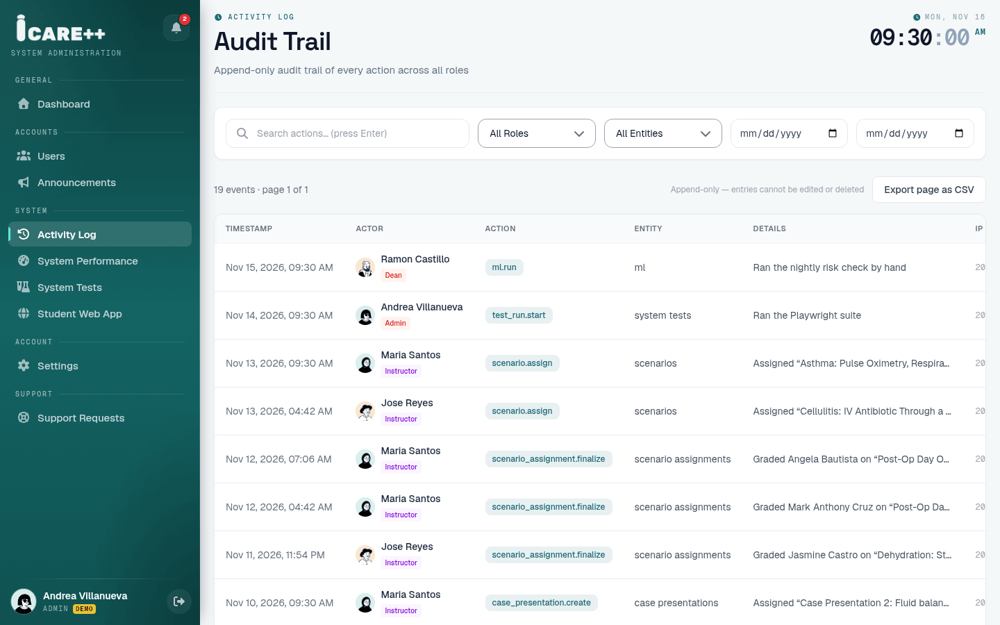

   *Figure 11. The Activity Log page, titled Audit Trail, with the filters above the newest actions.*

2. Optional: Narrow the list:
   - In the search box, enter part of an action code, such as `user.create`, and press **Enter**.
   - In the role list, choose **Admin**, **Dean / Program Chair**, **Instructor** or **Student**
     instead of **All Roles**.
   - In the entity list, choose a kind of record instead of **All Entities**.
   - Set the **From date** and **To date** boxes.
3. Read the table: **Timestamp**, **Actor** (with their role), **Action**, **Entity**, **Details**
   and **IP**. The line above it gives the count, for example "212 events · page 1 of 5".
4. To move between pages of 50 entries, select **← Previous** or **Next →**.
5. Optional: Select **Export page as CSV** to download the entries on screen.

If nothing matches, the table reads "No activity matches these filters".

> [!NOTE]
> The page title says "Audit Trail" (see
> [Names you will see on screen](README.md#names-you-will-see-on-screen)). Search matches action
> codes such as `user.create`, not names or details. **Export page as CSV** exports only the 50
> rows on screen, so export each page you need.

Action codes for the Admin's own work:

| Action code | What happened |
|---|---|
| `user.create`, `user.update`, `user.delete` | An account was created, edited or deleted |
| `user.password_reset` | An Admin issued a new temporary password |
| `access_request.accepted`, `access_request.declined` | An account request was accepted or declined |
| `announcement.sent` | An announcement was sent |
| `support_request.replied`, `support_request.resolved`, `support_request.reopened` | A support request was answered, resolved or reopened |
| `student_web.on`, `student_web.off` | The student web app was turned on or off |

## Watch system performance

**System Performance** shows how long people wait for the portal to answer, how many requests it
handles, and how many fail. Look here when the status banner's reliability or response time
reading isn't green.

To watch system performance:

1. In the sidebar, select **System Performance**.
2. Choose a time range: **1 hour**, **24 hours**, **7 days** or **30 days**. It starts on **24
   hours**.

   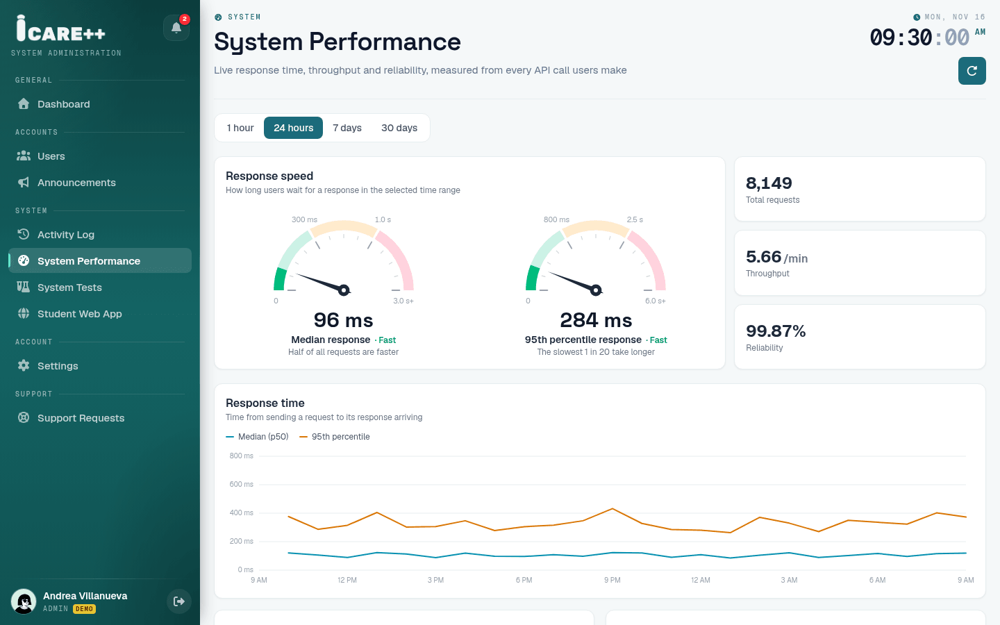

   *Figure 12. System Performance for the last 24 hours, with the two speed gauges, the request totals and the response time chart.*

3. Read the cards:
   - **Response speed**: two gauges, **Median response** (half of all requests are faster) and
     **95th percentile response** (the slowest 1 in 20 take longer), each in a Fast, Okay or Slow
     zone. Beside them are **Total requests**, **Throughput** (requests per minute) and
     **Reliability**.
   - **Response time**, **Throughput** and **Reliability**: charts over the time range.
     **Reliability** counts requests answered without a server or network error.
   - **Endpoints**: each address the portal calls, with **Requests**, **Median (p50)**, **Slowest
     5% (p95)** and **Errors**. Select a column heading to sort by it.
4. Optional: Select **Reload the metrics** (the circular arrow in the page header) to load the
   newest figures.

With no requests in the range, the **Endpoints** card reads "No requests recorded in this time
range yet". If the figures can't load, the page shows "Couldn't load the metrics."

> [!NOTE]
> Only the web portal's traffic is measured. Requests from the iCARE++ app aren't included, even
> though the page's subtitle says "every API call users make".

## Run and read system tests

The **System Tests** page brings together the health checks, the automated tests, the benchmarks
and the ML models' figures. To open it, select **System Tests** in the sidebar.

Across the top is a row of tiles, one per section: **System health checks**, **Frontend tests**,
**API tests**, **Load benchmark**, **Data warehouse benchmark** and **ML models**. Each tile shows
the latest verdict and how long ago it ran, or "Never run". Select a tile to jump to its section.
Sections that keep their earlier runs list them under **Previous runs** and a count; select a run
to see it.

> [!NOTE]
> If the page can't load the test runs, each section says no run has happened yet, for example "No
> system health check has been run yet." Reload the page before you rely on it.

### System health checks

The health checks test whether each service iCARE++ depends on is reachable and set up correctly.
The **Check System Health Status** button on the Dashboard runs the same checks.

To run the health checks:

1. In the sidebar, select **System Tests**.
2. In the **System health checks** section, select **Check System Health Status**. The button
   reads "Checking system health…" while the checks run.

   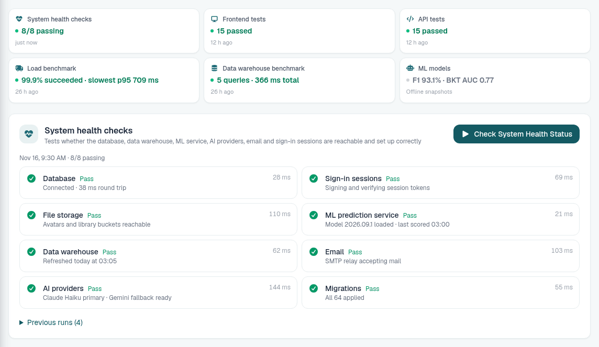

   *Figure 13. System Tests, with the row of tiles above the System health checks section and the result of each check.*

**Result:** A line gives the time and the count, for example "8/8 passing", with any warnings and
failures. Each check shows **Pass**, **Warning** or **Fail**, a detail line and how long it took:

| Check | What it tests |
|---|---|
| Database | The database answers |
| Data warehouse | The analytics data can be read and was refreshed in the last 48 hours |
| ML prediction service | The ML service answers |
| AI: Claude (primary) | The Claude key is accepted |
| AI: Gemini (fallback) | The Gemini key is accepted |
| AI: OpenRouter (last fallback) | The OpenRouter key is accepted and its free models are still offered |
| Email delivery | An email service is set up |
| Sign-in sessions | The secret that protects sign-in sessions is set and long enough |

A missing AI key gives a **Warning**, not a **Fail**: iCARE++ skips that provider and uses the
next one.

> [!NOTE]
> If the analytics data hasn't been refreshed for 48 hours, the check refreshes it, so running a
> check can change the figures on the Analytics pages. If a refresh is already running, the check
> leaves it to finish and says so. "Email delivery" passes once an email
> service is set up, which doesn't prove that emails arrive.

**Who is notified:** Nobody is notified.

### Load benchmark

The load benchmark measures response time, throughput and reliability as more people use iCARE++
at once. Run it to see how the system copes with a busy class.

To run the load benchmark:

1. In the **Load benchmark** section, choose the settings:
   - **Endpoints to test**: any of **Baseline (no database)**, **Sign-in check**, **Database
     read** and **Data warehouse query**. All are selected at first.
   - **Concurrent users**: any of 1, 5, 10, 25, 50, 100 and 200. The first five are selected at
     first. 100 and 200 start unselected, because each sends that many requests at the same
     moment.
   - **Requests per concurrency level**: 10, 20, 50 or 100. It starts on 20.
2. Read the line under the settings. It says how many requests the run will send. When you
   select a level above 160 users, an amber line adds that the site lets one browser keep 160
   requests open at once, so the rest wait in your browser first and that level's times include
   the wait.

> [!IMPORTANT]
> The benchmark sends real requests, and each counts toward the database's usage. The data
> warehouse query is the heaviest. The 100 and 200 levels slow the live site for everyone while
> they run, so use them when few people are signed in. If you select **Stop Load Benchmark** during a run, the run is
> discarded.

3. Select **Run Load Benchmark**. A progress bar shows how far the run has got. The requests come
   from your browser, so keep the page open until the run ends.

**Result:** A summary line gives the time, the number of requests, the share that succeeded and
the peak requests per second. The table shows each endpoint at each number of users, with
**Concurrent users**, **Median (p50)**, **Slowest 5% (p95)**, **Requests/s** and **Success
rate**. If the run can't be saved, the section shows "The run finished but could not be saved".

### Data warehouse benchmark

This benchmark times each of the six queries behind the Analytics pages, inside the database. Its
section is titled "Data warehouse query benchmark", while the tiles and the Dashboard call it
"Data warehouse benchmark"; they are the same test (see
[Names you will see on screen](README.md#names-you-will-see-on-screen)).

To run it, in the **Data warehouse query benchmark** section, select **Run Data Warehouse
Benchmark**. The button reads "Running benchmark…" while it runs.

**Result:** The table lists each **Query** with its **Execution time** and **Rows returned**. The
tile's verdict gives the number of queries and the total time, or how many failed, for example "1
of 6 queries failed".

### Frontend and API tests

These two sections show the results of automated test runs:

- **Frontend tests (Playwright)**: a real browser signs in and goes through each portal, checking
  what users see.
- **API tests (Postman)**: every endpoint's status codes, response shape and role restrictions
  are tested.

You can only read these results here; nothing on the page starts a run. The technical team runs
the tests, and the results appear on this page as they arrive. Until then, each section reads "No
run reported yet." with the command the team uses.

To read a run:

1. Find the tiles **Passed**, **Failed**, **Skipped** and **Duration**, and the line under them
   with the time and who reported the run.
2. Read the failed tests listed below, each with its error. "No failures in this run." means every
   test passed.
3. Optional: Select **Show every test, not just failures** to list every test.

While a run is in progress, the section updates on its own and lists each test as it finishes. A
run that sends nothing for 2 minutes is marked as stopped early. Skipped tests are tests that had
no test account to sign in with.

### ML models

This section is read-only. It describes the four models the ML service runs and how each was
evaluated.

- The first table lists each **Model**, **What it decides** and its **Active version**. "In use"
  marks the model that decides the Low performing flag.
- **Risk prediction** shows how the Low performing models scored on a fixed, offline test set:
  **Accuracy**, **Precision**, **Recall**, **F1** and **ROC-AUC**, and a confusion matrix for each
  model. If the flag now runs on a model retrained on iCARE++ students, a line above the table
  says so.
- **Bayesian Knowledge Tracing** scores the model that tracks each student's mastery of each skill
  and orders the review quiz. Under it, "Live fit, from the last whole-cohort run" shows the
  latest fit.

> [!NOTE]
> The labels "Predicted at-risk" and "Actually at-risk" here mean Low performing (see
> [Names you will see on screen](README.md#names-you-will-see-on-screen)). The Low performing
> check itself is run by Deans and Instructors (see [Run the risk check](dean.md#run-the-risk-check)).

## Turn the student web app on or off

Students use the iCARE++ app on Android phones. The student web app is the same app opened in a
web browser, at `https://www.i-care.dev/student`. The panel has approved students using it. It is
a second way in, not the main one, and it stays off until you turn it on. Turn it on when the
school wants students to use it. It isn't the iPhone version: there is no iPhone app yet.

**Before you start**

- The decision to offer the web version has been made.
- The web version is published on the site. If it isn't, the page shows "The web version isn't
  published on this site yet, so students would find nothing at its address." Ask the technical
  team to publish it (see [The student web app](setup-2-technical.md#the-student-web-app)).

To turn the student web app on or off:

1. In the sidebar, select **Student Web App**. The **Web version for students** card shows "On" or
   "Off".

   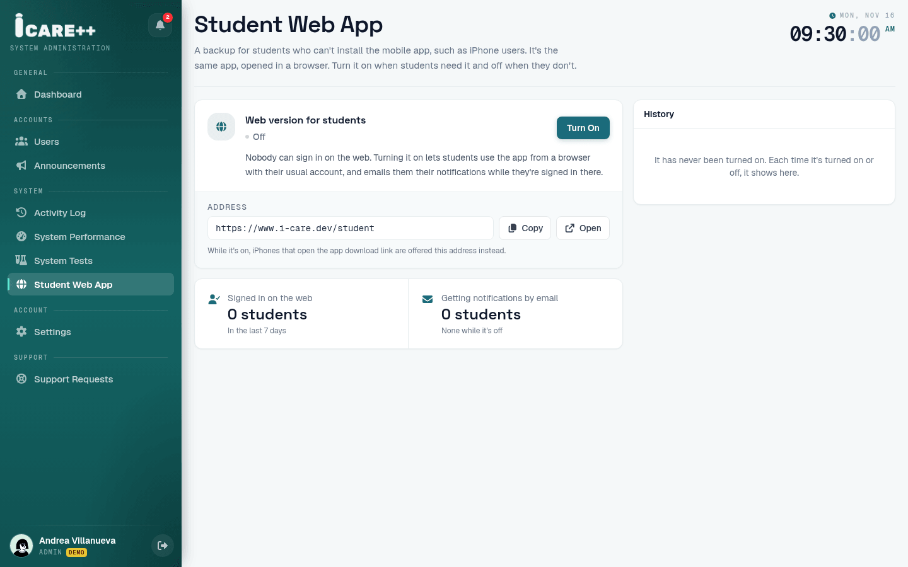

   *Figure 14. The Student Web App page, with the Web version for students card, its address, and the History card beside it.*

2. Select **Turn On**, or **Turn Off** if it is on. The **Turn on the web version?** or **Turn off
   the web version?** dialog opens and says what will change.
3. Select **Turn On** or **Turn Off** in the dialog.

**Result:** The message "The web version is on." or "The web version is off." appears, and the
change is added to **History** with the time and your name. Every server picks up the change
within about 15 seconds.

While it is on:

- Students sign in at the address with their usual account. Staff accounts can't sign in there.
- Browsers get no phone notifications, so each notification is also emailed to students signed in
  on the web, unless they turn that off in their settings.
- The portal's sign-in page tells students who try to sign in there that they can use this
  address.
- While it is on, the app download link sends iPhones to this address, because there is no
  iPhone version. That is a stopgap for a school that has chosen the web version, not an iPhone
  app.

While it is off, nobody can sign in there. Students already signed in on the web are signed out the
next time they tap anything. Their work is kept, and the Android app isn't affected.

The **Address** row has **Copy**, to copy the address, and **Open**, to open it in a new tab. The
counts **Signed in on the web** (in the last 7 days) and **Getting notifications by email** show
how many students use it.

> [!NOTE]
> Students aren't told when you turn the web version on or off. Send them an announcement as well
> (see [Send an announcement](#send-an-announcement)).

**Who is notified:** Nobody is notified.

## Your settings

Select **Settings** in the sidebar, or your name at the foot of the sidebar. The **Settings** page
("Your profile and password") works as described in
[Common tasks in the web portal](common-tasks.md):

- [Open your settings](common-tasks.md#open-your-settings)
- [Change your email](common-tasks.md#change-your-email)
- [Change your password](common-tasks.md#change-your-password)
- [Connect or disconnect Google](common-tasks.md#connect-or-disconnect-google)
- [Choose light or dark](common-tasks.md#choose-light-or-dark)
- [Save data on this device](common-tasks.md#save-data-on-this-device)

To leave the portal, see [Log out](common-tasks.md#log-out).
