# Common tasks in the web portal

This guide is for Admins, Deans, Program Chairs and Instructors: everyone who works in the web
portal at `https://www.i-care.dev`. It covers what every portal shares: finding your way around,
signing in and out, notifications, your settings, analytics filters and reports, and Help &
Support. Your role's own guide covers the rest. Students use the iCARE++ app instead; their
version of these tasks is in the [Student guide](student.md).

In this guide:

- [Find your way around](#find-your-way-around)
- [Sign in and out](#sign-in-and-out)
- [Notifications](#notifications)
- [Your profile and settings](#your-profile-and-settings)
- [Analytics and reports](#analytics-and-reports)
- [Help and Support](#help-and-support)

## Find your way around

Every portal uses the same frame: a sidebar on the left and the page on the right. Each page
starts with a page header: the page title, a one-line description, and a clock. Some page headers
also have one main button for the page.

### The sidebar

The sidebar is the dark teal column down the left edge.

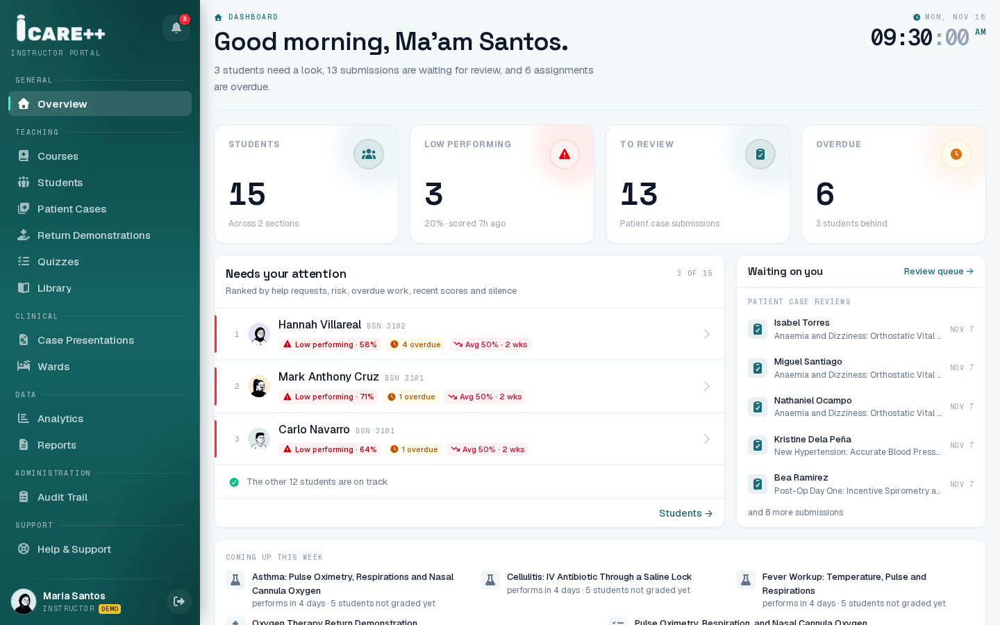

*Figure 1. The Instructor portal, with the sidebar on the left and the Overview page beside it.*

From top to bottom, it holds:

- **The logo and the portal's name.** The name is "Instructor Portal", "Dean Portal", "Program
  Chair Portal", or "System Administration" for the Admin portal. Select the logo to go back to
  your portal's first page.
- **The bell.** It opens your notifications; a red number shows how many are unread
  ([Read new notifications](#read-new-notifications)).
- **The links to each page**, grouped under small headings such as **General** and **Teaching**.
  The page you are on has a lighter background and a bright bar at its left edge. Your role's
  guide lists every link.
- **Your profile pill**, at the foot: your picture, your name and your role. Select it to open
  your settings ([Open your settings](#open-your-settings)).
- **Log out** (the arrow leaving a door), beside the profile pill ([Log out](#log-out)).

### Collapse the sidebar

You can shrink the sidebar to a narrow column of icons to give the page more room. This works on
computers and tablets.

To collapse the sidebar:

1. Hold the pointer over the sidebar. A small round button with a double arrow appears on the
   sidebar's right edge. On a touch screen, it is always there.
2. Select **Collapse sidebar** (the double arrow).

**Result:** The sidebar becomes a column of icons. Rest the pointer on it to open it over the
page; it closes again when the pointer leaves. While it is collapsed, a red dot on the logo means
you have unread notifications.

To bring the sidebar back, rest the pointer on the icons and select **Keep sidebar open**. On a
touch screen, select **Expand sidebar**.

Your browser remembers the choice the next time you open the portal.

### Use the portal on a phone or tablet

The portal works in a phone's browser. On a tablet, it looks as it does on a computer. On a
phone, the sidebar is hidden and a white top bar runs across the page instead. The top bar has
**Open navigation** (three lines) and the logo on the left, and the bell and your role on the
right.

To move to another page on a phone:

1. In the top bar, select **Open navigation** (three lines). The sidebar slides in over the page.

   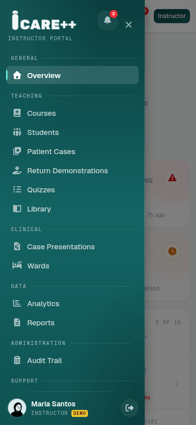

   *Figure 2. The portal on a phone, with the sidebar open over the page.*

2. Select a link.

**Result:** The page opens and the sidebar closes. To close the sidebar without choosing a page,
select **Close navigation** (X), select the dark area beside it, or press **Esc**.

> [!NOTE]
> You can add the portal to your phone's home screen from the browser's menu. It shows the
> iCARE++ icon under the short name "iCARE++" and opens the portal in your browser.

### Messages that appear in the corner

Short messages appear in the top-right corner of the screen to tell you what happened:

- Green, with a tick: something worked, such as "Profile saved."
- Red: something went wrong. The message says what.
- Teal: information, such as a new notification arriving while you are on another page.
- Teal, with a moving bar: work in progress, such as enrolling students one by one.

Most messages fade after a few seconds. Select **Dismiss** (X) to close one sooner.

If the connection drops, a red message stays until it comes back:

- "You're offline. Changes won't be saved until the connection is back."
- "Can't reach the server. Changes won't be saved until it's back."

When the connection returns, the message turns green: "Connection restored. You're back online."
Don't save work while the red message shows.

### When a new version is available

When a newer version of the portal is published while you have it open, a white bar appears at
the bottom of the page: "A new version is available." The portal never reloads by itself.

To use the new version, save your work, then select **Refresh**. The page reloads.

To hide the message, select **Dismiss** (X). It stays hidden in this tab until the next version.

## Sign in and out

Staff sign in at `https://www.i-care.dev/login`. If this is your first time, start with
[Sign in to the web portal for the first time](setup-1-getting-started.md#sign-in-to-the-web-portal-for-the-first-time).

### Sign in

To sign in to the web portal:

1. Go to `https://www.i-care.dev/login`.
2. In the **Email Address** box, enter your email address.
3. In the **Password** box, enter your password.
4. Optional: Select **Remember me** to stay signed in
   ([Stay signed in with Remember me](#stay-signed-in-with-remember-me)).
5. Select **Sign In**.

**Result:** Your portal opens on its first page. If your session had ended while you were on a
page, you go back to that page.

If you see "Invalid email or password", check both and try again. After too many tries, the page
asks you to wait; try again a few minutes later. If you've forgotten your password, see
[Reset a forgotten password](#reset-a-forgotten-password).

You can also select **Continue with Google** to sign in with a linked Google account
([Sign in with Google](setup-1-getting-started.md#sign-in-with-google)).

### Stay signed in with Remember me

**Remember me** on the sign-in page decides how long you stay signed in. Leave it off on a shared
computer.

> [!NOTE]
> **Remember me** is off by default. Then your session ends when you close the last tab of the
> portal. If you select it, you stay signed in for seven days.

### One browser at a time

Your account can be signed in to the web portal in one browser at a time. The newest sign-in
wins: signing in on another computer or browser signs out the one before.

> [!NOTE]
> The browser that was signed out shows the sign-in page with this message: "You were signed out
> because someone signed in to your account on another browser. If that wasn't you, sign in and
> change your password." The iCARE++ phone app is a separate sign-in, so it isn't affected.

If it wasn't you, sign in and [change your password](#change-your-password) at once.

### Reset a forgotten password

If you've forgotten your password, you can set a new one with a code sent to your email.

To reset a forgotten password:

1. On the sign-in page, select **Forgot password?**. The **Reset your password** page opens.
2. In the **Email Address** box, enter your email address.
3. Select **Send reset code**. The page says "If this account exists, a reset code has been
   sent." An email with the subject "Your iCARE++ password reset code" arrives.
4. In the **Reset Code** box, enter the 6-digit code from the email.
5. Select **Verify code**.
6. In the **New Password** box, enter a password of at least 8 characters.
7. In the **Confirm Password** box, enter it again.
8. Select **Reset password**.

**Result:** The page shows "Password updated" and "You can now sign in with your new password."
Select **Go to sign in**. Any browser or phone still signed in to your account is signed out.

If you only ever sign in with Google, the email tells you to use Google instead of sending a
code. To give up partway, select **Back to sign in**.

### Log out

To log out:

1. At the foot of the sidebar, select **Log out** (the arrow leaving a door). The **Log out**
   dialog opens. It shows your name and email and says "You'll need to sign in again to get back
   into the" portal, followed by your portal's name.

   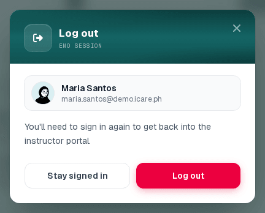

   *Figure 3. The Log out dialog, with Stay signed in and Log out.*

2. Select **Log out**.

**Result:** The sign-in page opens. To stay signed in instead, select **Stay signed in** or press
**Esc**.

In the demo, logging out ends the demo and resets everything you changed.

## Notifications

Notifications tell you about things that need you, such as a grade change request for a Dean or
a help request for an Instructor. Your role's guide lists the notifications you get. Admin
announcements reach every role.

### Read new notifications

The bell at the top of the sidebar shows how many notifications are unread.

To read new notifications:

1. In the sidebar, select the bell. The notifications popover opens beside it, with up to five
   unread notifications, newest first.

   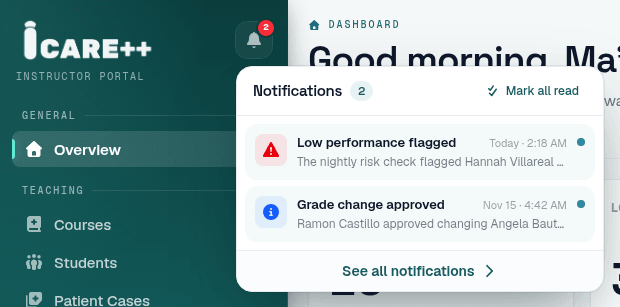

   *Figure 4. The notifications popover, with unread notifications and Mark all read.*

2. Select a notification. Its own page opens, with "Back to notifications" at the top (see
   [Open a notification](#open-a-notification)).
3. Optional: Select **Mark all read** (double tick) to mark them all read without opening them.

**Result:** The notification is marked read and the red number on the bell goes down. With
nothing unread, the popover reads "All caught up". To close it, press **Esc** or select anywhere
outside it.

Some notifications carry their own buttons, under them in the popover and on their page:

- Deans and Program Chairs: a grade change request has **Accept** and **Decline**
  ([Approve or decline a grade change](dean.md#approve-or-decline-a-grade-change)).
- Admins: an account request has **Accept** and **Decline**
  ([Create an account](admin.md#create-an-account)).

New notifications also appear as a message in the top-right corner, whatever page you are on.

### See all notifications

The **Notifications** page keeps every notification, read or not. It isn't in the sidebar; you
reach it from the bell.

To see all notifications:

1. In the sidebar, select the bell.
2. At the bottom of the popover, select **See all notifications**. The **Notifications** page
   opens. Its description reads "Live alerts and updates", with the number unread.

   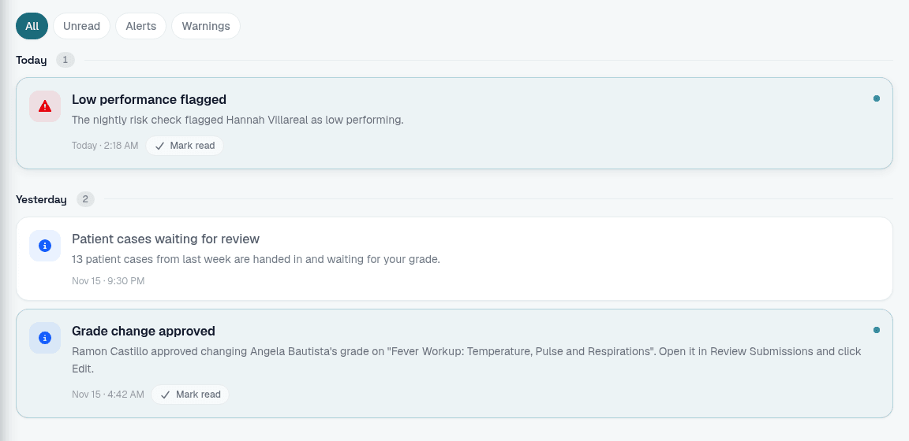

   *Figure 5. The Notifications page, with its filters above the list.*

3. Optional: Select **All**, **Unread**, **Alerts** or **Warnings** to show only those.
4. Optional: Select **Mark read** under a notification, or **Mark all read** in the page header.
5. Optional: Select a notification to open its page (see [Open a notification](#open-a-notification)).

**Result:** Notifications are listed under "Today", "Yesterday" or their date, each cut to a few
lines. A **Live** badge means new ones appear as they arrive. If it reads **Reconnecting**, new
ones appear once the connection is back; reload the page if it stays that way.

### Open a notification

Every notification has a page of its own, with the whole message. Selecting a notification in the
bell, or anywhere on its card on the **Notifications** page, opens it. The buttons on a card, such
as **Mark read** or **Accept**, act on their own and don't open the page.

The page shows the notification's title, what kind it is and when it came (for example "Update ·
Monday, November 16, 2026 at 9:30 AM"), and the whole message. A vital signs alert also lists what
was flagged, with what to do about each finding. Opening the page marks the notification read.

When a notification is about something you can open, its page has a button for it. The same button
shows on its card on the **Notifications** page:

| Notification | Button | Opens |
|---|---|---|
| A new course assignment (Instructors) | **Open the course** | The course's page |
| A grade change approved or declined (Instructors) | **Open Review Submissions** | The Patient Case's grading page, or **Patient Cases** for an older notification |
| A Case Presentation handed in (Instructors) | **Open the Case Presentation** | The Case Presentation's page |
| A help request, a vital signs alert, a low performance flag, or a student moved between groups | **Open the student's profile** | The student's profile (Instructors, Deans and Program Chairs) |
| A reply to your Help & Support message | **Open Help & Support** | Your **Help & Support** page |
| A support request (Admins) | **Open the support request** | The request on **Support Requests** |

Announcements have no such button: the message is the whole of it. Account requests and grade
change requests have **Accept** and **Decline** instead. To go back to the list, select **Back to
notifications** at the top of the page.

## Your profile and settings

Your settings hold your name, photo, email, password, Google sign-in, theme and local caching.

### Open your settings

> [!NOTE]
> Where your settings live depends on your role. Admins have **Settings** in the sidebar.
> Deans, Program Chairs and Instructors select their name at the foot of the sidebar.

To open your settings:

1. Admins: in the sidebar, select **Settings**. The **Settings** page opens.
2. Deans, Program Chairs and Instructors: at the foot of the sidebar, select your name (the
   profile pill). The page that opens depends on your role:
   - Instructors: **Instructor Settings**.
   - Deans: **Dean Administration**, on its **Profile** tab.
   - Program Chairs: **Program Chair Administration**, on its **Profile** tab.

   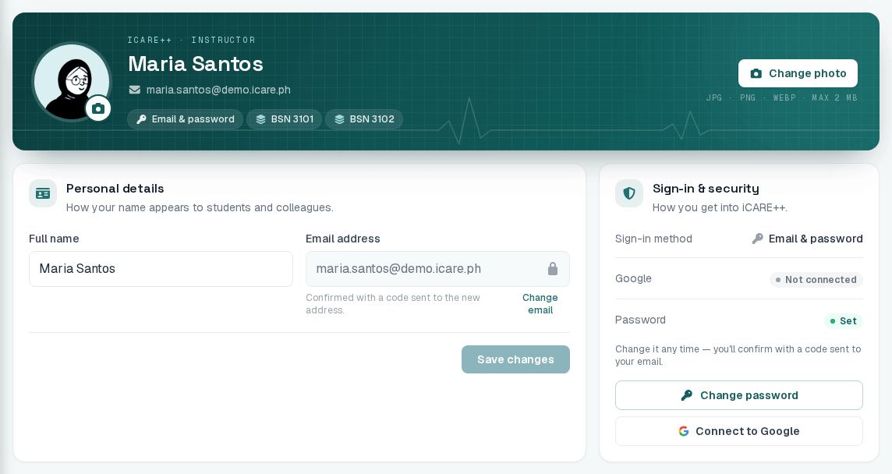

   *Figure 6. Instructor Settings, with the profile banner, Personal details and Sign-in & security.*

**Result:** The page opens with a banner showing your picture, your name, your email and how you
sign in. An Instructor's banner also lists their sections. Below it are the **Personal details**,
**Sign-in & security**, **Appearance** and **Local caching** cards.

A Program Chair's banner reads "iCARE++ · Dean"; it is still their own account
([Names you will see on screen](README.md#names-you-will-see-on-screen)). The Dean's other
settings tabs are covered in the Dean guide ([Settings](dean.md#settings)).

### Change your photo or name

Your name and photo show to your students and colleagues.

To change your photo:

1. In your settings, in the banner, select **Change photo**.
2. Choose a JPG, PNG or WebP picture of up to 2 MB.

**Result:** The message "Profile photo updated." appears, and your new photo shows in the sidebar.

To change your name:

1. In your settings, on the **Personal details** card, in the **Full name** box, change your
   name. "Unsaved changes" appears, with **Discard** to undo it.
2. Select **Save changes**.

**Result:** The message "Profile saved." appears.

### Change your email

You can change the email address you sign in with. iCARE++ sends a code to the new address to
make sure it's yours.

To change your email:

1. In your settings, on the **Personal details** card, beside "Confirmed with a code sent to the
   new address.", select **Change email**. The **Change your email** dialog opens, showing your
   current address.

   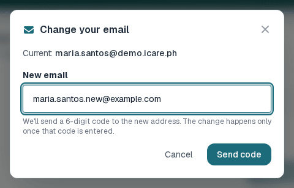

   *Figure 7. The Change your email dialog, before the code is sent.*

2. In the **New email** box, enter the new address.
3. Select **Send code**. The dialog says a code was sent to the new address.
4. Open that inbox and find the 6-digit code.
5. In the code box, enter the code. To start again with another address, select
   **Use a different email**.
6. Select **Confirm change**.

**Result:** The message "You now sign in with" followed by your new address appears. Your old
address gets the email "Your iCARE++ sign-in email was changed".

> [!NOTE]
> Changing your email also disconnects Google sign-in. To keep using Google, connect it again
> ([Connect or disconnect Google](#connect-or-disconnect-google)).

### Change your password

To change your password, you enter your current one, then a code sent to your email.

To change your password:

1. In your settings, on the **Sign-in & security** card, select **Change password**. The
   **Change Password** page opens: "Enter your current password to request a verification code."

   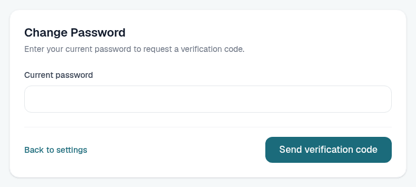

   *Figure 8. The first step of Change Password, asking for your current password.*

2. In the **Current password** box, enter your password.
3. Select **Send verification code**. The page says the code was sent to your email and expires
   in 10 minutes.
4. In the **Verification code** box, enter the 6-digit code from the email. If it hasn't come,
   wait for the countdown, then select **Resend code**.
5. Select **Verify code**. The page says "Verification confirmed. Enter your new password below."
6. In the **New password** box, enter a password of at least 8 characters.
7. In the **Confirm new password** box, enter it again.
8. Select **Update password**.

**Result:** The message "Password changed successfully." appears and your settings open again.

> [!NOTE]
> Changing your password signs you out on every other device: other browsers and the iCARE++
> app. This browser stays signed in.

If you have only ever signed in with Google, the button reads **Set a password**. You aren't asked
for a current password; you confirm with a code sent to your email, then choose a password.

### Connect or disconnect Google

Once Google is connected, you can select **Continue with Google** on the sign-in page instead of
entering your password. The **Sign-in & security** card shows **Google** as **Connected** or
**Not connected**.

To connect Google:

1. In your settings, on the **Sign-in & security** card, select **Connect to Google**.
2. Choose your Google account.

**Result:** The message "Google connected" appears, followed by the Google address and "You can
now continue with Google."

To disconnect Google:

1. On the **Sign-in & security** card, select **Disconnect Google**. A confirmation box asks
   "Disconnect Google? You'll sign in with your email and password only."
2. Select **OK**.

**Result:** The message "Google disconnected." appears. **Disconnect Google** shows only when your
account also has a password, so you can't lock yourself out.

### Choose light or dark

The **Appearance** card sets how the portal looks in this browser. The sidebar stays dark teal
either way.

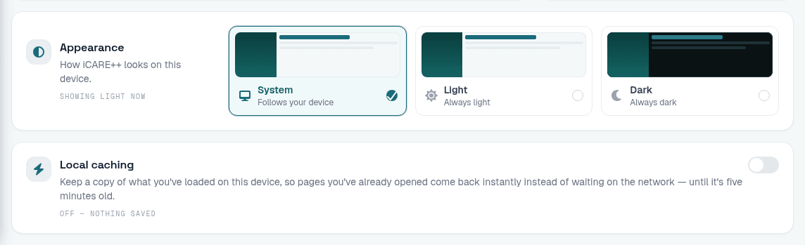

*Figure 9. The Appearance choices, and the Local caching switch beside them.*

To choose light or dark, in your settings, on the **Appearance** card, select **System**
(follows your device), **Light** or **Dark**.

### Save data on this device

Local caching keeps a copy of the pages you've opened on this computer, so they open at once
next time instead of waiting on the network. Copies are used for up to five minutes. Nothing
leaves your device.

The first time you open a portal page in a browser, a card at the bottom of the screen asks "Save
data on this device?":

- Select **Yes, speed it up** to turn local caching on.
- Select **Not now** or **Dismiss** (X) to leave it off.

The card asks only once in each browser. It never appears in the demo.

To change your answer later, in your settings, on the **Local caching** card, turn the switch on
or off. The card reads "Saving to this device" or "Off — nothing saved". Turn it off on a shared
computer.

## Analytics and reports

Deans, Program Chairs and Instructors have **Analytics** and **Reports** in the sidebar. The
panels on each page are described in your role's guide ([Dean guide](dean.md),
[Instructor guide](instructor.md)). This section covers the parts they share.

### Filter the figures

The filter bar across the top of **Analytics** chooses which students and dates the figures
cover.

To filter the figures:

1. In the sidebar, select **Analytics**.
2. Optional: In the filter bar, beside **Course**, choose a course. "All courses" covers every
   course.
3. Beside **Sections**, select the button that reads "All sections". A list opens with each
   section and its number of students.

   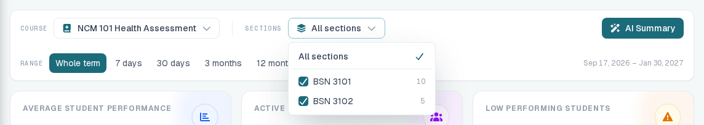

   *Figure 10. The filter bar, with the Sections list open.*

4. Select the sections you want, or **All sections**. Then select outside the list to close it.
5. Beside **Range**, select **7 days**, **30 days**, **3 months**, **12 months** or
   **This year**. With a course chosen, you can also select **Whole term**.
6. Optional: Select **Custom**, then enter the first and last dates in the two date boxes.

**Result:** The figures refresh; a moving heartbeat line shows while they load. The dates in view
are at the right of the filter bar. The range starts at **3 months**.

### Get an AI Summary

The AI Summary is a short reading of the figures in plain language: what went well, what to watch,
and what to do next. It is written only when you ask for it.

To get an AI Summary:

1. On **Analytics**, set the filters ([Filter the figures](#filter-the-figures)).
2. In the filter bar, select **AI Summary** (the magic wand). It is off until the figures have
   loaded. The **AI Summary** dialog opens and shows short phrases, such as "Reading the
   figures…", while it writes.
3. Read the summary: a headline, an overview, then **Highlights**, **Watch-outs** and
   **Suggested Actions**.

   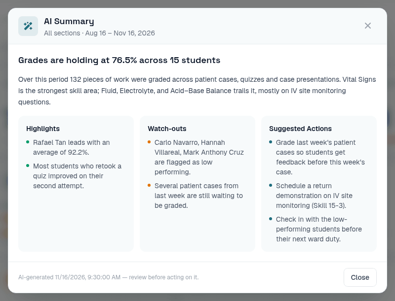

   *Figure 11. The AI Summary dialog, with its three lists.*

4. Select **Close**.

**Result:** The footer shows when the summary was written. If the figures haven't changed, the
same summary opens again next time without being rewritten. If writing fails, select **Retry**.

> [!NOTE]
> AI output can be wrong. The footer says "review before acting on it." A student's own records
> go to the AI only if that student allowed AI features in the app. If your filters cover a
> single student who hasn't, the dialog says "This selection covers one student, who hasn't turned
> on AI features in the app, so an AI summary isn't available." Instructors: see also
> [Get an AI summary of a student](instructor.md#get-an-ai-summary-of-a-student).

### Preview and download a report

Reports are PDFs built from the latest records. You can look at one before you download it.

To preview and download a report:

1. In the sidebar, select **Reports**.
2. Under **Report type**, select the kind of report. Instructors have **Section**,
   **Patient Case**, **Return Demonstration** and **Quiz**. Deans and Program Chairs have
   **Instructor**, **Rooms**, **Users** and a summary of their own area.
3. Find the subject of the report. Enter part of its name in the search box, or select an item
   to open it like a folder. Inside a folder, select **Per student** or **Per group** to change
   the list.
4. On the row you want, select **Preview** (the eye). The report opens in a dialog. It shows
   "Building the report from live records…" until the PDF is ready.

   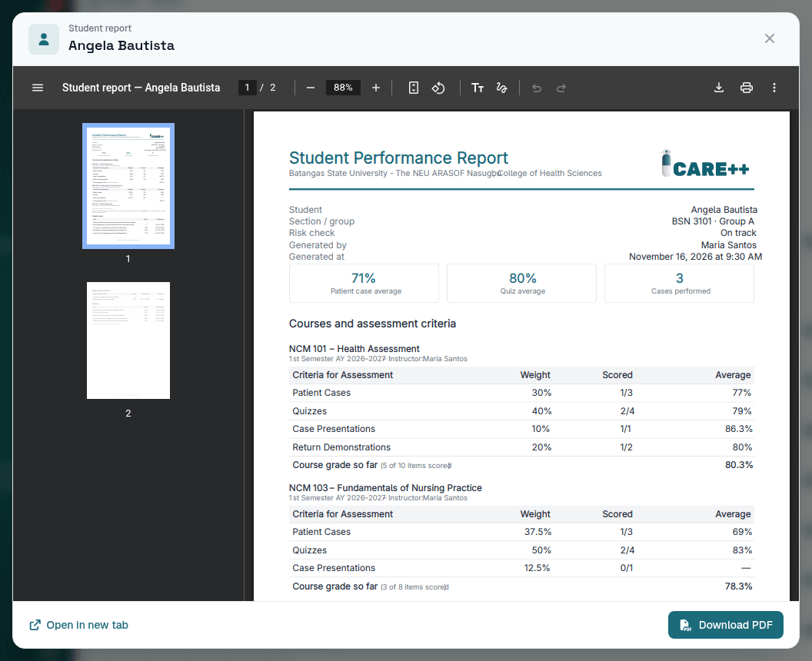

   *Figure 12. A student report in the preview dialog.*

5. Optional: Select **Open in new tab** to read the PDF in its own tab. On a phone, the dialog
   shows only the first page, so use this to see the rest.
6. Select **Download PDF**.

**Result:** The PDF downloads and the message "Downloaded" followed by its file name appears. The
report is added to the **Recent** card, which shows the reports you made on any device. To make a
report again with the latest records, select **Generate this PDF again** (the download arrow) on
its row in **Recent**.

To download without previewing, select **PDF** on the row.

Every report is a PDF on US Letter pages. The first page has a letterhead and tiles with the main
figures. Each later page has a running header, and every page is numbered "Page 1 of 4". What
comes next depends on the report:

- **Student, Section and Group reports** (Instructors) start with who needs attention, then
  list the work and scores. Scores are shaded by the same bands in every report, with the pass
  mark at 75%.
- **Patient Case and Quiz reports** (Instructors) show how the class did, then list the
  students.
- **Dean and Program Chair reports** show outcomes and the grading backlog. The **Users** report
  lists the accounts that need a look first: people who never signed in, then those who haven't
  signed in for the longest time. The **Suggested** cards at the top of
the page offer reports that may need your attention.

## Help and Support

Deans, Program Chairs and Instructors send questions and problems to the iCARE++ team from
**Help & Support** in the sidebar. The Admins are the team: they answer these messages and have
no **Help & Support** page of their own ([Answer support requests](admin.md#answer-support-requests)).

### Send a message to the iCARE++ team

To send a message to the iCARE++ team:

1. In the sidebar, select **Help & Support**. The **Help & Support** page opens.
2. Under **What is this about?**, select **Something isn't working**, **How do I…?**,
   **Account or sign-in**, **Suggestion** or **Something else**.
3. In the **Subject** box, enter a few words that sum up your message.
4. In the **Message** box, describe what you were trying to do, what happened, and what you
   expected instead.
5. Optional: Under **Images (optional)**, select **Add Image** to attach a screenshot. You can
   attach up to four images, paste a screenshot into the message, or drag one onto the area.

   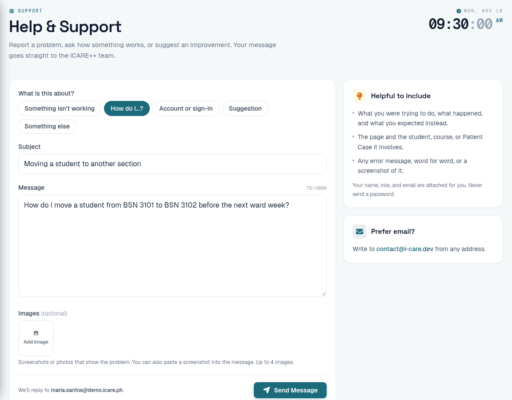

   *Figure 13. The Help & Support form, filled in and ready to send.*

6. Select **Send Message**.

**Result:** The form is replaced by "Message sent", and the message "Message sent to the iCARE++
team." appears. A copy of your message goes to your email, with the subject "We got your
message:" followed by your subject. Select **Write Another Message** to send another.

**Who is notified:** Every Admin gets the notification "Support request from" followed by your
name. The iCARE++ team's inboxes also get your message by email.

**What happens next:** An Admin replies by email ([When the team replies](#when-the-team-replies)).

Your name, role and email are attached for you. To write by email instead, use the address on the
**Prefer email?** card.

> [!NOTE]
> Never send a password, in the message or in a screenshot. The team's reply comes by email, to
> the address shown above **Send Message**.

### When the team replies

When an Admin answers your message:

- You get an email with the subject "Re:" followed by your subject. It holds the reply, any images
  the Admin attached, and your original message.
- You also get the notification "Support replied:" followed by your subject, with the start of
  the reply. It says the full reply is in your email.

You can answer by replying to the email; your reply goes to the team's inbox.

When an Admin marks your request resolved, you get the notification "Support request resolved:"
followed by your subject. If the problem is still there, send a new message from
**Help & Support**.
