# Dean guide

This guide is for Deans, who run a nursing program in iCARE++: its instructors, students, sections and groups, courses, wards, analytics and reports. Program Chairs use the same Dean portal and the same steps, apart from the **Program Chairs** page. If you are a Program Chair, read [the Program Chair guide](program-chair.md) first; it lists the differences and links back here. Everything you need to sign in, read notifications, change your settings and ask for help is in [Common tasks in the web portal](common-tasks.md).

In this guide:

- [What the Dean does](#what-the-dean-does)
- [Set up a new term](#set-up-a-new-term)
- [Overview](#overview)
- [Students](#students)
- [Instructors](#instructors)
- [Program Chairs](#program-chairs)
- [Curriculum](#curriculum)
- [Courses](#courses)
- [Wards](#wards)
- [Analytics](#analytics)
- [Reports](#reports)
- [Approve or decline a grade change](#approve-or-decline-a-grade-change)
- [Activity Log](#activity-log)
- [Settings](#settings)

## What the Dean does

You work in the Dean portal at `https://www.i-care.dev`. Its sidebar has these links, under the headings **General**, **Management**, **Data**, **Administration** and **Support**:

| Area | Sidebar link | What you do there |
|---|---|---|
| Overview | **Overview** | Read three key figures, your recent activity, and a list of what still needs setting up. |
| Students | **Students** | Create sections, enroll students, make groups and give each an instructor, email the app link, run the risk check, and read student profiles. |
| Instructors | **Instructors** | Add, edit and delete instructor accounts, and choose the groups each instructor handles. |
| Program Chairs | **Program Chairs** | Add, edit and delete Program Chair accounts. Deans only. |
| Curriculum | **Curriculum** | Keep your program of study, read from a PDF or typed in. |
| Courses | **Courses** | Add semesters and courses, choose who teaches each one, and pick the skills each course covers. |
| Wards | **Wards** | Arrange the floor plan, add rooms, admit simulated patients, and check them in and out. |
| Analytics | **Analytics** | Read figures on your students, instructors and rooms, and get an AI Summary. |
| Reports | **Reports** | Preview and download PDF reports. |
| Activity Log | **Activity Log** | See what you and your instructors have done. |
| Help & Support | **Help & Support** | Send a message to the iCARE++ team. See [Send a message to the iCARE++ team](common-tasks.md#send-a-message-to-the-icare-team). |

Your settings and your notifications aren't in the list: select your name at the foot of the sidebar for [your settings](#settings), and the bell beside the logo for [notifications](common-tasks.md#read-new-notifications).

You see only your own instructors, students, sections, rooms, patients and courses. Each Program Chair has their own, which you see only as counts on the **Program Chairs** page.

## Set up a new term

Do these steps in this order at the start of a term. Each step needs the one before it.

| Step | What to do | Where | Why it comes here |
|---|---|---|---|
| 1 | Optional: [upload](#upload-a-curriculum-pdf) or [type in](#start-a-blank-curriculum) your curriculum, then [use it](#use-or-stop-using-a-curriculum) | **Curriculum** | **Add Course** then offers your curriculum's laboratory courses. Without one, it offers a built-in list of NCM laboratory courses. |
| 2 | [Add your instructors](#add-an-instructor) | **Instructors** > **Add Instructor** | Courses and groups need instructors. |
| 3 | [Add a course for the semester](#add-a-course-for-a-semester) | **Courses** > **Add Course** | This creates the semester, the course and its instructor in one go. You also need a course before you can admit patients. |
| 4 | [Create the sections](#create-a-section) | **Students** > **New section** | Students are enrolled into a section. |
| 5 | [Enroll the class list](#enroll-a-class-list), or [register one student](#register-one-student) | **Students** > a section > **Bulk enroll** or **Register student** | Each student gets a welcome email with the app link and a temporary password. |
| 6 | [Make groups and give each an instructor](#make-groups-and-give-each-an-instructor), or [assign groups to an instructor](#assign-groups-to-an-instructor) | **Students** > a section > **Edit groups**, or **Instructors** > **Assign Groups** | An instructor sees only the students in the groups they supervise. |
| 7 | [Add rooms](#add-rooms-and-arrange-the-floor-plan) and [admit patients](#admit-a-patient) | **Wards** | Patient Cases take place on the ward. Admitting a patient needs a course (step 3). |
| 8 | [Email the app link](#email-the-app-link-to-students) | **Students** > **Email to students** | For students who haven't signed in yet. |
| 9 | Deans only: [add your Program Chairs](#add-a-program-chair) | **Program Chairs** > **Add Program Chair** | Each Program Chair then does steps 2 to 8 for their own people. They share your curriculum from step 1. |
| 10 | [Work through Needs Your Attention](#work-through-needs-your-attention) | **Overview** | It lists what is still missing. |

The risk check that marks students Low performing runs every night on its own. [Running it by hand](#run-the-risk-check) only matters once students have done some work.

## Overview

The **Overview** is the page you see after you sign in. Its header greets you and shows your institution and today's date.

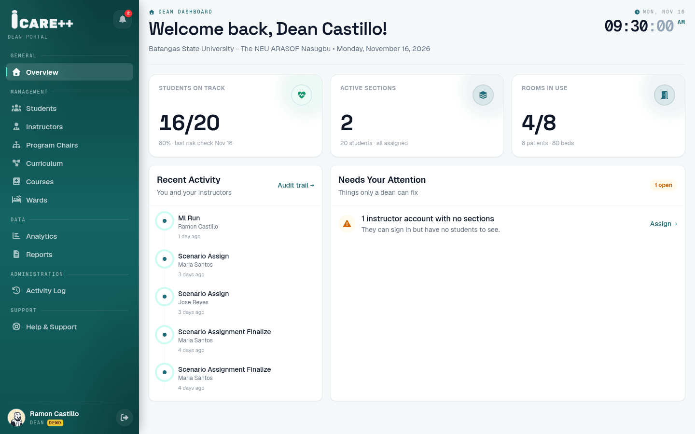

*Figure 1. The Overview, with the three key figures across the top, Recent Activity on the left and Needs Your Attention on the right.*

### Read the key figures

The three figures at the top of the **Overview** sum up your program. Select one to open the page behind it.

| Figure | What it shows | Opens |
|---|---|---|
| **Students on Track** | Students who aren't Low performing, out of those the risk check has scored. The caption gives the share and the date of the last risk check, or "No risk check yet". Students with no work yet aren't counted. | **Analytics** |
| **Active Sections** | Sections with students in them. The caption gives the number of students and how many have no section ("all assigned" when every student has one). | **Students** |
| **Rooms in Use** | Active rooms with at least one patient, out of all active rooms. The caption gives patients and beds. | **Wards** |

**Recent Activity** lists the last five things you and your instructors did. Select **Audit trail →** to open the [Activity Log](#activity-log).

### Work through Needs Your Attention

**Needs Your Attention** lists gaps in your setup that only you can close, with a count of open items. When nothing is open, it reads "Nothing needs your attention".

To work through the list:

1. On the **Overview**, find **Needs Your Attention**.
2. Read each row. The message says what is missing, and the line under it says why it matters.
3. Select the row to go where you fix it:

   | Message | Link | What to do |
   |---|---|---|
   | "*n* students not assigned to a section" | **Assign →** | Opens **Students**. The students are in the **Unassigned** card, often because their section was deleted. The Dean portal can't move a student into a section; an Admin can, so ask through [Help & Support](common-tasks.md#send-a-message-to-the-icare-team). |
   | "*n* students not in a group" | **Group them →** | Opens **Students**. [Put them in a group](#move-students-between-groups). |
   | "*n* sections without an instructor" | **Assign instructor →** | See the Important note below. |
   | "*n* instructor accounts with no sections" | **Assign →** | See the Important note below. |
   | "The risk check has never run", or "The risk check last ran *n* days ago" | **Run ML jobs →** | Opens **Students**. [Run the risk check](#run-the-risk-check). |

> [!IMPORTANT]
> The **Assign instructor →** and **Assign →** links on the two instructor rows open an older **Sections** page. Saving there gives the instructor no students. Instead, give the instructor groups: use [Assign groups to an instructor](#assign-groups-to-an-instructor), or a section's **Edit groups** ([Make groups and give each an instructor](#make-groups-and-give-each-an-instructor)). Both clear these rows.

**Result:** Each row goes away once its gap is closed. Reload the **Overview** to see the list again.

## Students

The **Students** page holds your sections and their students. Its header has the **Run ML Jobs** button (a brain icon) for [the risk check](#run-the-risk-check).

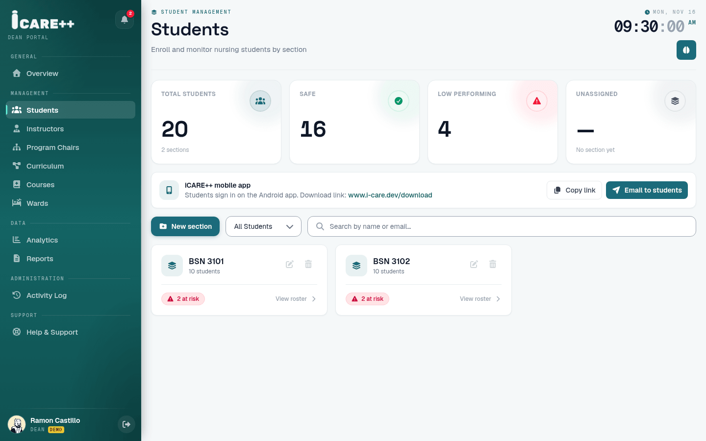

*Figure 2. The Students page, with the four figures, the iCARE++ mobile app card and one card per section.*

The page shows:

- Four figures: **Total Students**, **Safe**, **Low Performing** and **Unassigned** (students with no section).
- The **iCARE++ mobile app** card with the download link, **Copy link** and **Email to students**.
- **New section**, a filter list (**All Students**, **Low Performing**, **Safe**) and a search box.
- A card for each section, showing its students and either "All safe" or "*n* at risk" ("at risk" means Low performing; see [Names you will see on screen](README.md#names-you-will-see-on-screen)). Students with no section are in an **Unassigned** card.

### Create a section

A section holds a class of students and the instructors who teach them. Create one before you enroll its students.

To create a section:

1. In the sidebar, select **Students**.
2. Select **New section**. The **New section** dialog opens.
3. In the **Section name** box, enter the name, for example BSN 3101. Names can be up to 50 characters and must differ from your other sections.
4. Select **Create section**.

**Result:** The message "Created *name*" appears, and the page shows "Section "*name*" created." with **Dismiss**. The new section has its own card.

**Who is notified:** Nobody is notified.

**What happens next:** [Enroll the class list](#enroll-a-class-list).

### Rename or delete a section

You can rename a section at any time. Deleting it leaves its students without a section.

To rename a section:

1. On the **Students** page, on the section's card, select **Rename** (the pencil). Inside an open section, select **Rename** at the top.
2. In the **Rename section** dialog, enter the new name in the **Section name** box. Its students and instructors stay with it, and quizzes aimed at the section follow the new name.
3. Select **Save name**.

**Result:** The page shows "Section renamed to "*name*"", with a count of quizzes now aimed at the new name ("assessments" in this message means Quizzes; see [Names you will see on screen](README.md#names-you-will-see-on-screen)).

To delete a section:

1. On the section's card, select **Delete** (the bin), or **Delete** at the top of an open section. The **Delete section *name*?** dialog opens and shows "Checking what is attached…".
2. Read the list. It says how many students become unassigned (their accounts, attempts and scores are kept), which instructors lose the section, and any quizzes aimed at the section that will then reach nobody.
3. Select **Delete section**, or **Keep section** to stop.

**Result:** The page shows "Section "*name*" deleted", with the number of students now unassigned. They appear in the **Unassigned** card.

**Who is notified:** Nobody is notified in either case.

### Open a section roster

A section's roster lists its students, grouped by group, with their quiz count, average score, status and last sign-in.

To open a roster:

1. On the **Students** page, select the section's card (**View roster**). The section opens with **All sections** (to go back), its name and its student count.
2. Make sure the switch beside **Bulk enroll** is on **Students**, not **Edit groups**.

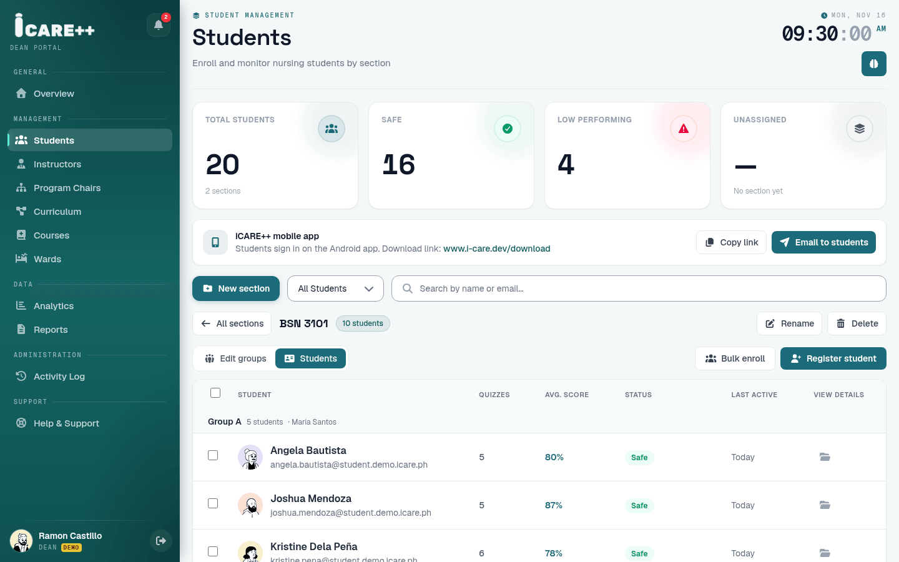

*Figure 3. The roster of BSN 3101, with each group's students under its own heading.*

The roster columns are **Student**, **Quizzes**, **Avg. Score**, **Status** and **Last Active**. **Status** reads "Low Performing", "Safe" or "Not scored yet". When the section has groups, students sit under a heading for their group with its instructor, and students in no group come last under **Not in a group**.

To open a student's profile, select their row, or **View profile** (the folder icon). See [Look at a student profile](#look-at-a-student-profile).

### Register one student

Register a student who joins a section after the class list is in.

**Before you start**

- The section exists. See [Create a section](#create-a-section).

To register a student:

1. On the **Students** page, open the section. See [Open a section roster](#open-a-section-roster).
2. Select **Register student**. The **Register a student** dialog opens.
3. In the **Full name** box, enter the student's name.
4. In the **Email** box, enter their email address.
5. Optional: In the **Sex** list, choose **Female** or **Male**.
6. Optional: If the section has groups, choose one in the **Group** list. Leave it on **Not in a group** to place them later.
7. Select **Register**.

**Result:** The dialog shows "Student registered" and "*name* is now in *section*". It then reads "Invitation sent to *email*." Select **Register another** or **Done**.

> [!IMPORTANT]
> If the welcome email couldn't be sent, the dialog says "The invitation to *email* didn't send. Share the password below." and shows the password under "Temporary password, shown once". Copy it before you close the dialog and give it to the student yourself. It is not shown again.

**Who is notified:** The student gets the email "Welcome to iCARE++ – Your Account Has Been Created", with **Download the iCARE++ app** and a temporary password.

**What happens next:** The student installs the app and signs in. See [Install the iCARE++ app](setup-1-getting-started.md#install-the-icare-app).

If you see "A user with this email already exists", that address already has an account. "That section belongs to another Dean or Program Chair" means the section isn't yours.

### Enroll a class list

Enroll a whole class at once, from a CSV or Excel file or by typing the students in.

**Before you start**

- The section exists. See [Create a section](#create-a-section).
- If you use a file, it has a header row and the columns `fname`, `lname`, `email`, `sex` and `group`. **Sex** (male or female) and **group** are optional. Select **CSV template** or **Excel template** in the dialog to download a blank one.

To enroll a class list:

1. On the **Students** page, open the section.
2. Select **Bulk enroll**. The **Bulk enroll into *section*** dialog opens.
3. Add the students in one of two ways:
   - Under **Import a CSV or Excel file**, select **Choose file** and pick the file, or drag the file onto the dialog. The rows appear under **Students**.
   - Select **Add a student by hand**, then enter the **First name**, **Last name** and **Email**, and optionally the **Sex** and **Group**. Repeat for each student.

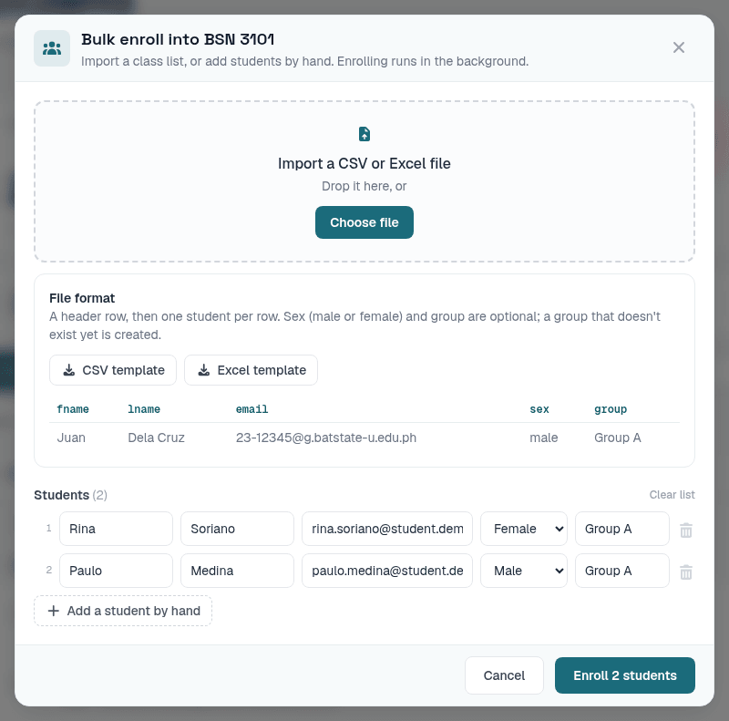

*Figure 4. The Bulk enroll dialog with two students added by hand.*

> [!IMPORTANT]
> Selecting anywhere outside the dialog closes it and loses every row you added. Keep the pointer inside the dialog until you have enrolled the students.

4. Check the rows under **Students**. Remove a row with its bin, or select **Clear list** to start again. A group name that doesn't exist yet becomes a new group.
5. Optional: If some students have no group, select **Group students who have no group**. They join the smallest of the section's groups. If the section has no groups yet, enter how many students go in each group, and the whole section is split into groups of that size.
6. Select **Enroll *n* students**.

**Result:** The dialog closes and a progress card opens in the bottom-right corner: "Enrolling *n* students into *section*". You can keep working while it runs. It ends with "Enrolled *n* into *section*", or "Enrolled *n* of *m* into *section*" if some failed; the card says why for each failed student.

> [!IMPORTANT]
> When a student's welcome email couldn't be sent, their row in the progress card says "The invitation email didn't go out; hand them this password." and shows a temporary password. Copy it before you close the card and give it to the student. It is not shown again.

**Who is notified:** Each student gets the email "Welcome to iCARE++ – Your Account Has Been Created", with **Download the iCARE++ app** and a temporary password.

**What happens next:** [Make groups and give each an instructor](#make-groups-and-give-each-an-instructor), if the list had no groups.

Before it enrolls anyone, the dialog checks the list and stops on the first problem, for example "*email* needs a first and last name." or "*email* appears twice in this batch."

### Make groups and give each an instructor

Instructors see only the students in the groups they supervise. Split each section into groups and give every group an instructor.

**Before you start**

- The section has students. See [Enroll a class list](#enroll-a-class-list).
- The instructors have accounts. See [Add an instructor](#add-an-instructor).

To make groups:

1. On the **Students** page, open the section.
2. Set the switch to **Edit groups**. The **Groups** card opens above the list of students not in a group.
3. Select **Create groups** (it reads **Regroup** once the section has groups). The **Create groups** dialog opens.
4. In the **Students per group** box, enter a number. The dialog shows how many groups that makes.
5. Select **Create *n***. The students are split at random, as evenly as possible.
6. On each group's card, in the **Instructor** list, choose the instructor. The message "*name* now supervises *group*" appears.

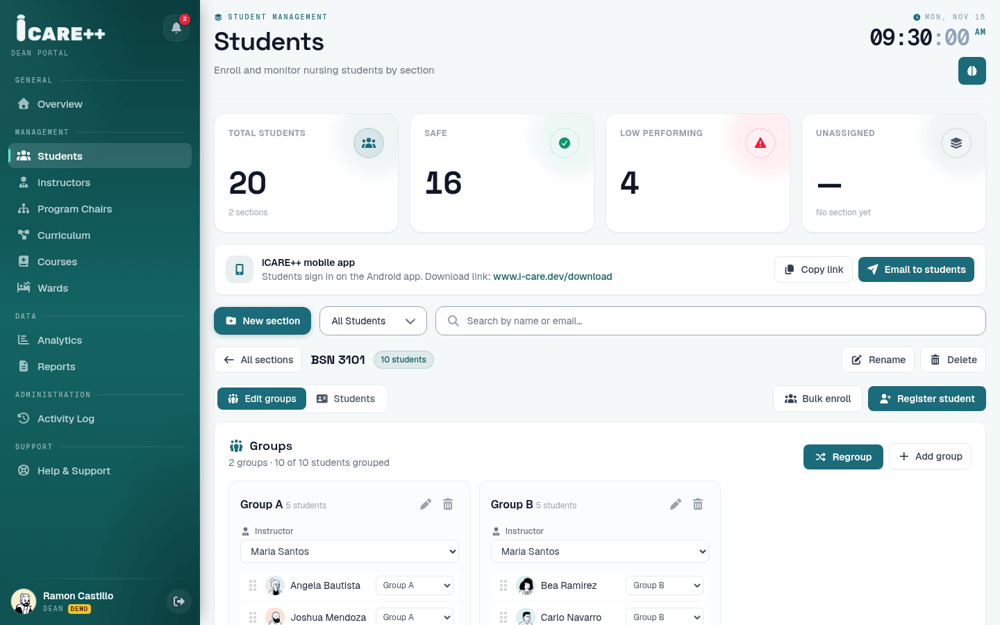

*Figure 5. Edit groups for BSN 3101, with an Instructor list on each group's card.*

**Result:** The **Groups** card shows "*n* groups · *g* of *s* students grouped". Each group's instructor now sees its students.

> [!NOTE]
> The instructor isn't notified when you give them a group. Tell them yourself.

**Who is notified:** Nobody is notified.

**What happens next:** The instructor finds the students on their **Students** page. See [Create groups](instructor.md#create-groups) in the Instructor guide.

You can also manage the groups on this card:

- **Add group** adds an empty group, up to 20 per section.
- **Rename** (the pencil) on a card renames the group.
- **Delete** (the bin) on a card asks "Delete *group*?". Select **Delete group**; its students move to the list of students not in a group.
- **Regroup** reshuffles everyone into new groups. Existing groups keep their names and instructors, and extra groups are removed.
- Choosing **No instructor yet** in a card's **Instructor** list takes the instructor off that group.

### Move students between groups

Move a student into a group, between groups, or out of every group.

To move students:

1. On the **Students** page, open the section and set the switch to **Edit groups**.
2. Move each student in one of these ways:
   - Drag the student from one group's card onto another. The card reads "Drop to add to *group*".
   - In the list beside a student's name on a card, choose **Move to *group***, or **Remove from group**.
   - For students under **Not in a group**, select a row, hold **Ctrl** and select more rows, or hold **Shift** and select a range. Then drag them onto a group's card.
   - To take a student out of their group, drag them onto the list of students not in a group.

**Result:** A message confirms each move, for example "Moved *name* to *group*".

**Who is notified:** Nobody is notified.

### Delete students

Deleting a student removes their account, quiz attempts, scores and risk history for good.

To delete students:

1. On the **Students** page, open the section. The switch is on **Students**.
2. Select the box at the start of each student's row. A bar shows "*n* students selected", with **Clear** and **Delete selected**.
3. Select **Delete selected**. The **Delete *n* students?** dialog lists them.
4. Select **Delete *n***.

**Result:** The page shows "*n* students deleted — their attempts and scores are gone too."

**Who is notified:** Nobody is notified.

### Email the app link to students

Send each student an email with the app's download link and how to install it.

To email the app link:

1. In the sidebar, select **Students**. To email only one section, open that section first.
2. On the **iCARE++ mobile app** card, select **Email to students**. The **Email the app link** dialog opens.
3. Choose **Haven't signed in yet** (the default) or **Everyone**. Each choice shows how many students it reaches.
4. Select **Send to *n* students**.

**Result:** The message "Emailed the app link to *n* students" appears.

> [!NOTE]
> The email and the card say the app is for Android phones. There's no iPhone version yet.

**Who is notified:** Each student gets the email with the download link.

To copy the link instead, select **Copy link**; the message "Download link copied" appears. To send it to one student, open their profile and select **Send app link**. If the card says "The download link isn't set up yet. Ask the iCARE++ team to add it.", [send a message to the iCARE++ team](common-tasks.md#send-a-message-to-the-icare-team).

### Run the risk check

The risk check scores each student for the chance of being Low performing, and updates skill mastery. It runs every night on its own. Run it by hand when you want fresh results, for example after a week of graded work.

To run the risk check:

1. In the sidebar, select **Students**.
2. In the page header, select **Run ML Jobs** (the brain icon). The button shows a percentage, and its progress line reads "Step 1 of 2 · Scoring students for risk", then "Step 2 of 2 · Updating skill mastery". The first step can take up to a minute to start.

**Result:** A message reports how many students were scored and how many are Low performing. The **Status** of each student and the **Safe** and **Low Performing** figures update. The run scores every student in iCARE++, but you still see only your own.

> [!NOTE]
> The button has no text; its name shows when you hold the pointer over it: "Run ML Jobs — score every student for risk and update skill mastery". The result message ends "Run Refresh Warehouse on Analytics…", but **Analytics** has no such button: it catches up on its own within about 5 minutes. A student profile with no score says the jobs run "from the Analytics page"; they run from here, on **Students**.

**Who is notified:** Nobody is notified. Instructors see the new results on their own pages.

Instructors can score their own students with **Assess**; see [Score students for risk](instructor.md#score-students-for-risk).

### Look at a student profile

A student profile shows one student's figures, risk score and work. It is read-only.

To open a profile:

1. On the **Students** page, open the student's section.
2. Select the student's row. The profile opens.

The profile shows:

- The student's name, email, the month they enrolled, and **Send app link**.
- Four figures: **Avg Score**, **Quizzes**, **Last Active** and **Risk Status** ("Low Performing", "On Track" or "Not scored yet").
- The **ML Risk Prediction** card: **Risk Level** ("AT RISK" or "SAFE"; see [Names you will see on screen](README.md#names-you-will-see-on-screen)), **Risk Probability**, when it was **Predicted**, the **Model**, and the **Top Contributing Factors**.
- Three tabs: **Performance** (quiz results), **Patient Cases** (each case with the number of tasks performed) and **Skill Areas** (skill mastery).

Select **Back to students** to return.

> [!NOTE]
> You can't rename a student or move them to another section here; an Admin can, so ask through [Help & Support](common-tasks.md#send-a-message-to-the-icare-team). To delete one student, select the box on their row in the section roster and select **Delete selected** (see [Delete students](#delete-students)).

## Instructors

The **Instructors** page lists your instructor accounts and the groups each one handles.

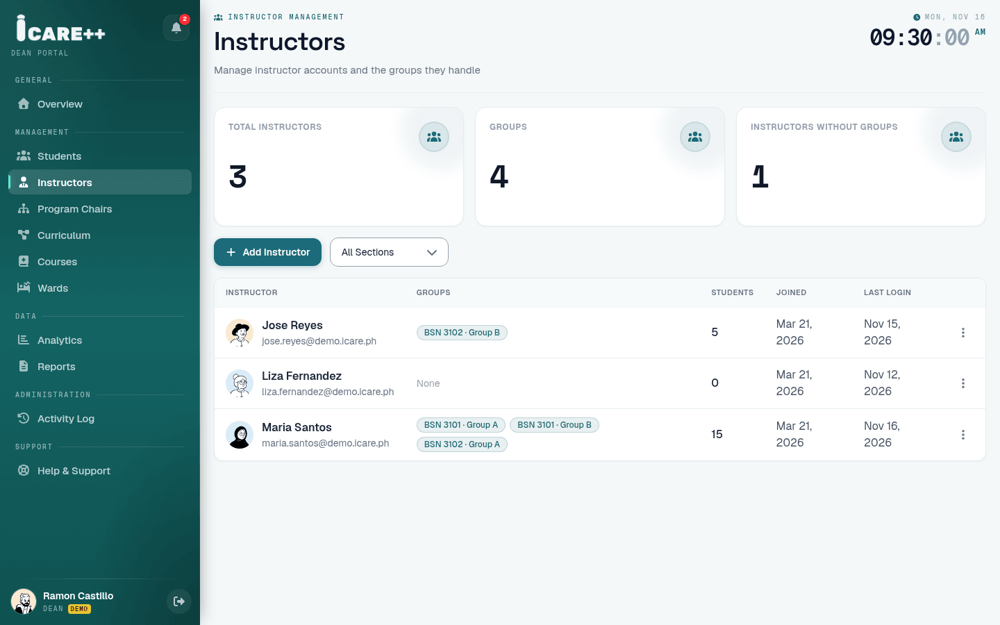

*Figure 6. The Instructors page, with three figures and the table of instructors.*

The figures are **Total Instructors**, **Groups** and **Instructors Without Groups**. The filter list narrows the table to **All Sections**, **No Group** or one section. The table shows each instructor's **Groups** (as "*section* · *group*", or "None"), **Students**, **Joined** and **Last Login**. Select **Actions** (the three vertical dots) at the end of a row for **Edit Account**, **Assign Groups** and **Delete Account**.

### Add an instructor

Create an account for a new clinical instructor.

To add an instructor:

1. In the sidebar, select **Instructors**.
2. Select **Add Instructor**. The **Add New Instructor** dialog opens.
3. In the **Full Name** box, enter the instructor's name.
4. Optional: In the **Gender** list, choose **Female (Ms.)** or **Male (Mr.)**. This sets how iCARE++ addresses them.
5. In the **Email** box, enter their email address.
6. Select **Add Instructor**.

**Result:** The dialog closes, and the page shows "Instructor account created. Their temporary password was emailed to *email*." The instructor appears in the table with no groups. If something is wrong, for example "A user with this email already exists", the dialog stays open and the message appears at the top of the page, behind the dialog.

> [!IMPORTANT]
> If the welcome email couldn't be sent, an amber banner shows "Temporary password for *email*: *password* — they must change it at first login." Copy the password and give it to the instructor before you select **Dismiss**. It is not shown again.

**Who is notified:** The instructor gets the email "Welcome to iCARE++ – Your Account Has Been Created". It says their Dean created the account, with a sign-in link and a temporary password.

**What happens next:** The instructor signs in and sets their own password (see [Sign in to the web portal for the first time](setup-1-getting-started.md#sign-in-to-the-web-portal-for-the-first-time)). They see no students until you [assign them groups](#assign-groups-to-an-instructor) and [a course](#add-a-course-for-a-semester).

### Assign groups to an instructor

Choose all the groups one instructor handles, across your sections, in one place. A group has one instructor, so picking another instructor's group moves it to this one.

**Before you start**

- The sections have groups. See [Make groups and give each an instructor](#make-groups-and-give-each-an-instructor).

To assign groups:

1. In the sidebar, select **Instructors**.
2. Select the instructor's row. The **Assign Groups to *name*** dialog opens.

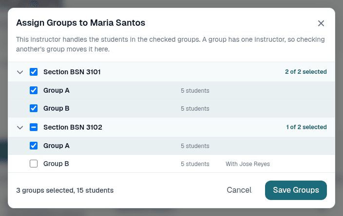

*Figure 7. The Assign Groups dialog for Maria Santos, with her groups listed under each section.*

3. Select a section's row to open it. Its groups appear, each with its number of students and its current instructor: "With *name*", "Moves from *name*", "No instructor" or "Will have no instructor".
4. Select the box beside each group this instructor handles, and clear the box for any group they no longer handle. The box on a section's row selects all its groups. With many groups, use the **Search groups or instructors** box.
5. Check the footer. It shows "*n* groups selected, *m* students", and, in amber, how many groups move from another instructor or will have no instructor.
6. Select **Save Groups**.

**Result:** The dialog closes and the page shows "Groups updated". The table shows the instructor's new groups.

**Who is notified:** Nobody is notified. Tell the instructor and any instructor who lost a group.

**What happens next:** The instructor sees the students of these groups on their **Students** page.

If a section has no groups, its row reads "No groups yet." with **Create groups**, which opens **Students**.

> [!IMPORTANT]
> If you have no sections, the dialog says "No sections yet. Create them on the Sections page". That link opens an older **Sections** page, where saving gives the instructor no students. Create sections on **Students** instead (see [Create a section](#create-a-section)).

### Edit an instructor account

Change an instructor's name, gender or sign-in email.

To edit an instructor:

1. On the **Instructors** page, on the instructor's row, select **Actions** (the three vertical dots), then **Edit Account**. The **Edit Instructor Account** dialog opens.
2. Change the **Full Name** or **Gender**.
3. Select **Save Changes**. The page shows "Instructor account updated".

To change their email:

1. In the **Edit Instructor Account** dialog, select **Change Email**.
2. In the **New email** box, enter the new address, then select **Send code**. A 6-digit code goes to the new address.
3. Ask the instructor for the code, enter it, and select **Confirm change**.

**Result:** The page shows "Email changed to *email*. The old address was notified."

**Who is notified:** For an email change, the old address gets an email saying the sign-in email changed. Nobody is notified of a name change.

### Delete an instructor account

Delete the account of an instructor who has left. Their grades and the work they made stay.

To delete an instructor:

1. On the **Instructors** page, on the instructor's row, select **Actions** (the three vertical dots), then **Delete Account**. The **Delete *name*'s account?** dialog opens.
2. Read the list. It says which groups will have no instructor, which course assignments will show "No instructor", and how many Library materials pass to you. The grades they gave and the Patient Cases and quizzes they made stay.
3. Select **Delete Account**.

**Result:** The page shows "*name*'s account was deleted". The instructor can no longer sign in.

> [!NOTE]
> Their Library materials pass to you, so students keep them.

**Who is notified:** Nobody is notified.

**What happens next:** [Assign their groups](#assign-groups-to-an-instructor) to another instructor, and [change the instructor](#change-or-remove-an-instructor) of their courses.

## Program Chairs

Only Deans have this page. A Program Chair runs their own part of the program with their own instructors, students and wards. You see each one's counts here, but not their people or records.

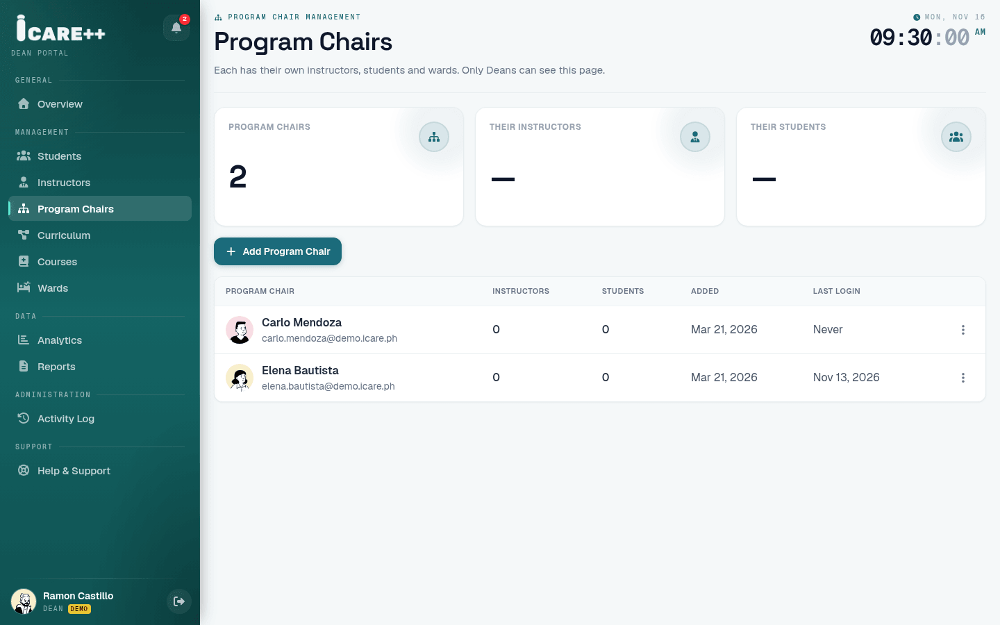

*Figure 8. The Program Chairs page, with the number of instructors and students each Program Chair has.*

The figures are **Program Chairs**, **Their Instructors** and **Their Students**. The table shows each Program Chair's **Instructors**, **Students**, **Added** and **Last Login**.

### Add a Program Chair

Create a Program Chair account under you.

To add a Program Chair:

1. In the sidebar, select **Program Chairs**.
2. Select **Add Program Chair**. The **Add New Program Chair** dialog opens.
3. In the **Full Name** box, enter their name.
4. Optional: In the **Gender** list, choose **Female (Ms.)** or **Male (Mr.)**.
5. In the **Email** box, enter their email address.
6. Select **Add Program Chair**.

**Result:** The page shows "Program Chair account created. Their temporary password was emailed to *email*." Errors such as "A user with this email already exists" show inside the dialog. The new Program Chair belongs to you and takes your institution.

> [!IMPORTANT]
> If the welcome email couldn't be sent, an amber banner shows "Temporary password for *email*: *password* — they must change it at first login." Copy the password and give it to the Program Chair before you select **Dismiss**. It is not shown again.

**Who is notified:** The Program Chair gets the email "Welcome to iCARE++ – Your Account Has Been Created".

**What happens next:** The Program Chair signs in and starts with an empty portal. They set up their own term; see [the Program Chair guide](program-chair.md).

### Edit or delete a Program Chair

To edit a Program Chair:

1. On the **Program Chairs** page, on their row, select **Actions** (the three vertical dots), then **Edit Account**. The **Edit Program Chair Account** dialog opens.
2. Change the **Full Name** or **Gender**, or select **Change Email** to change their sign-in email the same way as for an instructor (see [Edit an instructor account](#edit-an-instructor-account)).
3. Select **Save Changes**. The page shows "Program Chair account updated".

To delete a Program Chair:

1. On their row, select **Actions** (the three vertical dots), then **Delete Account**. The **Delete *name*'s account?** dialog opens.
2. Select **Delete Account**.

**Result:** The page shows "*name*'s account was deleted".

> [!NOTE]
> A Program Chair who still has instructors, students or other records can't be deleted. The dialog then shows "*name* still has … Ask an Admin to move them before deleting this account." Ask an Admin through [Help & Support](common-tasks.md#send-a-message-to-the-icare-team) to move them first.

**Who is notified:** Nobody is notified.

## Curriculum

The **Curriculum** page keeps your program of study: year levels, terms, courses, units, pre-requisites and co-requisites. You can have more than one curriculum, but only one is in use. The one in use decides which courses **Add Course** offers.

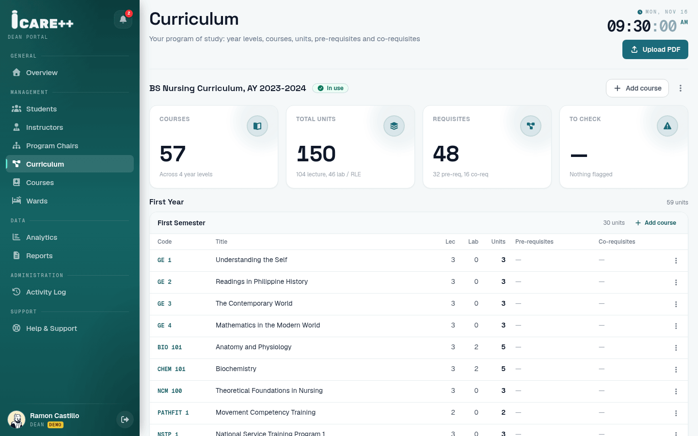

*Figure 9. The Curriculum page, with the curriculum in use and its courses grouped by year and term.*

### Upload a curriculum PDF

Let iCARE++ read your curriculum from a PDF, scanned or not, into courses you can check.

To upload a curriculum:

1. In the sidebar, select **Curriculum**.
2. Select **Upload PDF** in the page header. With no curriculum yet, you can also select **Choose PDF**, or drag the PDF onto the page.
3. Pick the PDF. It can be up to 20 MB.

**Result:** A progress bar shows each stage; reading a long curriculum can take up to a minute. Then the message "Read *n* courses from *file*. Check them before using this curriculum." appears. The new curriculum is **Not in use** until you choose to use it.

**Who is notified:** Nobody is notified.

**What happens next:** [Check and correct the courses](#check-and-correct-the-courses).

The PDF is read by an AI inside iCARE++. No student records are sent.

### Start a blank curriculum

Type a curriculum in by hand instead of uploading one.

To start a blank curriculum:

1. On the **Curriculum** page, select **Start blank**. If you already have a curriculum, select **Curriculum actions** (the three vertical dots), then **New blank curriculum**.
2. In the **Start a blank curriculum** dialog, enter a **Name**, or keep "BS Nursing Curriculum".
3. Select **Create**.
4. Select **Add course** to add each course. See [Check and correct the courses](#check-and-correct-the-courses).

### Check and correct the courses

Check every course against your PDF before you use the curriculum.

To check a curriculum:

1. On the **Curriculum** page, if you have more than one curriculum, choose it in the list at the top.
2. Read the figures: **Courses**, **Total units**, **Requisites** and **To check**.
3. If an amber box reads "*n* things to check", open it. Select **Open course** beside an item to fix that course. Under **Notes from reading the PDF**, read the notes, then select **Dismiss notes**.
4. In the course tables, find a course to change, select **Actions** (the three vertical dots) on its row, then **Edit**. The **Edit *code*** dialog opens.
5. Correct the **Code**, **Title**, **Year level**, **Term**, **Lecture units** or **Lab / RLE units**, the **Pre-requisites** and **Co-requisites**, or **Other requirements**.
6. Select **Save course**.

To add a missing course, select **Add course**, fill in the same fields, and select **Add course** in the dialog. To remove one, select **Delete** in its row's actions.

To see the original PDF, select its name at the top of the page.

### Use or stop using a curriculum

Put a checked curriculum in use, so that **Add Course** offers its laboratory courses.

To use a curriculum:

1. On the **Curriculum** page, choose the curriculum. A banner reads "Not in use yet."
2. Select **Use this curriculum**. The **Use *name*?** dialog says how many laboratory courses **Add Course** will offer. Existing course assignments and grades don't change.
3. Select **Use this curriculum**.

**Result:** The message "*name* is now in use" appears. Any curriculum that was in use before is kept, but no longer in use.

To stop using it, select **Curriculum actions** (the three vertical dots), then **Stop using**, and confirm. **Add Course** goes back to the built-in list of NCM laboratory courses. To delete a curriculum, select **Delete** in the same menu, then **Delete curriculum**; its courses and its PDF are removed for good.

> [!NOTE]
> A curriculum only changes what **Add Course** offers. Only courses whose code ends in L (the laboratory courses) are offered. Pre-requisites and co-requisites are for reference; iCARE++ doesn't enforce them.

**Who is notified:** Nobody is notified.

## Courses

The **Courses** page shows your semesters and courses, and who teaches each course. Choose a semester in the list beside **Add Course** to see its courses.

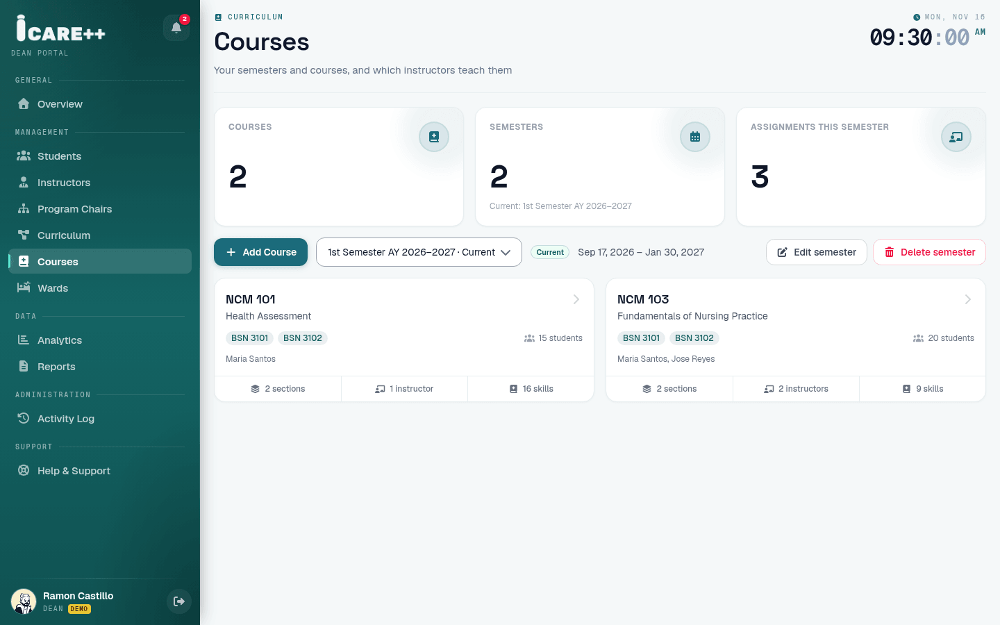

*Figure 10. The Courses page, with the semester list and a card for each course taught that semester.*

The figures are **Courses**, **Semesters** (with the current one) and **Assignments this semester**. Each course card shows its code, title, sections, number of students and instructors. Its footer shows the number of sections, instructors and skills, or **Pick skills** in amber when it has none. Courses not taught in the chosen semester are listed under **Not assigned this semester**.

### Add a course for a semester

Give a course to an instructor for a semester. This also creates the semester and the course if they are new.

**Before you start**

- The instructor has an account. See [Add an instructor](#add-an-instructor).

To add a course:

1. In the sidebar, select **Courses**.
2. Select **Add Course**. The **Add Course** page opens.
3. Under **Semester**, choose the **Semester** (**First Semester**, **Second Semester** or **Midterm**) and the **Academic year**.
4. If the semester is new, the page says it's added when you assign. Check the **Starts** and **Ends** dates. Only work graded within these dates counts toward the course.
5. Under **Course**, choose the course. If it isn't one of your courses yet, you can enter an optional **Description**; **Detect with AI** later reads it to find the course's skills.
6. Under **Instructor**, choose the instructor.
7. Check the **Course assignment** card beside the steps.
8. Select **Add course**.

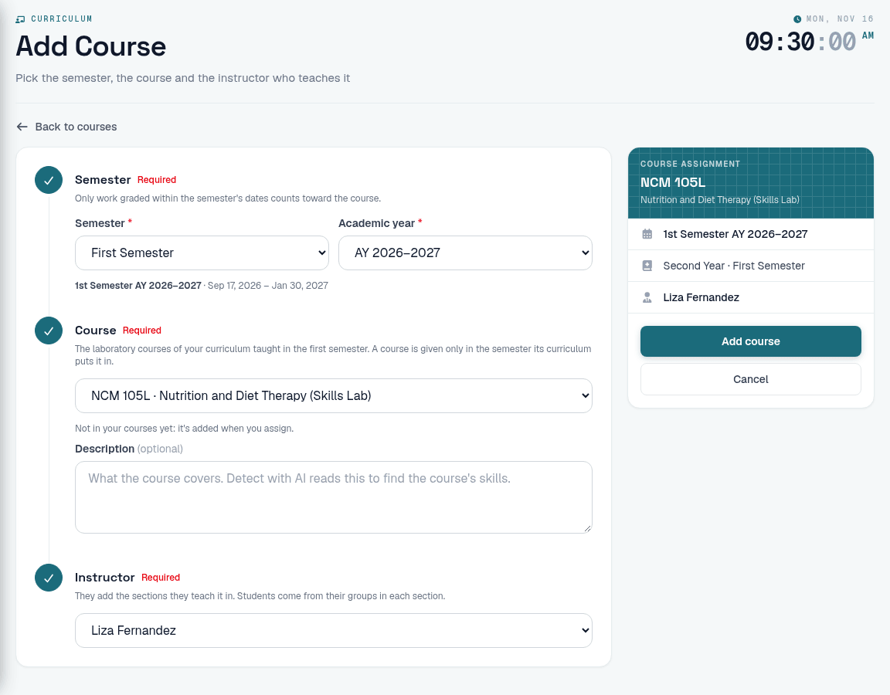

*Figure 11. The Add Course page with a semester, a course and an instructor chosen, and the Course assignment card.*

**Result:** The message "Added *code* for *instructor*" appears, and the **Courses** page shows the course in that semester, with "No sections yet" until the instructor adds them.

> [!NOTE]
> There is no separate button for a new semester: a semester is added here. Only the instructor can add sections to a course. If semesters overlap, the page warns you; work graded in the overlap counts for both.

**Who is notified:** The instructor gets the notification "New course assignment": "You were assigned *code* *title* (*semester*). Add the sections you teach it in, then set up its requirements checklist."

**What happens next:** The instructor chooses the sections they teach it in. See [Choose the sections you teach](instructor.md#choose-the-sections-you-teach) in the Instructor guide.

To give a course from **Not assigned this semester** to an instructor, select **Assign** on it. The **Add Course** page opens with the course and semester chosen.

### Look inside a course and section

See which sections take a course, who teaches it in each one, and the course's skills.

To look inside a course:

1. On the **Courses** page, choose the semester, then select the course's card. The course opens with its section cards. If the instructor hasn't added sections yet, the page says so.
2. Select a section's card. It opens on two tabs, **Instructors** and **Skills**.
3. On the **Instructors** tab, read each instructor's line:
   - "Teaches their groups here", or "No group here, so the whole section is on their roster".
   - The number of students in all their sections.
   - Their checklist for the course ("checklist of *n* items", or "checklist not set up").
4. Optional: Select the instructor's name to see their students for the course. The dialog shows where each student comes from: "Their group", "Whole section" or "Added by hand".
5. On the **Skills** tab, read the skills the course covers. Patient Cases, quizzes and the Library use this list.

Select **Courses** in the breadcrumb at the top to go back.

### Add a student to an instructor roster

Put a student outside the instructor's groups and sections onto their roster for one course, for example a student repeating the course.

To add a student:

1. On the **Courses** page, open the course and then the section. See [Look inside a course and section](#look-inside-a-course-and-section).
2. On the **Instructors** tab, on the instructor's line, select **Add student**. The **Add a student to *code*** dialog opens.
3. In the search box, enter at least two letters of the student's name or email.
4. Select **Add** beside the student.

**Result:** The student's line reads "On the roster", and the message "*name* added to *code*" appears.

**Who is notified:** Nobody is notified.

### Change or remove an instructor

Hand a course to another instructor, or take it away for the semester.

To change the instructor:

1. On the **Courses** page, open the course and then the section.
2. On the **Instructors** tab, on the instructor's line, select **Actions** (the three vertical dots), then **Change instructor**. The **Edit *code*** dialog opens; the checklist stays with the assignment.
3. In the **Instructor** list, choose the new instructor.
4. Select **Save assignment**.

**Result:** The message "Course assignment saved" appears.

**Who is notified:** The new instructor gets the notification "New course assignment".

To remove the course from the instructor for this semester:

1. On the instructor's line, select **Actions** (the three vertical dots), then **Remove from semester**. The dialog says what is removed: the course's checklist for this instructor, with their scores and ticks. Graded work is not touched.
2. Select **Remove assignment**, or **Keep assignment** to stop.

To add a second instructor to the course, select **Assign another instructor**. The **Add Course** page opens with the course chosen.

### Edit the skills of a course

Pick the skills a course covers. The list is shared with every instructor teaching the course, and Patient Cases, quizzes and the Library use it.

To edit the skills:

1. On the **Courses** page, on the course's card, select its skill count (or **Pick skills**). You can also open the course, select **Actions** (the three vertical dots), then **Edit skills**. The ***code* skills** dialog opens.
2. Find skills with the **Search skills or chapters** box, or select **Selected only** to see the ones already picked.
3. Select the skills the course covers, or use **Select all** and **Clear** beside a chapter.
4. Optional: Select **Detect with AI** to have the AI pick skills from the course's code, title and description. It says "Ticked *n* skills the course covers. Review them before saving." Check its picks.
5. Select **Save skills**.

**Result:** The message "*code* now covers *n* skills" appears.

**Who is notified:** Nobody is notified.

### Edit or delete a semester or course

To edit a semester:

1. On the **Courses** page, choose the semester in the list.
2. Select **Edit semester**. The **Edit *semester*** dialog opens.
3. Change the dates. If courses are taught in it, the dialog warns that their requirements are re-checked right away.
4. Select **Save semester**.

To delete a semester, choose it, select **Delete semester**, then **Delete *semester***. Its course assignments and their checklists are removed. Your courses and all graded work are kept.

To edit a course's description, open the course or find it under **Not assigned this semester**, select **Actions** (the three vertical dots), then **Edit course details**. Change the **Description** and select **Save course**.

To delete a course, find it under **Not assigned this semester**, select **Actions** (the three vertical dots), then **Delete course**, then **Delete *code***. Its course assignments and checklist items are removed. Graded Patient Cases, Quizzes and Case Presentations are not touched. Only courses not taught in the chosen semester show **Delete course**.

**Who is notified:** Nobody is notified.

## Wards

The **Wards** page is your simulated ward: the floor plan, the rooms and the patients in them. All patients are simulated. Instructors see the patients of their courses and use them for Patient Cases.

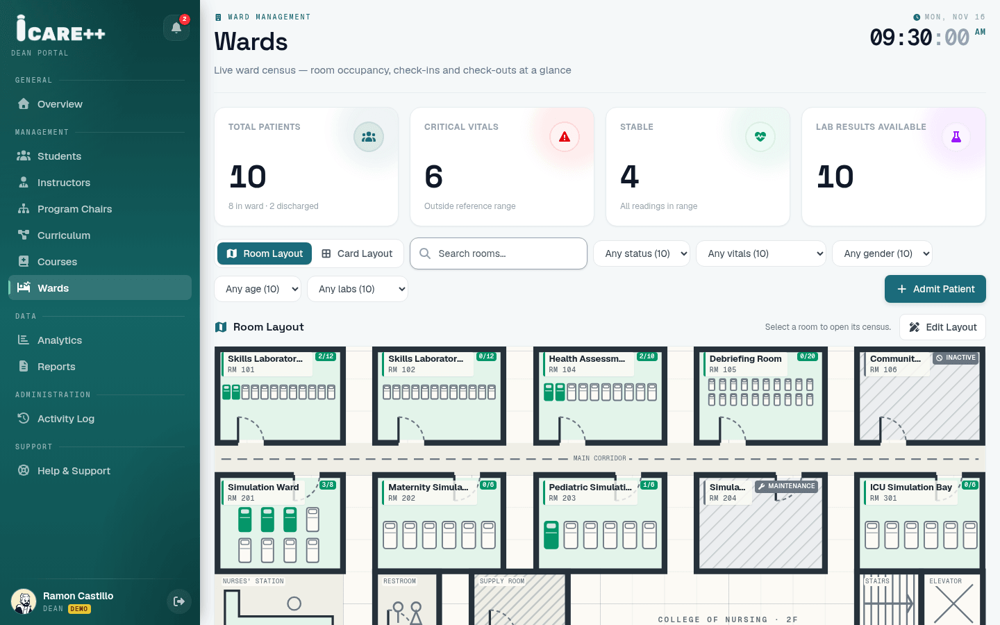

*Figure 12. The Wards page in Room Layout, with each room coloured by how full it is.*

The figures are **Total Patients**, **Critical Vitals**, **Stable** and **Lab Results Available**; select one to filter the patients. **Room Layout** shows the floor plan, and **Card Layout** shows a card per room. Use **Search rooms...** and the filter lists to narrow the view.

### Add rooms and arrange the floor plan

Add the ward's rooms and place them, with corridors and stations, on the floor plan.

To add a room and place it:

1. In the sidebar, select **Wards**.
2. Make sure **Room Layout** is chosen, then select **Edit Layout**. The heading reads "Editing Room Layout".
3. Select **Add Room**. The **Add Room** dialog opens.
4. Enter the **Room Name**, **Room Number** and **Capacity** (the number of beds), and set its status.
5. Select **Create Room**. The message "Room added — place it from the tray" appears.
6. Under **Rooms not on the plan**, drag the room onto the sheet, or select it.
7. Optional: Under **Add to the plan**, drag in corridors, stations and other fixtures, such as **Corridor** or **Nurse Station**.
8. Optional: Select a placed room for **Rotate**, **Edit** or **Remove from plan**.
9. Select **Save Layout**. It reads **Saved** when nothing is waiting.
10. Select **Done**.

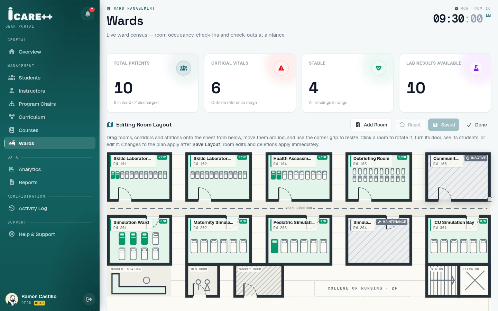

*Figure 13. Editing the Room Layout, with Add Room, the rooms not yet on the plan, and Save Layout.*

**Result:** The message "Room layout saved" appears. Changes to the plan apply only after **Save Layout**, but adding, editing and deleting a room apply at once. **Reset** drops changes you haven't saved; selecting **Done** with unsaved changes asks "Discard your unsaved layout changes?" in a confirmation box.

> [!NOTE]
> **Add Room** is only in **Edit Layout**. **Card Layout** shows only rooms that have patients, so a new, empty room appears only on the floor plan.

**Who is notified:** Nobody is notified.

### Admit a patient

Admit a simulated patient to a room. Pick a condition, and **Fill with AI** drafts the patient's chart for you to check.

**Before you start**

- You have at least one course. See [Add a course for a semester](#add-a-course-for-a-semester).
- The ward has rooms. See [Add rooms and arrange the floor plan](#add-rooms-and-arrange-the-floor-plan).

> [!IMPORTANT]
> You need one of your own courses before you can admit a patient. Without one, the dialog says "You have no assigned courses yet. Ask your Dean or Program Chair to assign you a course before adding patients." Instead, [add a course](#add-a-course-for-a-semester) with **Add Course**, then come back.

To admit a patient:

1. In the sidebar, select **Wards**.
2. Select **Admit Patient**. Inside an open room, you can select **Add to *room*** instead. The **Add Patient** dialog opens.

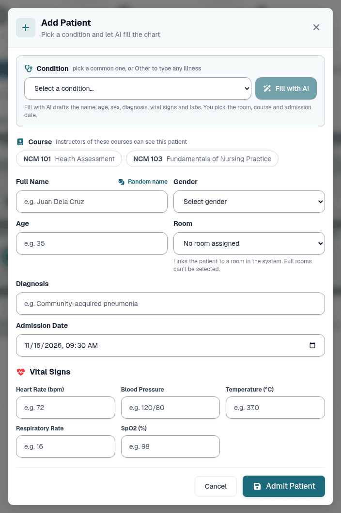

*Figure 14. The Add Patient dialog, with the Condition list and Fill with AI at the top, then a course, the patient's details and vital signs.*

3. Under **Condition**, choose the patient's condition from the list of common ones, such as those under **Respiratory** or **Heart & Blood Pressure**. The diagnosis, vital signs and labs fill in at once with typical values, and a line under the list reads "Filled from "*condition*"." If the condition isn't in the list, choose **Other (type a condition)…** and type the illness in the box that opens, for example "Leptospirosis".
4. Optional: Select **Fill with AI**. The button reads "Filling…" for a few seconds, and the form is locked while it works. The AI drafts the patient's name, age, sex, diagnosis, vital signs and labs for that condition. A name, age or sex you typed or chose yourself is kept, and the AI works around it. The button is greyed out until you have chosen or typed a condition. With **Other**, pressing **Enter** in the box does the same.
5. Read the line under the condition. It reads "Filled by AI for "*condition*". Check every field before admitting." Check every field the AI filled. It is a draft, and you can change all of it except the labs.
6. Choose at least one of your courses. The instructors of these courses can see the patient.
7. Check the patient's name (or select **Random name**), gender, age and room. Full rooms can't be selected.
8. Check the diagnosis, the admission date and the vital signs, and change them if you need to. The labs are shown under **Labs**, marked "typical for this condition" or "suggested by AI". You can't edit them here.
9. Select **Admit Patient**.

**Result:** The message "Patient created successfully" appears. The patient shows in their room on both layouts.

> [!NOTE]
> If the AI can't draft the chart, a red message appears under the condition, for example "Unable to fill the chart with AI." When you picked a condition from the list, its typical diagnosis, vital signs and labs stay in the form, so you can still admit the patient. If the message says the AI couldn't make a patient from the condition, name it differently and try again. Only the condition and a made-up age and sex are sent to the AI, never a student's record.

> [!NOTE]
> On a ward with no patients yet, **Card Layout** shows "No patients found" with a developer command under it. Ignore the command and use **Admit Patient**.

**Who is notified:** Nobody is notified. The instructors of the chosen courses see the patient on their **Wards** page.

**What happens next:** Instructors use the patient in a Patient Case. See [Assign a Patient Case](instructor.md#assign-a-patient-case) in the Instructor guide.

### Check patients in and out

Check a patient out to free their bed, and check them back in later.

To check a patient out:

1. On the **Wards** page, select the patient's room on the floor plan, or its card in **Card Layout**. The room's patients are listed. A room with no patients shows the message "No patients in *room* yet" instead.
2. On the patient's row, select **Check out patient**. The **Check Out Patient** dialog asks you to confirm; their bed is freed and the record moves to Discharged.
3. Select **Check Out**.

**Result:** The message "*name* checked out" appears. In **Card Layout**, the patient is under **Discharged**.

To check a patient back in:

1. In **Card Layout**, open **Discharged**.
2. On the patient's row, select **Check in patient**. The **Check In Patient** dialog opens.
3. Choose a room. Full rooms are marked full. The admission date restarts at check-in.
4. Select **Check In**.

**Result:** The message "*name* checked in" appears.

On the same row, **Edit patient** changes the patient's details, and **Delete patient** removes the patient for good.

**Who is notified:** Nobody is notified.

## Analytics

The **Analytics** page (titled "Analytics Dashboard") shows figures on your own students, instructors and rooms. Its figures refresh themselves at most every 5 minutes.

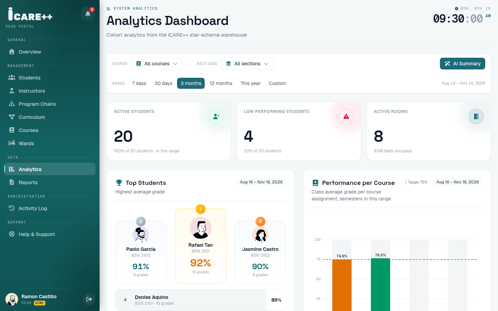

*Figure 15. The Analytics Dashboard, with the filter bar across the top and the panels below.*

To narrow the figures to a course, some sections or a date range, use the filter bar; see [Filter the figures](common-tasks.md#filter-the-figures). To get a plain-language reading of what is on screen, select **AI Summary**; see [Get an AI Summary](common-tasks.md#get-an-ai-summary).

The panels are:

| Panel | What it shows |
|---|---|
| **Active Students** | Students active in the range. |
| **Low Performing Students** | Students the risk check marked Low performing. |
| **Active Rooms** | Rooms in use. |
| **Top Students** | Your students with the highest average grade. **View full leaderboard →** ranks every student in the current filters. |
| **Performance per Course** | The average grade for each course, against the target. With one course chosen, it becomes **Course Grade**. |
| **Skill Mastery** | How well your students know each skill, weakest first. |
| **Performance by Activity** | Average grades for each kind of graded work, and the overall average. |
| **Room Utilization** | How full the busiest rooms are. |
| **Section Engagement** | Students, active students and graded work for each section. |
| **Users by Role** | Your accounts by role. |

## Reports

The **Reports** page makes PDF reports on your instructors, rooms and users. Suggestions at the top point to reports worth reading now, such as instructors with no sections or rooms at capacity.

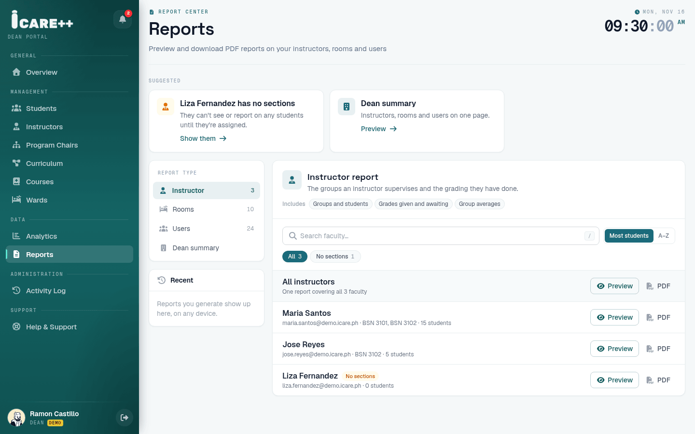

*Figure 16. The Reports page, with suggestions, the report types and the Recent list.*

| Report | Filters | Sorts | Whole-scope report |
|---|---|---|---|
| **Instructor** | **No sections** | **Most students**, **A–Z** | **All instructors** |
| **Rooms** | **Full**, **Has space**, **Inactive / maintenance** | **Fullest**, **Room no.** | **All rooms** |
| **Users** | **Never signed in**, **No sign-in 30d+**, and the **Role** list | **A–Z**, **Newest** | **All users** |
| **Dean summary** | none | none | The whole report |

Each report is on US Letter paper, with the iCARE++ letterhead, a running header and page numbers. It starts with tiles, then tables that put what needs a look first:

- **Instructor** reports show who has work awaiting grade (with how long the oldest has waited), and the groups each instructor supervises. The all-instructors report lists the instructors with the most awaiting grade first, and shades those without a group.
- **Rooms** reports show how many places are occupied, and shade full and inactive rooms.
- **Users** reports list the accounts that need a look first: those that never signed in, then those with no sign-in for over 30 days.
- The **Dean summary** shows the overall average, how many students are below 75%, the work awaiting grade and the oldest wait, and how many students are on no instructor's roster. It then gives averages by kind of work and by section, each instructor's workload and the rooms.

To make a report:

1. In the sidebar, select **Reports**.
2. Choose the report type.
3. Find the instructor, room or user with the search box, or choose the whole-scope report.
4. Select **Preview** to read it, or **Download PDF** to save it. See [Preview and download a report](common-tasks.md#preview-and-download-a-report).

**Result:** The report is added to **Recent**, which keeps your reports on any device. Select **Generate this PDF again** beside one to make it again with today's figures.

> [!NOTE]
> In the **Rooms** report, "Full" and "*n* of *c* occupied" come from room assignments, so they can differ from the patients on the **Wards** page.

## Approve or decline a grade change

Once an instructor saves a grade for a Patient Case or Return Demonstration, they need your approval to change it. Their request reaches you as a notification.

**Before you start**

- One of your instructors has sent a request. See [Ask to change a saved grade](instructor.md#ask-to-change-a-saved-grade) in the Instructor guide.

To answer a request:

1. In the sidebar, select the bell, or go to the **Notifications** page (see [See all notifications](common-tasks.md#see-all-notifications)). The request is titled "Grade change request" and reads "*instructor* wants to change *student*'s grade on "*case*". Reason: *reason*".

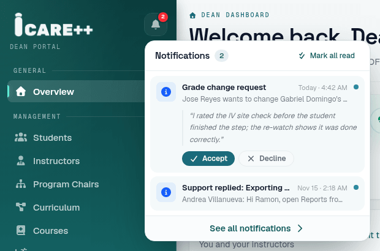

*Figure 17. A grade change request in the notifications popover, with the instructor's reason and Accept and Decline.*

2. Read the reason.
3. Select **Accept** or **Decline**. A confirmation box asks "Let *instructor* change *student*'s grade on "*case*"?" or "Decline *instructor*'s request to change *student*'s grade?".
4. Select OK in the box to go ahead, or Cancel to stop.

**Result:** The request reads "Accepted by *name*" or "Declined by *name*".

> [!NOTE]
> Requests appear only in your notifications. There is no list of pending requests and no link to the work. Each approval allows the instructor one more save of that grade.

**Who is notified:** The instructor gets "Grade change approved" ("… Open it in Review Submissions and click Edit.") or "Grade change declined".

**What happens next:** The instructor opens the work, changes the ratings and saves once. To change it again, they ask again.

## Activity Log

The **Activity Log** lists what you and your instructors have done, newest first. Entries can't be edited or deleted.

> [!NOTE]
> The page title says "Audit Trail". It is the same page (see [Names you will see on screen](README.md#names-you-will-see-on-screen)).

To find an action:

1. In the sidebar, select **Activity Log**.
2. Optional: In the **Search actions… (press Enter)** box, enter a word from the action and press **Enter**.
3. Optional: Narrow the list with the role list (**All Roles**, **Dean / Program Chair** or **Instructor**), the **All Entities** list, and the from and to dates.
4. Read the table: when it happened, who did it, the action, what it acted on, and the details.

Use **← Previous** and **Next →** to page through. **Export page as CSV** saves the rows on the current page.

## Settings

Your settings are on the **Dean Administration** page. To open it, select your name at the foot of the sidebar. It opens on the **Profile** tab, where you change your photo, name, email, password, Google sign-in, light or dark theme, and local caching. See [Open your settings](common-tasks.md#open-your-settings), [Change your email](common-tasks.md#change-your-email), [Change your password](common-tasks.md#change-your-password), [Connect or disconnect Google](common-tasks.md#connect-or-disconnect-google), [Choose light or dark](common-tasks.md#choose-light-or-dark) and [Save data on this device](common-tasks.md#save-data-on-this-device) in Common tasks.

> [!NOTE]
> The **Access Control**, **Data Privacy** and **Notifications** tabs are not yet available, and nothing you change there is saved. Only **Profile** works.
