# Instructor guide

This guide is for clinical instructors. It covers the Instructor portal on the web, where you
group your students, build and assign Patient Cases, Return Demonstrations, Quizzes and Case
Presentations, grade them, and follow your class. It also covers the Instructor's screens in the
iCARE++ app. For signing in, notifications, settings, analytics filters, AI summaries, reports
and Help & Support, which work the same for every web role, see
[Common tasks in the web portal](common-tasks.md). Some labels differ from screen to screen; the
README lists them under [Names you will see on screen](README.md#names-you-will-see-on-screen).

**In this guide**

- [What the Instructor does](#what-the-instructor-does)
- [Before you start](#before-you-start)
- [Overview](#overview)
- [Students and groups](#students-and-groups)
- [Courses](#courses)
- [Patient Cases](#patient-cases)
- [Return Demonstrations](#return-demonstrations)
- [Quizzes](#quizzes)
- [Case Presentations](#case-presentations)
- [Library](#library)
- [Wards](#wards)
- [Analytics](#analytics)
- [Reports](#reports)
- [Audit Trail](#audit-trail)
- [Notifications you receive](#notifications-you-receive)
- [The iCARE++ app for Instructors](#the-icare-app-for-instructors)

## What the Instructor does

The sidebar groups the Instructor portal's pages under small headings. This table follows the
sidebar from top to bottom.

| Sidebar section | Link | What you do there |
|---|---|---|
| General | **Overview** | See who needs a look, what is waiting for you to grade, what is coming up this week, and alerts from your students. |
| Teaching | **Courses** | Choose the sections you teach each course in, follow each student's progress, enter scores for work done outside iCARE++, and set the course's skills. |
| Teaching | **Students** | Find students, make and change groups, register late students, email the app link, and score students for Low performing. |
| Teaching | **Patient Cases** | Build a case around a ward patient, assign it with a date of performance, and grade each student's checklist. |
| Teaching | **Return Demonstrations** | Build a skill checklist with no patient, assign it, and grade it step by step. |
| Teaching | **Quizzes** | Create quizzes, write or generate questions, assign them with a deadline, read the results, and grade essay answers. |
| Teaching | **Library** | Publish study materials for each Taylor's skill to the student app, and read the skill checklists. |
| Clinical | **Case Presentations** | Have groups report a patient from hospital duty with slides, and grade each group on a rubric. |
| Clinical | **Wards** | Read the ward census and check patients in and out. |
| Data | **Analytics** | Follow class and group performance, the leaderboard and skill mastery. |
| Data | **Reports** | Preview and download PDF reports per section, student, group, Patient Case, Return Demonstration or Quiz. |
| Administration | **Audit Trail** | Read your own action history. |
| Support | **Help & Support** | Send a message to the iCARE++ team. |

Your settings open from your name at the foot of the sidebar, and notifications from the bell
beside the logo. See [Find your way around](common-tasks.md#find-your-way-around).

## Before you start

Your Dean or Program Chair sets you up:

- **Your account.** Your Dean or Program Chair creates it, and you get the email "Welcome to
  iCARE++ – Your Account Has Been Created" with a temporary password. Sign in at
  `https://www.i-care.dev` and set your own password. See
  [Sign in to the web portal for the first time](setup-1-getting-started.md#sign-in-to-the-web-portal-for-the-first-time).
- **A course.** Your Dean or Program Chair assigns you a course for a semester
  ([Add a course for a semester](dean.md#add-a-course-for-a-semester)). You get the notification
  "New course assignment".
- **Groups.** Your Dean or Program Chair gives you groups in a section
  ([Assign groups to an instructor](dean.md#assign-groups-to-an-instructor)). You can also make
  your own groups ([Create groups](#create-groups)).

You see only the students in the groups you supervise, or the whole section where you supervise
no group.

The Dean or Program Chair who created your account is the one who approves changes to grades you
have already saved ([Ask to change a saved grade](#ask-to-change-a-saved-grade)).

The iCARE++ app has a short Instructor view for following course requirements on your phone. See
[The iCARE++ app for Instructors](#the-icare-app-for-instructors).

## Overview

The **Overview** is the portal's home page. Its title greets you as Sir or Ma'am with your surname (or by your first name when no sex is
recorded), and the line
under it sums up your day, for example "2 students need a look, 3 submissions are waiting for
review." When nothing is pending it reads "Everyone is on track and nothing is waiting on you."

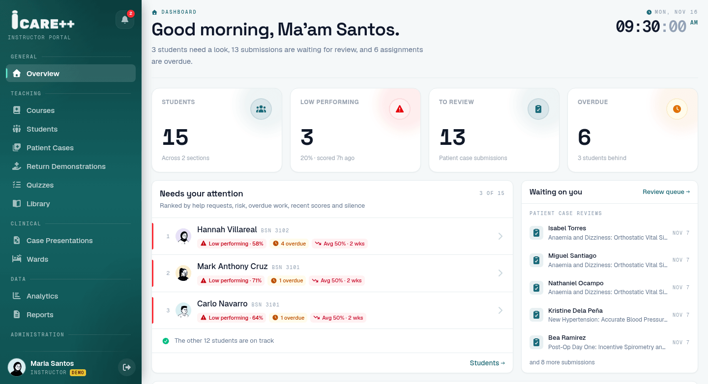

*Figure 1. The top of the Overview: four tiles, the Needs your attention list and the Waiting on you card.*

### Read the tiles

The four tiles across the top count your students and your work. Each tile is a link.

| Tile | What it counts | Opens |
|---|---|---|
| **Students** | Students on your roster, "Across N sections" | **Students** |
| **Low performing** | Students the nightly prediction flags as Low performing, with the share and when they were scored, or "Not scored yet" | **Students** |
| **To review** | Patient Case work students have submitted that you haven't graded, or "Queue is clear" | **Review Submissions** |
| **Overdue** | Patient Cases, Return Demonstrations and Quizzes whose date has passed without being completed or handed in, with "N students behind" | **Students** (the whole roster, not only the students behind) |

> [!NOTE]
> **To review** counts only work a student has submitted for review. Work you still have to
> grade may not appear there, so also look at the "N to grade" count on each card on the
> [Patient Cases](#patient-cases) page.

### Needs your attention

**Needs your attention** lists the students to look at first, "Ranked by help requests, risk,
overdue work, recent scores and silence". Each row shows why, with one or more chips:

- "Asked for help": the student asked for you during a Patient Case.
- "Low performing · N%": the nightly prediction flags the student.
- "N overdue": work whose date has passed.
- "Avg N% · 2 wks": the student's average over the last two weeks is under 60%.
- "Quiet N days" or "No activity yet": nothing from the student for a week or more.

Select a row to open the student's profile ([Read a student profile](#read-a-student-profile)).
**Students →** at the foot opens the **Students** page. When nobody needs a look, the list reads
"Everyone is on track".

### Waiting on you

The **Waiting on you** card has two parts:

- **Patient case reviews**: submitted work to grade, longest-waiting first. Select a row, or
  **Review queue →**, to open **Review Submissions** ([Grade a Patient Case](#grade-a-patient-case)).
  When empty it reads "Queue is clear — nothing to finalize."
- **Coming up this week**: what falls in the next 7 days. Patient Cases and Return Demonstrations
  read "performs in N days · N students not graded yet"; Quizzes read "due in N days · N students
  yet to hand in". When empty it reads "Nothing coming up in the next 7 days."

When both parts are empty, the card reads "That's everything for now".

### Section monitors and clinical alerts

Further down the **Overview**:

- **Section monitors** ("How each section is doing") show one card per section: the "Quiz
  average, last 2 weeks", the change against the two weeks before ("+N vs prior"), and counts of
  **Low performing**, **Overdue** and **Handed in**. **Open analytics →** opens
  [Analytics](#analytics).
- **Clinical alerts** lists open help requests (**Help**) and abnormal vital signs (**Vitals**)
  from your students. Select one to open the student's profile. When there are none it reads "No
  open clinical alerts".
- **Your recent activity** lists your own recent actions, for example "Assigned a patient case".

A student asks for help from the app while performing a Patient Case
([Ask your instructor for help](student.md#ask-your-instructor-for-help)). You also get the
notification "<student> needs assistance".

> [!NOTE]
> A help request stays on the Overview until the student cancels it in the app. You can't clear
> it from the portal. Once you've helped the student, ask them to tap "I no longer need help".

## Students and groups

The **Students** page holds everyone on your roster, course by course and section by section. It
opens with four tiles (**Total Students**, **Thriving**, **At Risk** and **Not in a group**),
the **iCARE++ mobile app** card with the download link, and a card for each of your courses.

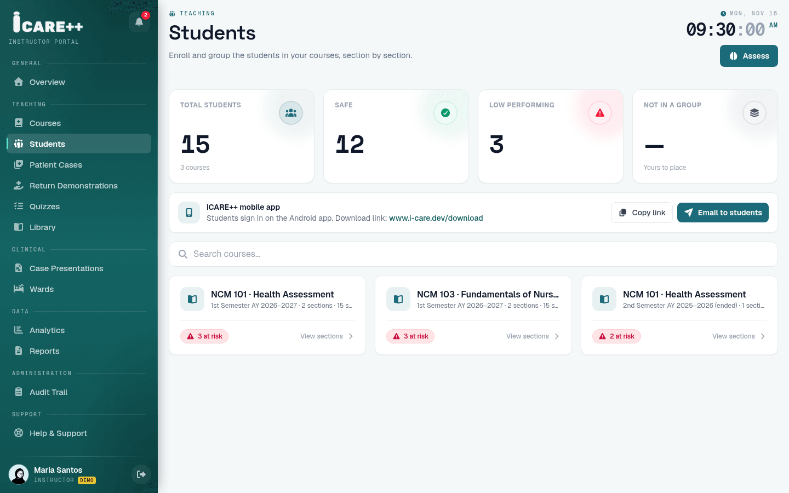

*Figure 2. The Students page, with a card for each course you teach.*

### Find a student

Open a student's profile to see their grades, finished work and skills.

**Before you start**

- Your Dean or Program Chair has assigned you a course. Until then the page reads "No courses
  yet".

To find a student:

1. In the sidebar, select **Students**. The **Students** page opens with a card per course.
2. Select a course card (**View sections**). The course's sections open.
3. Select a section card (**View roster**). The roster opens, with the students under a heading
   for each group.
4. Optional: In the search box, enter part of the student's name or email. To see only some
   students, choose **At risk** or **Thriving** in the filter list.
5. Select the student's row, or **View profile** at the end of the row. The student's profile
   opens.

**Result:** The profile opens. To go back, select **Back to Students**.

The **Status** column reads "At risk", "Thriving" or "Not scored yet". To go back up a level,
select **<course code> sections** or **All courses**.

### Create groups

Groups split a section into smaller teams. A Patient Case or Case Presentation can be given to a
whole group, and a Case Presentation is graded group by group.

**Before you start**

- The course has sections ([Choose the sections you teach](#choose-the-sections-you-teach)).

To split a section into groups at random:

1. In the sidebar, select **Students**, then select the course and the section.
2. Above the roster, select **Edit groups**. The **Groups** card opens above the list of students
   in no group.
3. Select **Create groups**, or **Regroup** if the section already has groups. A dialog opens and
   says how many students are split.
4. In the **Students per group** box, enter a number. The dialog shows how many groups that makes.
5. Select **Create N**, or **Regroup into N**.

**Result:** The message "Split N students into N groups" appears. The new groups are yours to
supervise. Regrouping reshuffles everyone; existing groups keep their names and extra groups are
removed.

To change groups one at a time, on the **Groups** card:

- **Add group** makes one more group with the next name, for example "Group C".
- **Rename** (the pencil) lets you type a new name. Press **Enter** to save it or **Esc** to
  cancel.
- **Delete** (the bin) asks "Delete <group>?". Select **Delete group**. Its students move to the
  **Not in a group** list.

If another group in the section isn't yours, regrouping is refused with "Another instructor has
groups in this section, so it can only be regrouped by your Dean or Program Chair". You can still
add, rename and delete your own groups.

**Who is notified:** Nobody is notified.

**What happens next:** Place students into the groups
([Move students between groups](#move-students-between-groups)).

### Move students between groups

Move a student from one of your groups to another, put a student in no group into a group, or
take a student out of a group.

**Before you start**

- You are on the section's **Edit groups** view ([Create groups](#create-groups)).

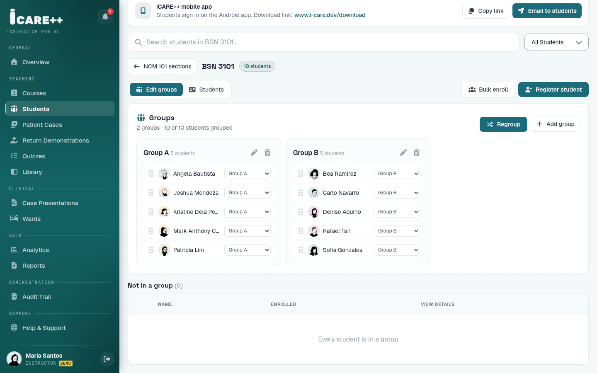

*Figure 3. The Edit groups view, with a card per group and the students in no group below.*

To move one student:

1. On the student's group card, open the list beside the student's name.
2. Choose **Move to <group>**, or **Remove from group**.

**Result:** The message "Moved <student> to <group>" appears.

To put several students in no group into a group:

1. In the **Not in a group** table, select a student's row. To add more, hold **Ctrl** (or **Cmd**
   on a Mac) and select more rows, or hold **Shift** to select a range. The bar above the table
   counts them.
2. Drag any of the selected rows onto a group card.

To take a student out of a group, you can also drag their name from a group card onto the **Not
in a group** table.

You can use only groups you supervise. Students in another instructor's group are not shown.

> [!NOTE]
> No reason is asked for, and nobody is notified, when you move a student.

### Register a late student or enroll a class list

Add a student who joins late, or a whole class list, straight into one of your groups. iCARE++
creates each account and emails the student their sign-in details.

**Before you start**

- You have at least one group in the section ([Create groups](#create-groups)).

> [!NOTE]
> **Register student** and **Bulk enroll** stay off until you have a group in that section. Their
> tooltip reads "Make a group in this section first; new students join one of your groups."

To register one student:

1. In the sidebar, select **Students**, then select the course and the section.
2. Select **Edit groups**, then **Register student**. The **Register a student** dialog opens.
3. In the **Full name** and **Email** boxes, enter the student's name and email address.
4. Optional: In the **Sex** list, choose **Female** or **Male**.
5. In the **Group** list, choose one of your groups.
6. Select **Register**. The dialog changes to "Student registered", with "Invitation sent to
   <email>."
7. Select **Done**, or **Register another** for the next student.

To enroll a class list:

1. In the section's **Edit groups** view, select **Bulk enroll**. The **Bulk enroll into
   <section>** dialog opens.
2. Do one or both of these:
   - Under **Import a CSV or Excel file**, drop the file onto the box or select **Choose file**.
     Under **File format**, **CSV template** and **Excel template** give you a file to fill in: a
     header row, then one student per row with first name, last name, email, and optionally sex
     and group. A group must be one of yours.
   - Select **Add a student by hand** and fill in the row's boxes.

> [!IMPORTANT]
> Selecting outside the **Bulk enroll** dialog closes it, and every row you added is lost. Use
> **Cancel** or the enroll button to leave it.

3. Look over the list under **Students**. Students with no group go under **Not in a group**, where
   you can drag them into one.
4. Select **Enroll N students**. The dialog closes and a card in the bottom-right corner shows each
   student as they are enrolled.

**Result:** Each student has an account, is in the section and the group you chose, and gets the
welcome email with a temporary password and a download button for the app.

> [!IMPORTANT]
> If the welcome email can't be sent, a temporary password appears once: in the **Register a
> student** dialog under "Temporary password, shown once", or on the student's row in the
> enrolling card. Copy it now and give it to the student. It won't be shown again.

**Who is notified:** Each student, by email: "Welcome to iCARE++ – Your Account Has Been
Created".

**What happens next:** The student installs the app and signs in
([Install the iCARE++ app](setup-1-getting-started.md#install-the-icare-app)).

### Email the app link

Send students the download link for the iCARE++ app, for example to those who haven't signed in
yet.

To email the app link:

1. In the sidebar, select **Students**. Optional: open a course or a section to send the link only
   to its students.
2. On the **iCARE++ mobile app** card, select **Email to students**. The **Email the app link**
   dialog opens.
3. Choose **Haven't signed in yet** or **Everyone**.
4. Select **Send to N students**.

**Result:** The message "Emailed the app link to <students>" appears. Each student gets their own
email with the link and how to install the app.

To copy the link instead, select **Copy link**. To send it to one student, open their profile and
select **Send app link**.

**Who is notified:** The students you chose, by email.

The app is for Android phones. There's no iPhone version yet.

### Score students for risk

Low performing is a prediction made every night from each student's record. Run it yourself when
you want fresh results, for example after a round of grading.

To score your students:

1. In the sidebar, select **Students**.
2. In the page header, select **Assess** (tooltip "Run ML Jobs — score your students for risk").
   The button shows a percentage while it works.

**Result:** The message "Scored N of your students (N low performing)." appears. The **At risk**
and **Thriving** labels on the Students page and the student profiles, and the Low performing
counts on the **Overview**, update. Your Dean or Program Chair sees the same results.

**Who is notified:** Nobody is notified.

A student is scored once they have started or completed some work. Your Dean or Program Chair can
run the same check for all their students ([Run the risk check](dean.md#run-the-risk-check)).

### Read a student profile

A student's profile brings together their grades, finished work, skills and the prediction for
how they are heading. You read it here; you don't grade from it.

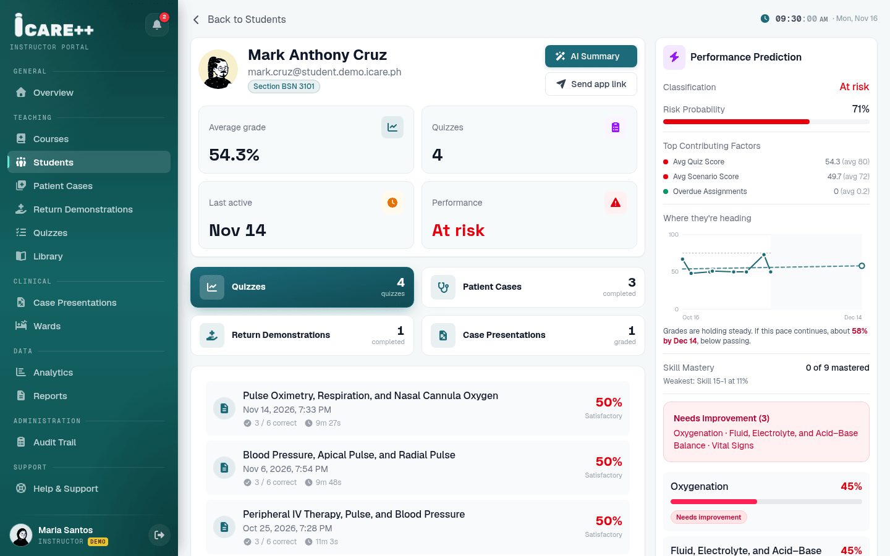

*Figure 4. A student profile, with the figures and tab tiles on the left and the Performance
Prediction card on the right.*

To read a student's profile, open it from the roster ([Find a student](#find-a-student)) or from
**Needs your attention** on the **Overview**. The profile shows:

- Four figures under the student's name: **Average grade**, **Quizzes**, **Last active** and
  **Performance**. **Performance** reads "Thriving", "At risk" or "Not scored yet".
- Four tiles that each open a list below them. The tile shows how many items the list holds:
  - **Quizzes**: every quiz the student took, with each try. The list opens first.
  - **Patient Cases**: the cases they have completed. Select **View** to read the graded
    checklist in a window. You can't change anything there.
  - **Return Demonstrations**: the same, for the ones they have completed.
  - **Case Presentations**: the presentations they belong to, with the status and the grade. Select
    one to open it.
- The **Performance Prediction** card. Its **Classification** reads "At risk" or "Thriving"
  (see [Names you will see on screen](README.md#names-you-will-see-on-screen)). It also shows the
  **Risk Probability** and the **Top Contributing Factors**. Under them are:
  - **Where they're heading**: a line of the student's recent quiz and Patient Case grades, with
    where it leads if the pace continues. It needs at least three graded items on different days.
  - **Skill Mastery**: how many skills the student has mastered.
  - The student's score for each skill area, with **Needs improvement** at the top when any is low.
  - **Skill mastery** by chapter, with the **Average mastery** over time. **Show all N chapters**
    opens the rest.

> [!NOTE]
> When a student isn't scored yet, the card says to "run it from Admin > Analytics": as an
> Instructor, use **Assess** on the Students page instead
> ([Score students for risk](#score-students-for-risk)). Skill area scores come from graded
> work.

To grade or change a Patient Case or Return Demonstration, use **Review** on its card
([Grade a Patient Case](#grade-a-patient-case)). The window opened by **View** says the same.

### Get an AI summary of a student

Ask the AI for a short written summary of one student's performance, with strengths, areas for
improvement and recommendations.

**Before you start**

- The student has allowed AI features in the app
  ([Turn AI features on or off](student.md#turn-ai-features-on-or-off)).

To get an AI summary of a student:

1. Open the student's profile ([Find a student](#find-a-student)).
2. In the profile header, select **AI Summary**. The **AI Performance Summary** dialog opens and
   shows short phrases, such as "Reviewing quiz scores…", while it writes.
3. Read the overview, then **Strengths**, **Areas for Improvement** and **Recommendations**.
4. Select **Close**.

**Result:** The footer reads "AI-generated <date and time> — review before acting on it." The
same summary is shown again if the student's data hasn't changed. If writing fails, select
**Retry**.

> [!NOTE]
> If the student hasn't allowed AI features, the dialog reads "This student hasn't turned on AI
> features in the app, so an AI summary isn't available." A student's records reach the AI only
> after that student says yes in the app.

For the AI Summary on **Analytics**, see [Get an AI Summary](common-tasks.md#get-an-ai-summary).

## Courses

The **Courses** page lists the courses your Dean or Program Chair assigned you, grouped by
semester. Ended semesters fold under **Past semesters**. Each course card shows its sections, its
students, how many have met every requirement, and the next thing to do, such as **Add your
sections**.

Select a course's code to open it. The course page has four tabs: **Criteria for Assessment**
(called **Criteria** on the course card; see
[Names you will see on screen](README.md#names-you-will-see-on-screen)), **Progress**, **Performance** and **Skills**.

### Choose the sections you teach

Pick the sections you teach a course in. Their students join your roster for that course: the
students of your groups there, or the whole section where you supervise no group.

**Before you start**

- Your Dean or Program Chair has created the sections. If none exist, the dialog reads "There are
  no sections to choose from yet. Ask your Dean or Program Chair to add them."

To choose the sections you teach:

1. In the sidebar, select **Courses**, then select the course.
2. In the page header, select **Sections**, or **Add sections** on the banner of a course with no
   sections. The **<course code> sections** dialog opens.
3. Select the box of each section you teach. Each row says "Your groups: …" or "No group of yours
   here, so the whole section joins your roster".
4. Select **Save sections**.

**Result:** The message "Sections saved" appears. If you clear a section, the dialog first warns
that its students leave the roster; their work and scores are kept.

After the semester ends, the sections can't change.

### See how the course grade is made

The **Criteria for Assessment** tab shows what makes up the course grade.

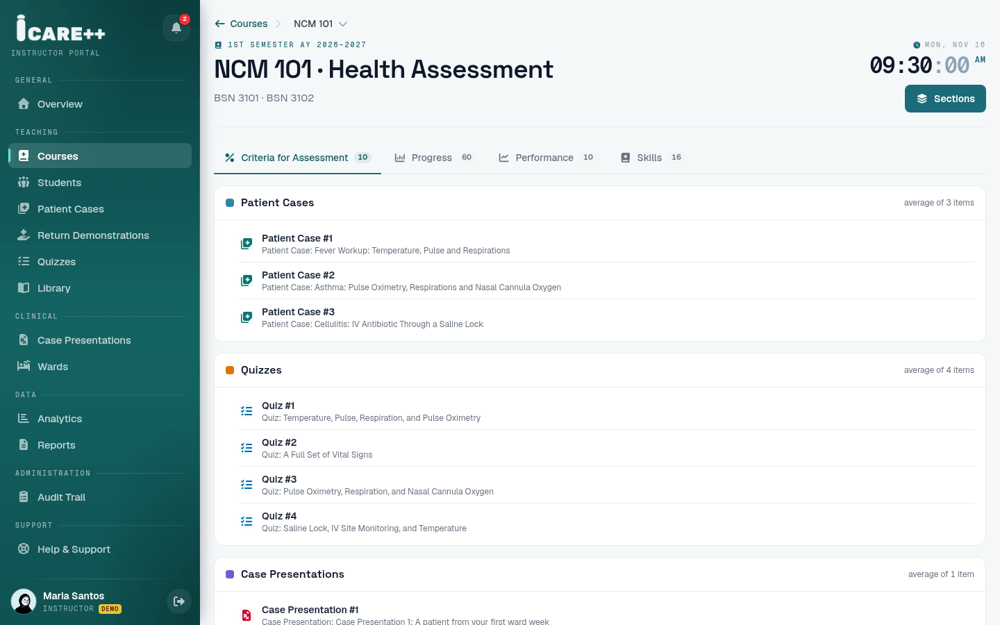

*Figure 5. The Criteria for Assessment tab, with the course's activities listed under each part.*

To see how the course grade is made, open the course and select **Criteria for Assessment**. The
tab has four parts: **Patient Cases**, **Quizzes**, **Case Presentations** and **Return
Demonstrations**. Each lists the activities you made for this course and reads "average of N
items".

The grade works like this:

- Each part's grade is the average of its items.
- The course grade is the average of every item, so every item counts the same and a part with
  more items counts for more.
- Work with no score yet is left out, so a grade reads as the grade so far.

> [!NOTE]
> This tab fills itself and can't be edited. An activity counts for a course only if you pick
> that course when you create it. The "Set up the checklist" links elsewhere open this tab, and
> the "set up its requirements checklist" in the "New course assignment" notification means the
> same: there is nothing to set up.

### Track progress

The **Progress** tab shows every student against every item of the course. It fills in on its own
as you grade work in iCARE++.

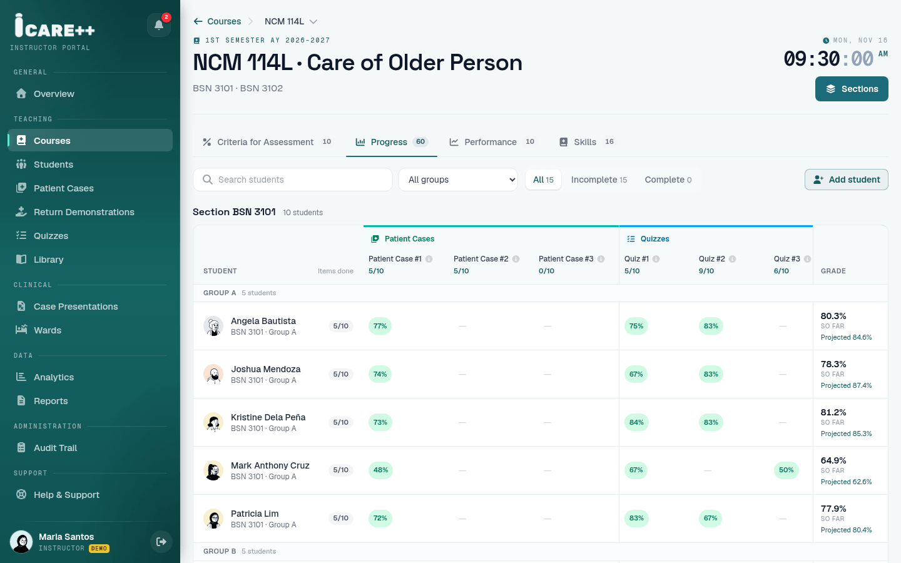

*Figure 6. The Progress grid for a course.*

To see a course's progress:

1. Open the course and select **Progress**. The grid shows students down the side, under their
   section and group, and the items across the top.
2. Optional: Use **Search students**, the **All groups** list, or **All**, **Incomplete** and
   **Complete** to narrow the grid.

A cell shows the student's best score on that item. The note under the grid says "Scores can't be
entered here.": to change a score, grade or regrade the work itself. Select a column header to see
a summary of that item.

### Add or remove a student

Add a student from outside your groups and sections to a course, or take one off its roster.

To add a student:

1. Open the course and select **Progress**.
2. Select **Add student**. The **Add a student to <course code>** dialog opens.
3. In the search box, enter at least two letters of the student's name or email.
4. Beside the student, select **Add**.

**Result:** The message "<student> added to <course code>" appears.

To remove a student, on the **Progress** tab select **Remove from this course** on the student's
row. The dialog asks "Remove <student>?" and explains that their work stays saved. Select
**Remove**. Adding them again brings their work back.

**Who is notified:** Nobody is notified.

### See grades

The **Performance** tab shows each student's course grade with a column for each part. Use the
search box and the **All groups** list to narrow it. **How the grade is computed** explains the
rule when you hold the pointer over it. If nothing has been made for this course yet, it reads
"Nothing to grade in this course yet".

### Set the course skills

The course's skill list is the set of Taylor's skills it covers. Patient Cases, Quizzes and the
Library use it. The list is shared with your Dean or Program Chair and every instructor teaching
the course.

To set the course skills:

1. Open the course and select **Skills**.
2. Select **Edit Skills**, or **Pick skills** if the list is empty. The **<course code> skills**
   dialog opens.
3. Select the box of each skill the course covers. To find skills, enter words in the **Search
   skills or chapters** box, or use **Selected only**. Each chapter has **Select all** and
   **Clear**.
4. Optional: Select **Detect with AI**. It ticks the skills the course covers and says "Ticked N
   skills the course covers. Review them before saving."
5. Select **Save skills**.

**Result:** The message "<course code> now covers N skills" appears.

**Who is notified:** Nobody is notified.

## Patient Cases

A Patient Case is built around a patient on the ward. You assign it to students with a date of
performance, the student performs it in front of you, and you grade them on the skill
checklists.

The **Patient Cases** page groups your cases by course, numbered "Patient Case #N". Each card
shows the case's chapters, its patient, how many students have it, and when it was created.

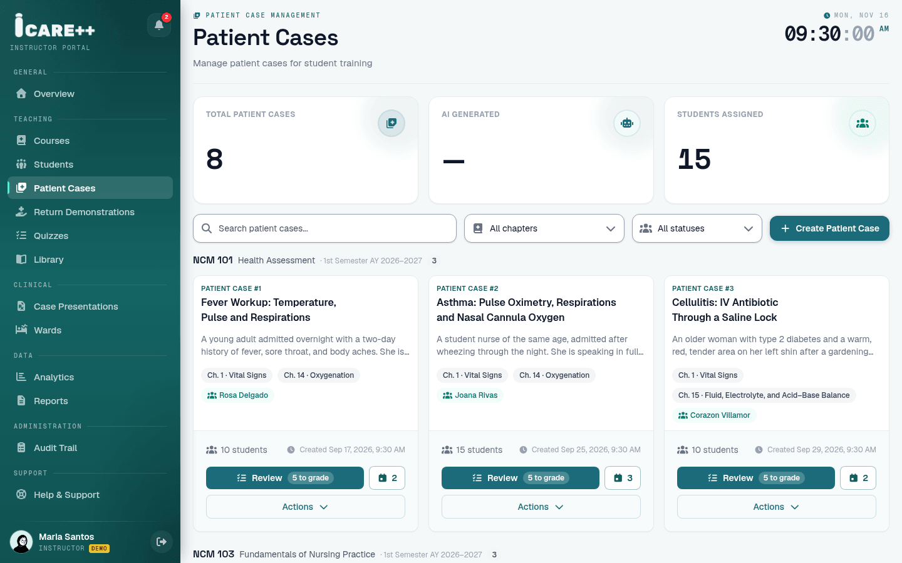

*Figure 7. The Patient Cases page, with a card for each case.*

At the foot of each card:

- **Review** with "N to grade", or **Review grades** once everything is graded, opens the grading
  page for that case.
- The calendar button, with the number of groups, opens who has the case and their dates.
- **Actions** opens **Edit**, **Assign** and **Delete**.

Use the search box and the chapter and status lists to filter the page. **Needs grading** shows
cases with work to grade.

### Create a Patient Case

**Before you start**

- Your course has a patient on the ward. If not, add one from this page, or ask your Dean or
  Program Chair.
- Your Dean or Program Chair has set up rooms on the ward.

To create a Patient Case:

1. In the sidebar, select **Patient Cases**, then select **Create Patient Case**. The **Create
   Patient Case** page opens.
2. Under **Patient**, choose the **Course** the case is for. The case counts toward that course's
   grade once you assign it.
3. Find the patient in the search box and select them. The card shows their age, sex, room,
   diagnosis and vital signs.

   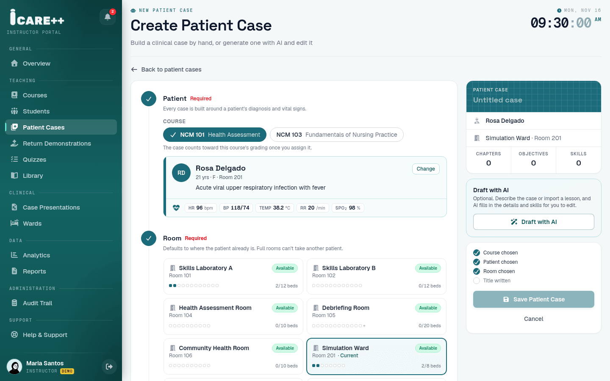

   *Figure 8. The Create Patient Case page with a course, a patient and a room chosen.*

   To add a new patient instead, select **Add patient**. The **Add Patient** dialog is the same
   one the Dean uses ([Admit a patient](dean.md#admit-a-patient)). To have the chart drafted for
   you, see [Draft a patient with AI](#draft-a-patient-with-ai).
4. Under **Room**, confirm the room. It defaults to where the patient already is. Full rooms can't
   take another patient.
5. Under **Case details**, enter the **Title**. Optional: enter a **Description** and the
   **Learning objectives**, one per line.
6. Under **Skills**, choose the Taylor's skills the student will perform:
   - Select **Detect skills** to pick them from your title and description, or
   - Search the list and select the skills yourself.

   To leave out a step students won't do here, select **View selected skills**, select the skill,
   and clear that step's box under **Checklist steps**. Students aren't graded on steps you
   leave out. Without any skills, the case gets a general starter task list.
7. Optional: Select **Draft with AI** in the side panel. Pick chapters, describe the case or
   select **Import Lesson**, then select **Generate**. The message "Draft filled in. Review the
   details and skills before saving." appears. Review everything the AI wrote.
8. Select **Save Patient Case**.

**Result:** The message "<title> saved" appears and the case is on the **Patient Cases** page,
with no students yet.

**Who is notified:** Nobody is notified.

**What happens next:** Set your own rating wording if you want it
([Edit a Patient Case before you assign it](#edit-a-patient-case-before-you-assign-it)), then
[Assign a Patient Case](#assign-a-patient-case).

### Edit a Patient Case before you assign it

Change a case's patient, room, details or skills, or set your own wording for the rating levels.
Editing is possible only until the case is assigned.

> [!IMPORTANT]
> Once a student has a Patient Case, it can't be edited. **Edit** is greyed out, and its tooltip
> tells you to make a new one. The rating wording can be set only through **Edit**, so set it
> before you assign the case.

To edit a Patient Case:

1. In the sidebar, select **Patient Cases**.
2. On the case's card, select **Actions**, then **Edit**. The case opens with "Change the
   patient, room, details and skills, then save."
3. Make your changes in the same steps as [Create a Patient Case](#create-a-patient-case).
4. Optional: Under **Rating wording**, enter your own words for each rating level. Blank levels
   use the book's wording. **Reset to Taylor's defaults** puts the book's wording back.
5. Select **Save changes**.

**Result:** The case is saved. Your rating wording shows in the key under the grading sheet.

### Assign a Patient Case

Give a Patient Case to students, with the date they will perform it.

**Before you start**

- The case is created and its wording is final.
- The students are on your roster for the case's course.

To assign a Patient Case:

1. In the sidebar, select **Patient Cases**.
2. On the case's card, select **Actions**, then **Assign**. The **Assign Patient Case** dialog
   opens.
3. Under **Assignment Settings**, set the **Date of performance**.
4. Under **Select Students**, choose who gets it. Students are listed by section and group:
   - Select a student's box to pick one student.
   - Select a group's box to pick everyone in that group.
   - Use **Select All**, or the search box, to find students.

   Students who already have the case show "Assigned". Students you added to the course by hand
   show "Added by you".

   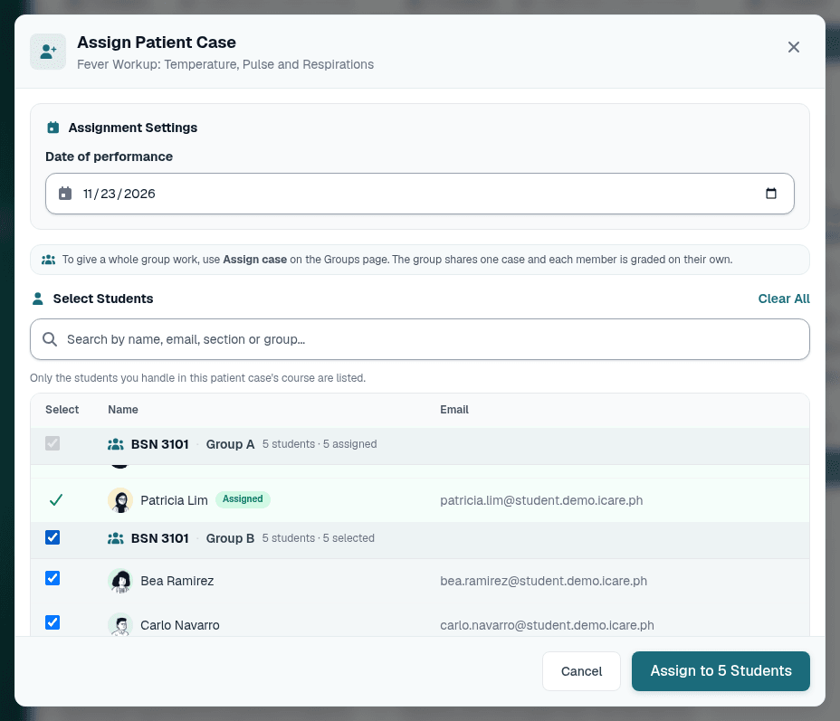

   *Figure 9. The Assign Patient Case dialog with a date set and a group selected.*

> [!NOTE]
> The dialog says to use "Assign case on the Groups page". There is no such button. To give a
> whole group the case, select the group's box in this dialog.

5. Select **Assign to N Students**.

**Result:** The message "Assigned to N students" appears. If everyone you picked already has the
case, the message reads "Nobody new to assign — everyone chosen already has this patient case".

**Who is notified:** Each student gets "New patient case assigned": "You have been assigned
"<title>". You'll perform it on <date>."

**What happens next:** The student finds the case in the app's Clinic tab and performs it in
front of you on the date ([Perform a Patient Case](student.md#perform-a-patient-case)). Then
[Grade a Patient Case](#grade-a-patient-case).

### Change the date of performance

Move a group's date of performance after the case is assigned.

To change the date of performance:

1. In the sidebar, select **Patient Cases**.
2. On the case's card, select the calendar button. The **Who has "<title>"** dialog opens, with
   each group's date and "N of N graded".
3. Under the group, choose the new date and select **Change date**.

**Result:** The message "<group> now performs on <date>" appears. Students already graded keep
their date.

**Who is notified:** Nobody is notified. Tell the students about the new date.

### Grade a Patient Case

You grade each student while they perform the case in front of you, rating every step of the
checklist.

**Before you start**

- The case is assigned, and the student is performing it or has performed it.

To grade a Patient Case:

1. In the sidebar, select **Patient Cases**. On the case's card, select **Review**. The grading
   page opens with the case's title. (From the **Overview**, **To review** and **Review queue →**
   open the same page for all your cases, titled **Review Submissions**.)
2. In the left panel, find the student. Enter a name in the **Search a student** box, or choose a group.
   Each group shows its average and how many are graded.
3. Select the student, then select their Patient Case. Use the **Assigned**, **Completed** and
   **All** tabs to filter the list.
4. Rate each row of the checklist: select the box under **Excellent**, **Satisfactory** or
   **Needs Practice**. To clear a rating, select the ticked box again. To rate every unrated row
   of a task at once, use the double tick in the task's header row.

   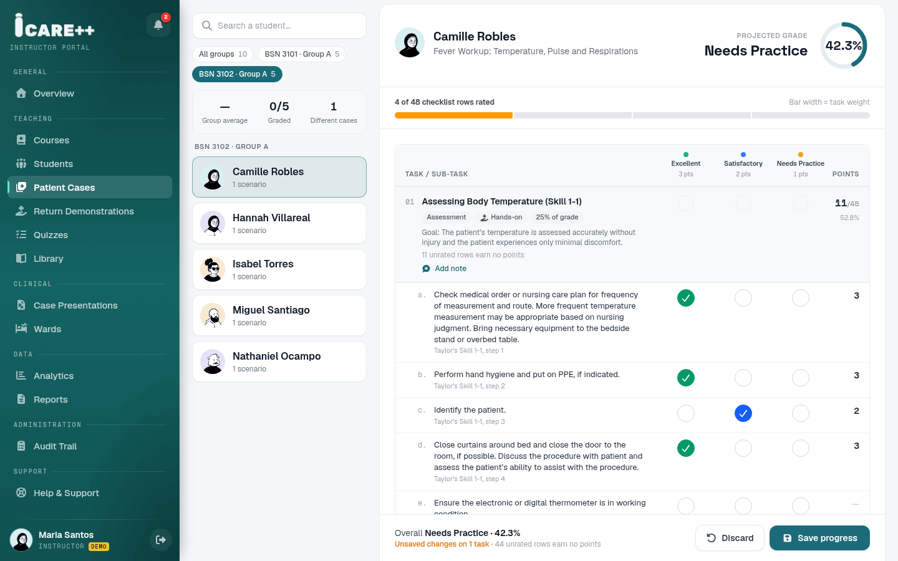

   *Figure 10. A student's checklist being rated, with the projected grade at the top.*

5. Optional: Select **Add note** on a task and enter what went well and what to work on.
6. Watch the top of the sheet: it shows the **Projected grade** and how many rows are rated.
7. To save before every row is rated, select **Save progress**, then **Save progress** in the
   dialog. The message "Progress saved — N rows left. It completes once every row is graded."
   appears.

> [!IMPORTANT]
> Once every row is rated, the button reads **Save & finish**. Saving it locks the grade. The
> page may say "you can edit it later", but changing a saved grade needs your Dean or Program
> Chair's approval, and each approval covers one more save
> ([Ask to change a saved grade](#ask-to-change-a-saved-grade)).

8. Select **Save & finish**. The dialog "Save this grade?" says the student will see it. Select
   **Save grade**.

**Result:** The message "Saved — <descriptor> (N%)" appears. The case moves to **Completed**, and
the footer reads "Saved as <descriptor> (N%) on <date>." The grade feeds the course's
**Progress** and **Performance** tabs, **Analytics** and your Dean's analytics. To drop changes
you haven't saved, select **Discard**.

**Who is notified:** Nobody is notified.

> [!NOTE]
> Students get no notification when you save a grade. They see it only when they open the case
> in the app ([See your grade](student.md#see-your-grade)), so tell them it's graded.

**How the grade is worked out**

| Rating | Points per row |
|---|---|
| Excellent | 3 |
| Satisfactory | 2 |
| Needs Practice | 1 |
| N/A | Not counted |

- The grading sheet has no N/A column. Only older ratings can read N/A. To leave a step out,
  clear it when you build the case ([Create a Patient Case](#create-a-patient-case)).
- An unrated row earns no points.
- The grade is the share of checklist points earned, scaled to 37.5–100%.
- The grade in words: 83% and up "Excellent", 50–82% "Satisfactory", under 50% "Needs Practice".

A student's profile shows a finished Patient Case but doesn't grade it
([Read a student profile](#read-a-student-profile)).

### Ask to change a saved grade

Change a grade you already saved with **Save & finish**. Your Dean or Program Chair has to agree
first.

**Before you start**

- The grade is saved and the case shows **Completed**.

To ask to change a saved grade:

1. Open the student's completed Patient Case on the grading page
   ([Grade a Patient Case](#grade-a-patient-case)). The footer reads "Changing a saved grade
   needs permission from your Dean or Program Chair."
2. Select **Request edit**. The **Ask to change this grade** dialog opens.

   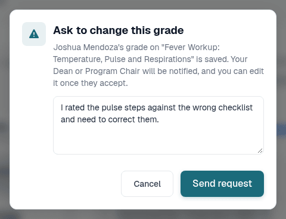

   *Figure 11. The Ask to change this grade dialog.*

3. In the box, enter why the grade needs to change.
4. Select **Send request**.

**Result:** The message "Request sent. You'll be notified when it's answered." appears. The
button reads **Awaiting approval**, and the footer reads "Change requested <time> and waiting for
an answer."

**Who is notified:** The Dean or Program Chair who created your account gets "Grade change
request", with your reason and **Accept** and **Decline**
([Approve or decline a grade change](dean.md#approve-or-decline-a-grade-change)). If there is no
one to ask, the request is refused with "There is no Dean or Program Chair to ask".

**What happens next:** You get "Grade change approved" or "Grade change declined". Then:

1. Open the same work again. The notification doesn't link to it.
2. If approved, the footer reads "<name> approved a change. Saving it uses the approval up."
   Select **Edit**, change the ratings or notes, and select **Save**.
3. If declined, the footer reads "<name> declined your last request. You can ask again."

Each approval covers one save. To change the grade again later, send a new request.

### Delete a Patient Case

To delete a Patient Case, on its card select **Actions**, then **Delete**. The dialog "Delete
patient case?" says it can't be undone and, if the case is assigned, that the students'
assignments are removed too. Select **Delete**. The message "Patient case deleted" appears.

## Return Demonstrations

A Return Demonstration is a skill checklist with no patient. Students demonstrate the skills to
you step by step, and you grade them on the same sheet as a Patient Case. In the app, students
find them under **Demos**.

The **Return Demonstrations** page groups them by course, numbered "Return Demonstration #N". Each
card shows its skills, "N assigned · N graded", **Review** or **Review grades**, the calendar
button and **Actions**. Only the instructor who made a Return Demonstration can assign, edit or
delete it.

### Create a Return Demonstration

**Before you start**

- You know which Taylor's skills to grade, or you have your own checklist as a PDF or Excel file.

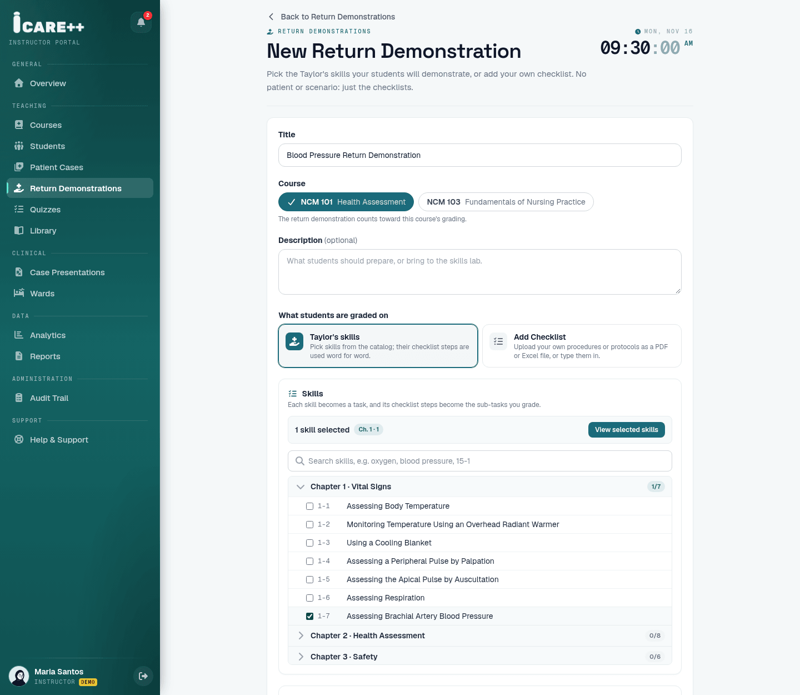

*Figure 12. The New Return Demonstration page with a course, a title and a skill chosen.*

To create a Return Demonstration:

1. In the sidebar, select **Return Demonstrations**, then select **New Return Demonstration**.
2. In the **Title** box, enter a title.
3. Under **Course**, choose the course it counts toward.
4. Optional: In the **Description** box, enter what students should prepare or bring.
5. Under **What students are graded on**, choose one:
   - **Taylor's skills**: pick skills from the catalog. Their checklist steps are used word for
     word, and you can leave out steps as for a Patient Case.
   - **Add Checklist**: select **Upload checklist** to read your own PDF or Excel file, or **Type
     it in**. Edit the steps with **Add step** and **Add section**, then select **Use this
     checklist**.
6. Optional: Under **Forms**, select the box of a form students fill in on the app before the
   skills, such as the **PhilPEN Form**. **View form** shows the form before you add it. To use
   your own PDF form, see [Upload your own form](#upload-your-own-form). Forms aren't scored; you
   read the answers while grading.
7. Select **Create**.

**Result:** The message "Return Demonstration created" appears.

> [!IMPORTANT]
> Once a student has a Return Demonstration, it can't be edited. Make a new one instead.

**Who is notified:** Nobody is notified.

If a scanned file has no readable steps, the page reads "No numbered steps were found in that
file. It may be a scanned image. Type the steps in below."

### Upload your own form

Add a PDF form of your own, such as a school assessment sheet. The students fill it in on the app
before the skills, like the **PhilPEN Form**. iCARE++ reads the form's fields from the PDF, and you
check them before you save.

**Before you start**

- You have the form as a PDF file.
- You are on the **New Return Demonstration** page, or editing one that no student has yet.

To upload a form:

1. Under **Forms**, select **Upload a form (PDF)** and choose the file. The button reads "Reading
   the form… this takes up to a minute".
2. The **Check the form** dialog opens. It says how many fields were found and how many are
   placed on the page. The form's pages are on the left, and its fields are on the right.
3. Check the **Form title** and the optional **Description**.
4. Under each section, read the fields. For each field you can:
   - change its label, or its type (**Short text**, **Long text**, **Number**, **Date**, **Blood
     pressure**, **One choice** or **Checkboxes**);
   - tick **Required**;
   - remove it, if students shouldn't fill it in;
   - edit the options of a choice, or select **+ Add option**.
5. Select **Add field** to add a field to a section, or **Add section** to add a part.
6. Optional: To show where an answer is written on the page, select **Place** on the field, then
   select the spot on the page. The button reads "Placed" once it has a spot. Answers without a
   place show in a list beside the form.
7. Select **Save form**.

**Result:** The message "Form saved and added" appears. The form joins the **Forms** list, ticked
for this Return Demonstration. Later Return Demonstrations can use it too.

> [!NOTE]
> If the PDF is a scan, the dialog warns that the fields were read from the picture and have no
> place on the page yet. Use **Place** on each field, or leave them: the answers still show in the
> list beside the form.

To remove a form you uploaded, select the bin beside it under **Forms**. The question "Remove
"<title>" from your forms?" appears. Confirm it, and the message "Form removed" appears. A form
that a Return Demonstration already uses can't be removed. You can't remove the built-in forms.

**Who is notified:** Nobody is notified.

### Assign and grade a Return Demonstration

Assigning and grading work as for Patient Cases.

To assign a Return Demonstration:

1. In the sidebar, select **Return Demonstrations**.
2. On its card, select **Actions**, then **Assign**. The **Assign Return Demonstration** dialog
   opens. It works like [Assign a Patient Case](#assign-a-patient-case).
3. Set the **Date of performance**, choose the students or groups, and select **Assign to N
   Students**.

**Result:** The message "Assigned to N students" appears.

**Who is notified:** Each student gets "New Return Demonstration": "You'll demonstrate "<title>"
on <date>. Open it to see the checklist."

The student prepares in the app and fills in any forms
([Get ready for a Return Demonstration](student.md#get-ready-for-a-return-demonstration)). To
move a group's date, use the calendar button as in
[Change the date of performance](#change-the-date-of-performance).

To grade a Return Demonstration:

1. On its card, select **Review**. The **Grade Return Demonstrations** page opens. It is the same
   page as **Review Submissions** for Patient Cases
   ([Names you will see on screen](README.md#names-you-will-see-on-screen)).
2. Find the student and select their Return Demonstration.
3. Rate each step under **Excellent**, **Satisfactory** or **Needs Practice**, and add notes, as in
   [Grade a Patient Case](#grade-a-patient-case).

> [!IMPORTANT]
> **Save & finish** locks the grade. The page may say "you can edit it later", but changing it
> needs your Dean or Program Chair's approval, and each approval covers one more save
> ([Ask to change a saved grade](#ask-to-change-a-saved-grade)).

4. Select **Save & finish**, then **Save grade**.

**Result:** The message "Saved — <descriptor> (N%)" appears.

**Who is notified:** Nobody is notified.

> [!NOTE]
> Students get no notification when you save a grade. They see it only when they open the Return
> Demonstration in the app ([See your ratings](student.md#see-your-ratings)), so tell them it's
> graded.

To change a saved grade, use **Request edit** as in
[Ask to change a saved grade](#ask-to-change-a-saved-grade). The "Grade change approved"
notification says "Open it in Review Submissions"; for a Return Demonstration, open it from the
**Return Demonstrations** page instead.

### Read the forms a student filled in

When a Return Demonstration has forms, the grading sheet shows a strip such as "1 form · all
handed in" or "0 of 1 handed in". Select **View submitted forms** to open the **Submitted forms**
dialog and read the student's answers written on the form's pages, and again as a list. A form
with more than one page shows every page. Forms aren't scored.

## Quizzes

The **Quizzes** page groups your quizzes by course, numbered "Quiz #N". The tiles count **Total
Quizzes**, **Published** (visible to students) and **Draft** (hidden from students). Each card
has a status line, such as "Not assigned yet · hidden from students" or "Assigned to N groups",
and when it was created. At the foot of each card:

- The main button is **Questions** until students have the quiz, and **Results** after that.
- Once the quiz is assigned, a button with the number of groups opens who has it and their
  deadlines.
- **Actions** opens **Assign**, **Questions** or **Results** (whichever the main button isn't),
  **Edit details** or **View**, and **Delete** (yours only). **Edit details** is greyed out once
  the quiz is assigned; its tooltip says to make a new quiz.

**The quiz grade.** A student's grade is the average of their graded tries. A quiz allows one try
unless you allow more. The pass mark is 75%. After the last try, the student gets a review quiz
of the questions they got wrong, which never changes the grade
([Take a quiz again or a review quiz](student.md#take-a-quiz-again-or-a-review-quiz)).

### Create a Quiz

To create a Quiz:

1. In the sidebar, select **Quizzes**, then select **New Quiz**. The **New Quiz** page opens.
2. Choose the **Course** the quiz is for.
3. Under **Details**, enter the **Title**. Optional: enter a **Description**.
4. Under **Rules**, optionally set a **Time limit** in minutes and seconds (for example 15:00),
   and set **Attempts allowed**.

> [!NOTE]
> The hint under **Rules** says "The best one counts", but the grade is the average of the
> student's graded tries.

5. Under **First questions**, choose one:
   - **Start empty**: add questions yourself after creating.
   - **From a lesson**: attach a lesson file. Choose **Multiple choice** or **Identification**
     and how many questions. The AI writes the questions and the scoring criteria.
   - **With AI**: choose a Taylor's skill under **Write from**, add an optional **Focus**, and
     choose how many questions.
6. Select **Create Quiz**, or **Create & Generate Quiz** when the AI writes the questions.

**Result:** The quiz editor opens. The message "Quiz created" appears, or "Quiz created — review
the N AI draft questions". The quiz is a draft, hidden from students.

> [!IMPORTANT]
> Once a quiz is assigned, its questions and details can't change. The editor then reads "View
> only". Make a new quiz to change it.

**Who is notified:** Nobody is notified.

**What happens next:** [Build the question bank](#build-the-question-bank), then
[Assign a Quiz](#assign-a-quiz).

### Build the question bank

The quiz editor holds the quiz's details, its scoring criteria and its questions. Questions the
AI wrote are drafts for you to review.

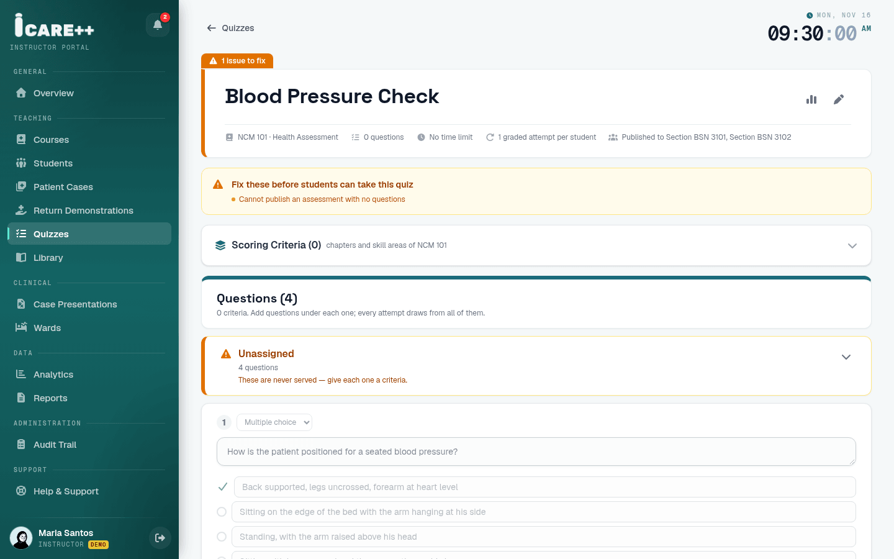

*Figure 13. The quiz editor, with the status line at the top, the list of what to fix, the
Scoring Criteria and the questions.*

To build the question bank:

1. In the sidebar, select **Quizzes**. On the quiz's card, select **Questions**, or **Actions**
   then **Questions** once the quiz is assigned. The editor opens.
2. Read the status line at the top. It reads "Ready for students", or "N issues to fix" with the
   list of what to fix before students can take the quiz.
3. Optional: To change the course, time limit, attempts or sections, select **Edit details**,
   make the change, and select **Save details**.
4. Under **Scoring Criteria**, review the chapters and skills the quiz covers. Each criterion sets
   the minimum number of its questions every attempt includes, and its weight.
5. Under each criterion, select **Add a question to <criterion>**. Choose **Multiple choice**,
   **True / False**, **Identification** or **Essay**, and write the question. For the first three,
   also write the answer. An **Essay** has no answer to write: the student types a reply and you
   grade it. A new essay is worth 10 **Points**; change it if you wish. Every other question is
   worth 1 point.
6. Edit or delete the AI's draft questions as needed. Questions with no criterion are never
   given to students, so give each one a criterion.
7. Select **Save quiz**.

**Result:** The message "Quiz saved" appears.

> [!NOTE]
> The AI writes only **Multiple choice** and **Identification** questions, so add essay questions
> yourself. A quiz with an essay can't be marked by iCARE++ alone: [Grade essays](#grade-essays)
> once students hand it in.

### Assign a Quiz

Assigning a quiz gives it to students with a deadline. It also makes the quiz visible to them.

**Before you start**

- The status line reads "Ready for students" ([Build the question bank](#build-the-question-bank)).

To assign a Quiz:

1. In the sidebar, select **Quizzes**.
2. On the quiz's card, select **Actions**, then **Assign**. The **Assign "<title>"** dialog
   opens.
3. Set the **Deadline**.
4. Optional: In **Attempts for these students**, enter how many graded tries these students get.
   Leave it blank to use the quiz's own number.

> [!NOTE]
> The hint here also says "their best one counts", but the grade is the average of the student's
> graded tries.

5. Under **Who gets it**, choose the sections, groups or students. Groups that already have the
   quiz are left out.
6. Select **Assign**.

**Result:** The message "Assigned to N students" appears, and the quiz becomes visible to them.
For a quiz that is already visible, the dialog also offers **Hide from students**.

**Who is notified:** Each newly assigned student gets "New quiz assigned": "You have been assigned
"<title>"." Students who weren't assigned but can see the quiz get "New quiz available" only when you
make a hidden quiz visible again.

**What happens next:** The student takes the quiz in the app's **Quizzes** tab
([Take a quiz](student.md#take-a-quiz)). It is graded automatically. You get no notification when
a student takes a quiz; see [Read the results](#read-the-results).

### Change a quiz deadline

To change a quiz deadline:

1. In the sidebar, select **Quizzes**.
2. On the quiz's card, select the button with the number of groups. The **Who has "<title>"**
   dialog opens.
3. Under the group, choose the new deadline and select **Change deadline**.

**Result:** The group's deadline changes.

**Who is notified:** Nobody is notified. Tell the students about the new deadline.

### Read the results

To read a quiz's results, on its card select **Results**. (Before the quiz is assigned, use
**Actions**, then **Results**.) The **Quiz Results** page shows the
tiles **Completed**, **Not Started** and **Average Score** ("Average of graded tries per
student"), then a table with each student's **Status**, **Grade**, **Attempts**, when they
**Submitted** and how long they took. Markers flag review quizzes and late tries. Filter by
status, section, group or score, or select **Export report** for a PDF.

### Grade essays

A quiz with **Essay** questions needs your grade for those answers. The other questions are marked
by iCARE++ when the student hands in. A try with an ungraded essay isn't counted in the student's
grade, mastery or prediction until you grade it. A blank essay is graded 0 straight away.

**Before you start**

- A student has handed in a try of the quiz that has an essay. On the **Quiz Results** page an
  amber banner reads "N tries have an essay to grade."

To grade essays:

1. On the **Quiz Results** page, select **Grade next** on the banner. Or, on a student's row under
   **Grade**, select **Grade essay** (or **Grade essays**). The **Grade essays** dialog opens with
   the student's name.
2. Read each try, newest first. A try with more than one shows "Try N". Its tag reads "To grade", or
   "Graded" with the score.
3. For each essay, read the question and what the student wrote. In the **Points** box, enter a
   whole number from 0 up to the essay's points, shown as "/ 10".
4. Optional: In the **Feedback for the student (optional)** box, write feedback.
5. Select **Save grades** at the foot of the try.

**Result:** The message "Graded. Score: N%" appears, and the student's grade on the results page
updates. If another essay in that try still has no points, the message reads "Grades saved. An essay
on this try is still ungraded." and the try stays **To grade**.

You can open the dialog again later, with **Essays** under a student's grade, to change a grade.
Unlike a Patient Case grade, you don't need approval to change it. Each **Save grades** scores the
try again.

**Who is notified:** The student gets "Your essay is graded", with their new score. You get no
notification when a student hands in an essay, and essays waiting don't show on the **Overview**.
Check the **Quiz Results** page of a quiz that has essays.

> [!NOTE]
> The editor and the results banner say an ungraded essay "counts as 0". That is true of the
> try's own score only. The student's **Grade** for the quiz leaves the try out until you grade
> it. In the app the student sees "Waiting for your instructor" instead of a score.

## Case Presentations

In a Case Presentation, each group reports a patient from their hospital duty. The group's leader
uploads the slides, and you grade the group as a whole on a rubric. In the app, students find
these under **Hospital Cases**.

The **Case Presentations** page has the tiles **Waiting for grading**, **Not handed in** and
**Graded**, and a card for each presentation with **Review** ("N to grade") or **Review grades**.

### Create and assign a Case Presentation

**Before you start**

- You have groups in the course's sections ([Create groups](#create-groups)).

To create and assign a Case Presentation:

1. In the sidebar, select **Case Presentations**, then select **New Case Presentation**.
2. Under **Course**, choose the course it is for.
3. Under **Details**, keep or change the **Title** (it starts as "Most Interesting Case"). Optional: enter
   **Instructions**.
4. Under **Due**, set the due date. Slides handed in late are still accepted, and marked Late.
5. Under **Groups and leaders**, select each group that reports, then choose its leader in the
   **Choose who reports** list. Only the leader uploads the slides. Students name the patient by initials only.

> [!NOTE]
> With no groups in the course, the page says to make them "in Students & Groups first". That is
> the **Students** page ([Create groups](#create-groups); see also
> [Names you will see on screen](README.md#names-you-will-see-on-screen)).

6. Select **Create & assign**.

**Result:** The message "Assigned to N groups" appears.

**Who is notified:** Every member of each group gets "New case presentation assigned". The leader's
message asks them to upload the slides; the others' says the leader will.

**What happens next:** The leader uploads the slides in the app
([Upload your group slides](student.md#upload-your-group-slides)). You get "Case presentation
handed in": "<group> (<section>) handed in their slides for "<title>"." Then
[Grade a group](#grade-a-group).

### Grade a group

**Before you start**

- The group has handed in its slides.

To grade a group:

1. In the sidebar, select **Case Presentations**. On the card, select **Review**. The
   presentation opens on the **Groups** tab.
2. Optional: Use **All**, **To grade**, **Graded** and **Waiting** to filter the groups.
3. Select the group (**Open & grade**). The slides open, with **Open** and **Download PDF**.
4. Under **Rubric**, rate each criterion **Excellent**, **Proficient**, **Developing** or
   **Beginning**. Optional: add remarks to each.

   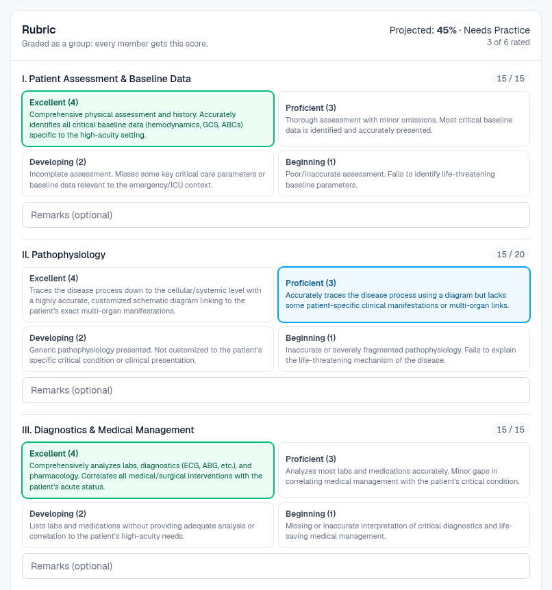

   *Figure 14. A group's rubric, partly rated.*

5. Optional: Select **Save** to keep a draft.

> [!IMPORTANT]
> A Case Presentation grade is final. Once you select **Finalize grade**, it can't be changed,
> and there is no request to change it.

6. When every criterion is rated, select **Finalize grade**.

**Result:** The message "Graded · N% for every member" appears. The group shows "Graded <time>.
The grade is final." Every member gets the same score.

**Who is notified:** Every member of the group gets "Case presentation graded".

**The rubric**

| Criterion | Weight |
|---|---|
| Patient Assessment & Baseline Data | 15 |
| Pathophysiology | 20 |
| Diagnostics & Medical Management | 15 |
| Nursing Care Plan (Prioritization & Interventions) | 30 |
| Presentation Skills & Use of AV Materials | 10 |
| Critical Thinking (Q&A/Defense) | 10 |

Each criterion earns its weight times the level (Excellent 4, Proficient 3, Developing 2,
Beginning 1) divided by 4, so all Excellent is 100%.

Students see the grade, each criterion's level and your remarks in the app
([Open the slides and see your grade](student.md#open-the-slides-and-see-your-grade)). To see
every file handed in, select the **Submitted files** tab.

### Edit a Case Presentation

To edit a Case Presentation, on its card select **Actions**, then **Edit**. The **Edit case
presentation** dialog changes the title, instructions, due date and **Group leaders**. Under
**Also give it to**, you can add groups; groups can be added, not removed. Select **Save**.

Deleting is possible only until a group has handed in.

## Library

The **Library** holds study materials for each Taylor's skill, which students open in the app's
**Library** tab. Switch between **Study materials** and **Skill checklists** at the top of the
page.

### Add and publish a study material

**Before you start**

- The course has sections, and the skill is on the course's skill list
  ([Set the course skills](#set-the-course-skills)).

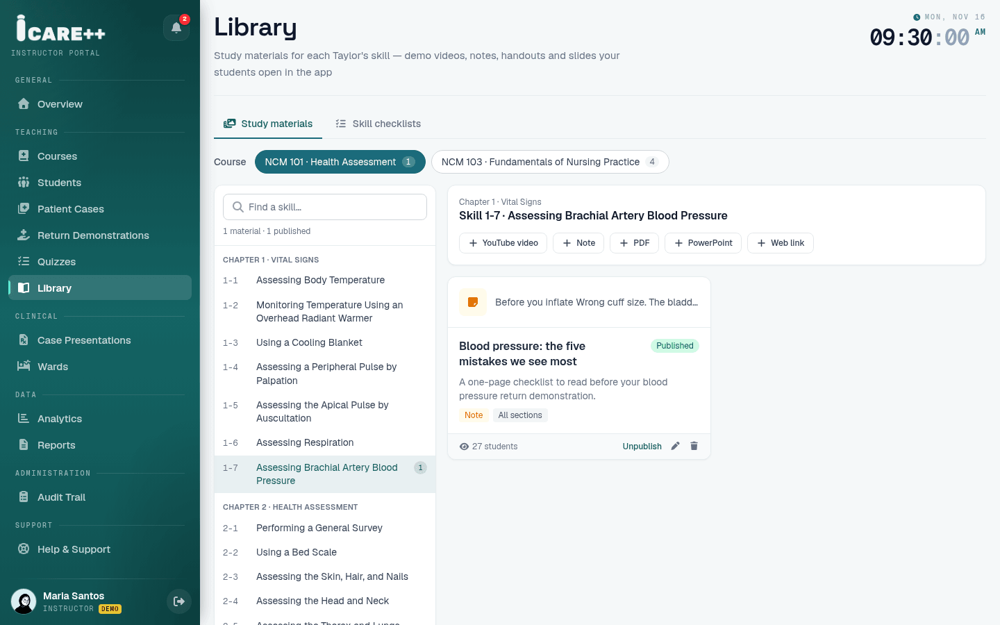

*Figure 15. The Library with a course chosen and one skill open.*

To add and publish a study material:

1. In the sidebar, select **Library**.
2. Next to **Course**, select the course.
3. In the **Find a skill** box, enter the skill's name or number, and open the skill.
4. Select the kind of material: **YouTube video**, **Note**, **PDF**, **PowerPoint** or **Web
   link**. The **Add material** dialog opens.
5. Fill in the link, note or file, then the **Title**. Optional: enter a **Description**.
6. Under **Sections**, choose the sections that see it.
7. Select **Publish**, or **Save draft** to keep it hidden.

**Result:** The message "Published to students" appears, or "Saved as a draft".

**Who is notified:** Students in the chosen sections get "New study <video, note, handout,
presentation or link> in the Library".

**What happens next:** Students open it in the app
([Open study materials](student.md#open-study-materials)). On a material's card, use
**Unpublish** to hide it again, or edit or delete it.

### Publish a suggested video

Some skills come with **Suggested demo videos**, "Curated for this skill — students see them only
once you publish". To publish one, open the skill and select **Publish to <course code>** under
the video. The video is then a published material like any other.

### Use the skill checklists

Select **Skill checklists** at the top of the **Library** to read every Taylor's skill checklist,
word for word. They are for instructors and are not shown to students.

## Wards

The **Wards** page shows the ward's patients room by room. Its title is **Ward Management**, and
the browser tab says "Monitoring"
([Names you will see on screen](README.md#names-you-will-see-on-screen)). Your Dean or Program
Chair sets up the rooms and the floor plan.

### Read the ward census

To read the ward census:

1. In the sidebar, select **Wards**.
2. Read the tiles: **Total Patients**, **Critical Vitals**, **Stable** and **Lab Results
   Available**.
3. Choose **Room Layout** to see the floor plan, or **Card Layout** to see a card per room.
4. Select a room to see its patients, with their diagnosis and vital signs.

To add a patient to the ward, select **Admit Patient**. The dialog is the same as the Dean's
([Admit a patient](dean.md#admit-a-patient)). To have the chart drafted for you, see
[Draft a patient with AI](#draft-a-patient-with-ai).

### Draft a patient with AI

In the **Add Patient** dialog, the AI can write a simulated patient's chart from a condition.
The dialog opens from **Admit Patient** on the **Wards** page, and from **Add patient** when you
[create a Patient Case](#create-a-patient-case).

**Before you start**

- You know the condition you want the case to be about, such as pneumonia.

To draft a patient with AI:

1. Open the **Add Patient** dialog.
2. Under **Condition**, open the list and choose a common condition. To use any other illness,
   choose **Other (type a condition)…** and type it in the box that appears, for example
   "Leptospirosis".
3. Optional: Enter a name, age or sex yourself. The AI keeps what you typed and drafts the rest.
4. Select **Fill with AI**. The button reads "Filling…" while it writes.
5. Read every field: the name, age, sex, diagnosis, vital signs and labs. Change what is wrong.
   The labs can't be edited here; to change them, select **Fill with AI** again.
6. Choose the **Course**, the **Room** and the **Admission Date**. The AI doesn't set these.
7. Select **Admit Patient**.

**Result:** The message "Patient created successfully" appears, and the patient can be used for a
Patient Case. After step 4, the line under the **Condition** list reads "Filled by AI for
"<condition>". Check every field before admitting."

> [!NOTE]
> Choosing a common condition from the list fills the diagnosis, vital signs and labs at once,
> without the AI. **Fill with AI** then adds a name, age and sex that fit it. If the AI can't
> write the chart, a red message appears under the list and the standard values of a listed
> condition stay, so you can still admit the patient. Only the condition and a made-up age and
> sex are sent to the AI, never a student's record. The patient is simulated. Check what the AI
> wrote before you use it.

**Who is notified:** Nobody is notified.

### Check a patient in or out

To check a patient out, in the room's list select **Check out patient** on their row. The dialog
**Check Out Patient** says their bed will be freed and the record moves to Discharged. Select
**Check Out**. The message "<patient> checked out" appears.

To check a patient back in, select **Check in patient** on their row. In the **Check In Patient**
dialog, choose a **Room** and select **Check In**. The admission date restarts at check-in. The
message "<patient> checked in" appears.

## Analytics

The **Analytics** page follows how your students are doing.

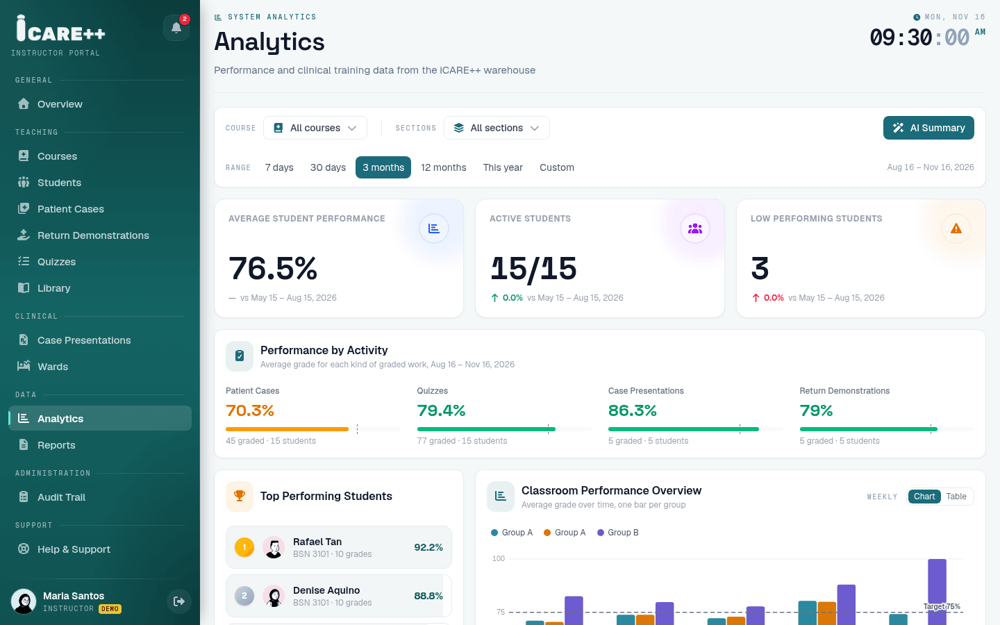

*Figure 16. The Analytics page.*

It shows:

- Tiles for **Average Student Performance**, **Active Students** and **Low Performing Students**.
- **Performance by Activity**, the average for each kind of work.
- **Top Performing Students**. **View full leaderboard →** opens the **Student Leaderboard**,
  every student ranked by their average grade.
- **Classroom Performance Overview**, **Performance per Skill Area** and **Skill Mastery**, which lists your students' weakest skills first.

To narrow the figures by course, section or date range, see
[Filter the figures](common-tasks.md#filter-the-figures). For a written summary, select **AI
Summary**; see [Get an AI Summary](common-tasks.md#get-an-ai-summary).

If **Performance per Skill Area** says to "record them from each student's profile", there is no
such control: skill area scores come from graded work.

## Reports

The **Reports** page (labelled "Report Center") makes PDF reports. The report types are:

| Type | What it includes |
|---|---|
| Section | The whole section, per group, or per student (averages, course grades, quizzes and skill areas) |
| Patient Case | The whole class, per student, or per group with a column for each member |
| Return Demonstration | The checklist steps with the grade beside each, per student, or per group with a column for each member |
| Quiz | How the whole class did, per student with every question and the answer given, or per group with a column for each member |

Every report is on US Letter paper, with the iCARE++ letterhead, a running header and page
numbers, and opens with tiles of its main figures. A Student report adds a "Needs attention" line
and groups the student's work by course. Section and Group reports list the students with the
lowest averages first, and mark those below the 75% pass mark. In a Section report, the Low
performing column is a prediction, not a grade.

To preview and download a report, see
[Preview and download a report](common-tasks.md#preview-and-download-a-report).

## Audit Trail

The **Audit Trail** page lists every action you have taken in the portal: "Your activity history —
every action you've taken, logged and unremovable". The label above the title reads "Activity
Log". Filter it with **All Actions**, **Alerts**, **Patient Cases**, **Reports**, **Reviews**,
**Logins** and **Logouts**. You can't change or delete entries.

## Notifications you receive

Notifications arrive in the bell and as a message in the corner of the page. To read them, see
[Read new notifications](common-tasks.md#read-new-notifications) and
[See all notifications](common-tasks.md#see-all-notifications).

| Title | When it comes | What to do |
|---|---|---|
| "New course assignment" | Your Dean or Program Chair assigned you a course | [Choose the sections you teach](#choose-the-sections-you-teach). The grading is automatic ([See how the course grade is made](#see-how-the-course-grade-is-made)). |
| "<student> needs assistance" | A student asked for help during a Patient Case | Go to the student. See [Section monitors and clinical alerts](#section-monitors-and-clinical-alerts). |
| "Case presentation handed in" | A group's leader uploaded the slides | [Grade a group](#grade-a-group) |
| "Grade change approved" | Your Dean or Program Chair accepted your request | Change the grade ([Ask to change a saved grade](#ask-to-change-a-saved-grade)) |
| "Grade change declined" | Your Dean or Program Chair declined your request | Nothing, or ask again with a fuller reason |
| "Support replied: <subject>" | The iCARE++ team answered your Help & Support message | Read the full reply in your email |
| "Support request resolved: <subject>" | The iCARE++ team closed your Help & Support message | Nothing, or send a new message if it still isn't fixed |
| Announcements | An Admin sent an announcement | Read it |

You also may see alerts about abnormal vital signs. You get no notification when a student takes a
quiz or performs a Patient Case.

> [!NOTE]
> Notifications don't open the item they are about. Open it from its own page. For "Grade change
> approved", go to **Patient Cases**, select **Review** on the case, open the student's work, and
> select **Edit**.

## The iCARE++ app for Instructors

The iCARE++ app has a short Instructor view for following your students' course requirements on
your phone. Install the app and sign in with your portal email and password
([Install the iCARE++ app](setup-1-getting-started.md#install-the-icare-app) and
[Sign in to the app for the first time](setup-1-getting-started.md#sign-in-to-the-app-for-the-first-time)).
The app header reads "INSTRUCTOR", and the tab bar has three tabs: **Courses**, **Students** and
**Me**.

The app is a separate sign-in from the web portal. You can be signed in on one phone and one
browser at the same time.

> [!NOTE]
> Grading, creating and assigning are on the web only. Where the app says "Add them on the web
> portal" about requirements, that is out of date: a course's requirements now fill themselves
> from the work you make for it.

### Courses tab

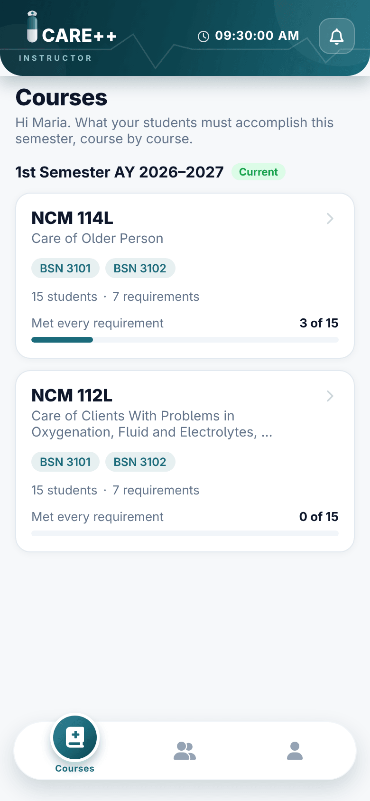

*Figure 17. The Courses tab in the app, with a card for each course.*

The **Courses** tab opens first. It lists your courses for the semester, each with its sections,
students, number of requirements, and how many students have met every requirement. Tap a course
to open it. Its **Checklist** view lists the requirements, and its **Students** view lists the
students.

### Students tab

The **Students** tab lists "This semester's requirements across your courses, the furthest behind
first." Use **Search by name or group** to find a student, and tap a student to see their
requirements and their skill mastery.

### Mark a requirement done

Mark an item done when a student met it some other way, such as a quiz taken on paper. Items
normally tick themselves from graded work.

To mark a requirement done:

1. Open the course's **Checklist**, or a student from the **Students** tab.
2. Beside the item, tap **Mark done**. The **Mark as done** sheet opens.
3. In the **Why it is done** box, enter the reason.
4. Tap **Mark done**.

**Result:** The item counts as met for that student.

To take a mark away, tap **Unmark**. The alert "Remove your mark?" says the item goes back to
counting graded work only. Tap **Remove**.

On the web there is no mark: the course's Progress tab fills in only from graded work
([Track progress](#track-progress)).

### Me tab

The **Me** tab holds:

- **Account**: your name, details and password.
- **Notifications**: course assignments and alerts.
- **Open the web portal**: opens your courses in the browser, to grade Patient Cases and do the
  rest of your work.
- **Appearance**: **System**, **Light** or **Dark**.
- **Help & Support**, **Terms of Use** and **Privacy Policy**.
- **Logout**, which asks "Are you sure you want to logout?". Tap **Logout**.
