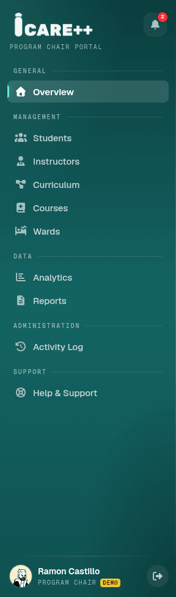
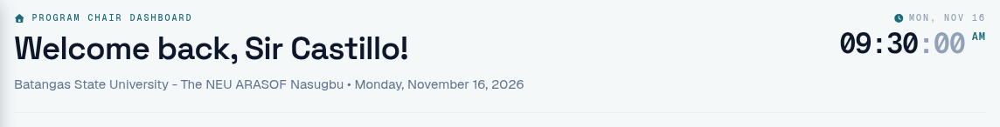

# Program Chair guide

This guide is for Program Chairs. A Program Chair runs their own part of a nursing program under a Dean, with the Dean's own tools. You use the Dean portal, so almost everything works exactly as the [Dean guide](dean.md) describes. This guide lists only what is different, then links to the Dean guide for every task you share.

In this guide:

- [How the Program Chair role differs](#how-the-program-chair-role-differs)
- [Your account](#your-account)
- [What you see](#what-you-see)
- [What you cannot do](#what-you-cannot-do)
- [Whose records you see](#whose-records-you-see)
- [Tasks you share with the Dean](#tasks-you-share-with-the-dean)

## How the Program Chair role differs

- You have every page of the Dean portal except **Program Chairs**.
- You keep your own instructors, students, sections, groups, courses, semesters, rooms and patients. Your Dean doesn't see them, and you don't see your Dean's.
- The curriculum is the exception. If you belong to a Dean, you work on your Dean's curriculum, and choosing which one is in use changes it for both of you.
- Your instructors send their grade change requests to you, not to your Dean.
- Some labels say "Program Chair" where a Dean's say "Dean". See [What you see](#what-you-see).

## Your account

Your Dean creates your account on their **Program Chairs** page, or an Admin creates it on **Users**. Either way:

- The account belongs to that Dean.
- It takes that Dean's institution.
- You get the email "Welcome to iCARE++ – Your Account Has Been Created", with a sign-in link and a temporary password that you change the first time you sign in.

Signing in, your first password, Google sign-in, **Remember me**, resetting a forgotten password, notifications, your settings and Help & Support work as for every web portal user. See [Sign in to the web portal for the first time](setup-1-getting-started.md#sign-in-to-the-web-portal-for-the-first-time) and [Common tasks in the web portal](common-tasks.md).

When you start, your portal is empty apart from your Dean's curriculum: you see nothing else your Dean has set up. Begin with [Set up a new term](dean.md#set-up-a-new-term).

## What you see

The portal is titled "Program Chair Portal", and the **Program Chairs** link is missing under **Management**.

*Figure 1. The sidebar of the Program Chair Portal, with no Program Chairs link under Management.*

The **Overview** greets you by your title and surname, or by your first name when no sex is recorded on your account.

*Figure 2. The Overview header, labelled Program Chair Dashboard, with the greeting.*

These labels differ from a Dean's:

| Where | A Dean sees | You see |
|---|---|---|
| Sidebar, under the logo | "Dean Portal" | "Program Chair Portal" |
| Profile pill, and the role tag in the top bar on a phone | "Dean" | "Program Chair" |
| **Overview** header label | "Dean Dashboard" | "Program Chair Dashboard" |
| **Overview** greeting | "Welcome back, Dean *Surname*!" | "Welcome back, Sir *Surname*!" or "Welcome back, Ma'am *Surname*!", or your first name |
| Under **Needs Your Attention** | "Things only a dean can fix" | "Things only a program chair can fix" |
| **Recent Activity** when empty | "Dean and instructor actions are logged here as they happen." | "Program Chair and instructor actions are logged here as they happen." |
| Settings page title | "Dean Administration" | "Program Chair Administration" |
| **Reports**: the summary report, and the **Role** list of the **Users** report | "Dean summary", "Dean" | "Program Chair summary", "Program Chair" |
| Welcome email to the instructors you add | "Your dean has created…" | "Your program chair has created…" |

> [!NOTE]
> The card at the top of your settings page reads "iCARE++ · Dean". It is still your own Program Chair account.

## What you cannot do

- **Manage Program Chairs.** You have no **Program Chairs** page. If you open its address, you go back to the **Overview**.
- **Change your own role or Dean.** Only an Admin can change these.

> [!NOTE]
> To change your account's role or the Dean it belongs to, ask an Admin through [Help & Support](common-tasks.md#send-a-message-to-the-icare-team).

You can still change your own photo, name, email and password in your settings. See [Open your settings](common-tasks.md#open-your-settings).

## Whose records you see

Each Dean and each Program Chair sees only their own instructors, students, sections, rooms, patients, courses, semesters, Patient Cases, Quizzes and Library materials. A Program Chair who belongs to a Dean shares that Dean's curriculum.

- Your Dean sees only your counts: how many instructors and students you have, on their **Program Chairs** page.
- Grade change requests from your instructors come to you. See [Approve or decline a grade change](dean.md#approve-or-decline-a-grade-change).
- **Analytics** and **Reports** cover only your own people and rooms.
- If you try to use a section or group that isn't yours, you see "That section belongs to another Dean or Program Chair" or "Some groups belong to another Dean or Program Chair".
- Only an Admin can move your instructors or students to someone else.

> [!NOTE]
> You and your Dean don't see each other's instructors, students, wards or courses. If you need to share people, ask an Admin to move them.

## Tasks you share with the Dean

Every other task is the same as for a Dean. Follow the Dean guide:

- Start a term: [Set up a new term](dean.md#set-up-a-new-term)
- Students:
  - [Register one student](dean.md#register-one-student)
  - [Enroll a class list](dean.md#enroll-a-class-list)
  - [Make groups and give each an instructor](dean.md#make-groups-and-give-each-an-instructor)
  - [Email the app link to students](dean.md#email-the-app-link-to-students)
  - [Run the risk check](dean.md#run-the-risk-check)
- Instructors:
  - [Add an instructor](dean.md#add-an-instructor)
  - [Assign groups to an instructor](dean.md#assign-groups-to-an-instructor)
  - [Delete an instructor account](dean.md#delete-an-instructor-account)
- Courses: [Add a course for a semester](dean.md#add-a-course-for-a-semester)
- Wards: [Admit a patient](dean.md#admit-a-patient)
- Grades: [Approve or decline a grade change](dean.md#approve-or-decline-a-grade-change)
- Your settings: [Settings](dean.md#settings)

The rest of the Dean guide also applies to you: the [Overview](dean.md#overview), [Students](dean.md#students), [Instructors](dean.md#instructors), [Curriculum](dean.md#curriculum), [Courses](dean.md#courses), [Wards](dean.md#wards), [Analytics](dean.md#analytics), [Reports](dean.md#reports) and the [Activity Log](dean.md#activity-log). Skip only its [Program Chairs](dean.md#program-chairs) section.
