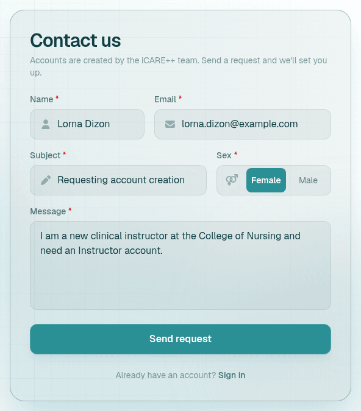
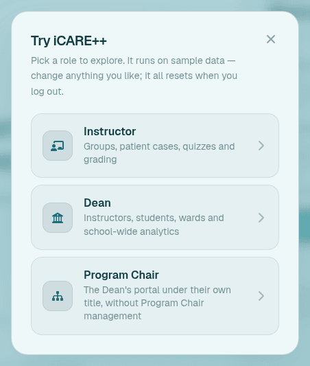
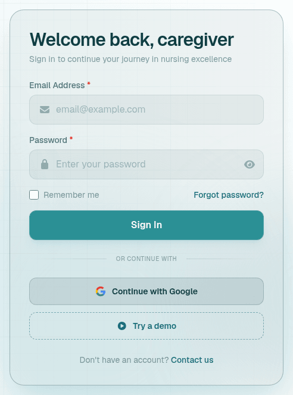
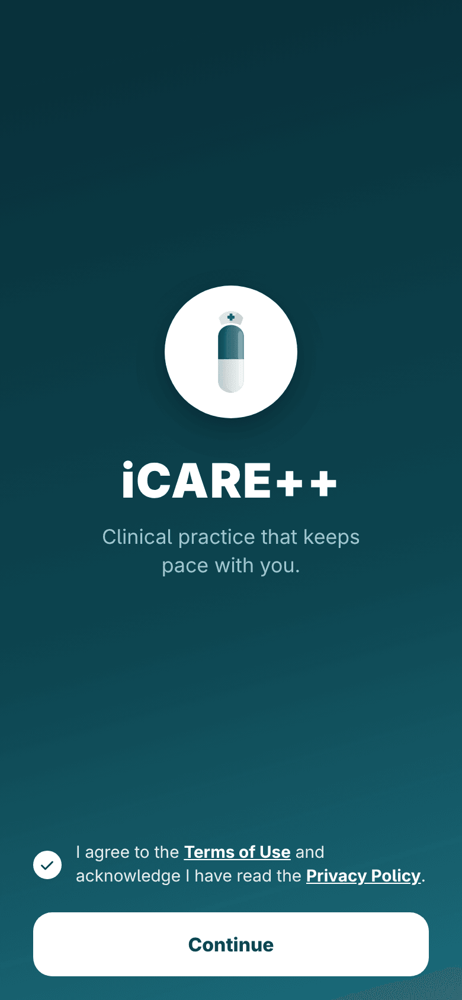
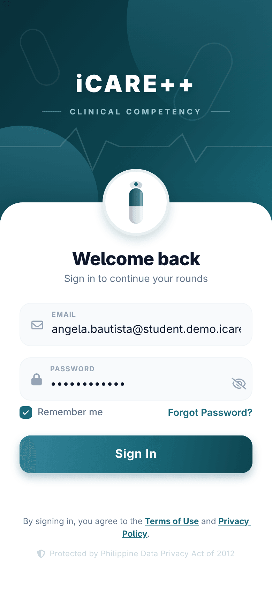
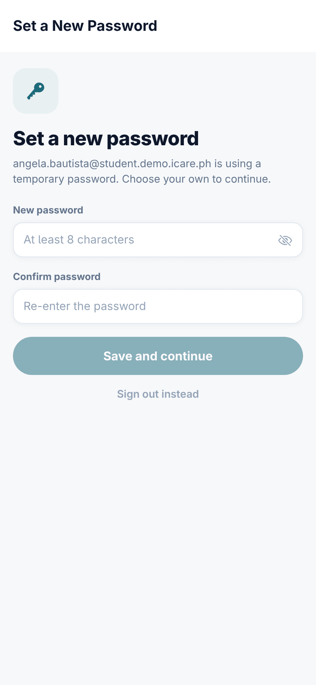
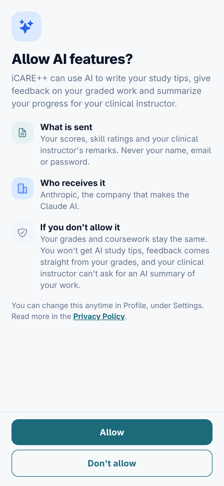

# Getting started with iCARE++

This guide is for everyone who uses iCARE++: Admins, Deans, Program Chairs, Instructors and
Students. It explains how you get an account, how to sign in the first time, and how to install
the iCARE++ app. Staff sign in to the web portal at `https://www.i-care.dev`. Students use the
iCARE++ app on an Android phone. Instructors use the web portal, and can also use the app for
their course checklists.

In this guide:

- [Get an account](#get-an-account)
- [Try iCARE++ without an account](#try-icare-without-an-account)
- [Sign in to the web portal for the first time](#sign-in-to-the-web-portal-for-the-first-time)
- [Install the iCARE++ app](#install-the-icare-app)
- [Sign in to the app for the first time](#sign-in-to-the-app-for-the-first-time)
- [Next steps](#next-steps)

## Get an account

Nobody signs themselves up. Someone with the right role creates your account, and iCARE++ emails
you a temporary password.

### Who creates your account

| Your role | Who creates your account | Where they do it |
|---|---|---|
| Admin | Another Admin | Admin portal, **Users** ([Create an account](admin.md#create-an-account)). The first Admin on a new installation is set up by the technical team ([Setting up and running iCARE++](setup-2-technical.md)). |
| Dean | An Admin | Admin portal, **Users** ([Create an account](admin.md#create-an-account)) |
| Program Chair | Your Dean, or an Admin | Dean portal, **Program Chairs** ([Add a Program Chair](dean.md#add-a-program-chair)), or the Admin portal ([Set up a Program Chair](admin.md#set-up-a-program-chair)) |
| Instructor | A Dean, a Program Chair or an Admin | Dean portal, **Instructors** ([Add an instructor](dean.md#add-an-instructor)), or the Admin portal |
| Student | An Instructor, a Dean, a Program Chair or an Admin | Instructor portal, **Students** ([Instructor guide](instructor.md)); Dean portal, **Students** ([Register one student](dean.md#register-one-student), [Enroll a class list](dean.md#enroll-a-class-list)); or the Admin portal |

If you are a Student, you don't need to ask for an account. Your instructor or your Dean creates
it when they enroll your class.

### Ask the iCARE++ team for an account

If you are staff and nobody has made an account for you yet, send a request to the iCARE++ team
from the sign-in page.

To ask for an account:

1. Go to `https://www.i-care.dev/login`.
2. Under the sign-in form, next to "Don't have an account?", select **Contact us**. The
   **Contact us** page opens. It says "Accounts are created by the iCARE++ team. Send a request
   and we'll set you up."

   

   *Figure 1. The Contact us form, filled in by a new instructor who needs an account.*

3. In the **Name** box, enter your full name.
4. In the **Email** box, enter the email address your account should use.
5. Optional: In the **Subject** box, change the subject. It starts as "Requesting account
   creation".
6. Under **Sex**, select **Female** or **Male**.
7. In the **Message** box, say who you are, your school, and the role you need.
8. Select **Send request**.

**Result:** The page shows "Request sent", and a confirmation goes to your email. If a request
from that address is already waiting, the page shows "Request already submitted" instead. There
you can select **Send follow-up** to add to your request.

**Who is notified:** Every Admin gets the notification "Account request from" followed by your
name. The iCARE++ team's inboxes also get the request by email.

**What happens next:** An Admin accepts the request and creates your account
([Create an account](admin.md#create-an-account)), and your welcome email arrives. If the request
is declined, you get the email "About your iCARE++ account request".

### Your welcome email

When your account is created, you get an email with the subject "Welcome to iCARE++ – Your
Account Has Been Created". It holds your temporary password under "Your temporary password:".

- **Admins, Deans, Program Chairs and Instructors** get a **Sign in to iCARE++** button. It
  opens the web portal's sign-in page. Go on to
  [Sign in to the web portal for the first time](#sign-in-to-the-web-portal-for-the-first-time).
- **Students** get a **Download the iCARE++ app** button. Open the email on your Android phone and
  go on to [Install the iCARE++ app](#install-the-icare-app).

> [!IMPORTANT]
> You must change the temporary password the first time you sign in. If the welcome email never
> came, the person who made your account may have been shown your temporary password, once, on
> their screen. Ask them for it, or ask them to check that your email address is right.

## Try iCARE++ without an account

The demo lets you look around the Instructor, Dean and Program Chair portals with made-up people
and records. Nothing you do in the demo reaches real records.

To start a demo:

1. Go to `https://www.i-care.dev/login`.
2. Select **Try a demo**. The **Try iCARE++** dialog opens.

   

   *Figure 2. The Try iCARE++ dialog, with a choice for each portal.*

3. Select **Instructor**, **Dean** or **Program Chair**.

**Result:** That portal opens with sample records. An amber **Demo** tag shows beside your role at
the foot of the sidebar.

When you finish, select **Log out**. Everything you changed is reset.

> [!NOTE]
> Some actions don't work in the demo, such as changing your password or sending a message to the
> iCARE++ team. They show "Not available in the demo". There is no Admin or Student demo. The
> Program Chair demo uses the Dean's sample records, as a real Program Chair works with their
> Dean's ([Program Chair guide](program-chair.md)).

## Sign in to the web portal for the first time

Admins, Deans, Program Chairs and Instructors sign in to the web portal. Students can't: a
student who signs in there is told to use the iCARE++ mobile app instead.

To sign in for the first time:

1. Go to `https://www.i-care.dev/login`, or select **Sign in to iCARE++** in your welcome email.
   The sign-in page opens, headed "Welcome back, caregiver".

   

   *Figure 3. The web portal's sign-in form.*

2. In the **Email Address** box, enter the email address your welcome email was sent to.
3. In the **Password** box, enter the temporary password from the email. Optional: select
   **Show password** (the eye) to see what you typed.
4. Select **Sign In**.

**Result:** The **Update your password** page opens. Go on to
[Set your own password](#set-your-own-password).

If you see "Invalid email or password", check the address and the password against your welcome
email and try again.

### Set your own password

The first time you sign in with a temporary password, iCARE++ asks you to choose your own.

To set your own password:

1. On the **Update your password** page, in the **New Password** box, enter a new password of at
   least 8 characters.
2. In the **Confirm New Password** box, enter it again.
3. Optional: Select **Show password** to see both passwords.
4. Select **Set Password**.

**Result:** Your portal opens on its first page. If the passwords are too short or don't match,
the page says "Password must be at least 8 characters" or "Passwords do not match".

The first time you open a portal page on a computer, a card at the bottom of the screen asks
"Save data on this device?". See [Save data on this device](common-tasks.md#save-data-on-this-device)
before you answer.

**What happens next:** Learn your way around the portal in
[Common tasks in the web portal](common-tasks.md#find-your-way-around), then read the guide for
your role.

### Sign in with Google

You can sign in with a Google account instead of a password. This works in the web portal only,
not in the app.

To sign in with Google:

1. On the sign-in page, under "or continue with", select **Continue with Google**.
2. Choose your Google account.

**Result:** If the Google account uses the same email address as your iCARE++ account, you are
signed in. The first time, iCARE++ links that Google account to yours and skips the
**Update your password** page. Your temporary password still works for email sign-in, so change
it in your settings ([Change your password](common-tasks.md#change-your-password)).

If your Google account uses a different address, sign in with your email and password first,
then connect Google in your settings
([Connect or disconnect Google](common-tasks.md#connect-or-disconnect-google)).

If no iCARE++ account uses that Google account, the **Contact us** page opens with your Google
address filled in. Send it to ask for an account
([Ask the iCARE++ team for an account](#ask-the-icare-team-for-an-account)).

## Install the iCARE++ app

Students need the app. Instructors can use it for their course checklists, but they grade and
assign work in the web portal. Deans, Program Chairs and Admins work in the web portal only.

### Install it on an Android phone

The app is installed from the iCARE++ download link, not from an app store.

To install the app:

1. On your Android phone, open your welcome email and tap **Download the iCARE++ app**. You can
   also open `www.i-care.dev/download` in the phone's browser. The app file downloads.
2. Open the downloaded file.
3. If the phone asks, allow installs from your browser, then install the app. These are the
   phone's own screens, and their wording differs from phone to phone.
4. Open **iCARE++** from your phone's apps.

**Result:** The app opens on its welcome screen. Go on to
[Sign in to the app for the first time](#sign-in-to-the-app-for-the-first-time).

> [!NOTE]
> If the phone asks, allow installs from your browser; otherwise the app can't be installed. If
> the link says "The app isn't available yet", ask your instructor for the link.

### iPhones

> [!NOTE]
> There's no iPhone version yet.

If you open the download link on an iPhone, it says "iCARE++ is for Android phones". Ask your
instructor what to do in the meantime. If your school has turned on a browser version of the app,
the link opens that instead, and your instructor will tell you how to sign in.

### Keep the app up to date

Most updates download by themselves while you use the app. When one is ready, the app shows the
alert "Update ready": "A new version of iCARE++ has downloaded. Restart now to use it, or it will
load the next time you open the app. Restarting closes anything you haven't saved."

- Tap **Later** to finish what you are doing. The update loads the next time you open the app.
- Tap **Restart** to use the update now. Save your work first.

Some updates are a new download instead. When your instructor or Dean tells you there is one,
download and install it from the same link, `www.i-care.dev/download`, as in
[Install it on an Android phone](#install-it-on-an-android-phone).

## Sign in to the app for the first time

These steps are for Students and Instructors. You do them once, on each new phone.

### Accept the terms

The first time you open the app on a phone, it asks you to agree to its terms.

To accept the terms:

1. On the welcome screen, optional: tap **Terms of Use** or **Privacy Policy** to read them.
2. Tap the box beside "I agree to the Terms of Use and acknowledge I have read the Privacy
   Policy." The box is ticked.

   

   *Figure 4. The welcome screen with the agreement box ticked.*

3. Tap **Continue**. It stays off until the box is ticked.

**Result:** The **Notifications and camera** sheet rises from the bottom of the screen.

### Choose notifications and camera

The sheet asks which phone features iCARE++ may use. It says "Turn on what you want iCARE++ to
use. You can change these anytime in Profile, under Settings."

To choose notifications and camera:

1. Optional: Turn on **Notifications** so the phone can alert you to new work and messages. The
   phone asks for permission; allow it.
2. Optional: Turn on **Camera** so you can take a profile picture, or a photo for a support
   request. Choosing a photo from your gallery needs no permission.
3. Tap **Continue to sign in**.

**Result:** The sign-in screen opens.

If you refused a permission before, the app shows an alert such as "Turn on notifications in
Settings", with **Not now** and **Open Settings**. Tap **Open Settings** to allow it in the
phone's settings.

Students can change these later in **Profile**, under **Settings**. Instructors can change them
in the **Me** tab, under **Settings**.

### Sign in

To sign in to the app:

1. On the sign-in screen, headed "Welcome back", in the **Email** box, enter your email address.
2. In the **Password** box, enter your password. The first time, this is the temporary password
   from your welcome email. Optional: tap the eye to see what you typed.
3. Leave **Remember me** ticked to stay signed in. If you untick it, closing the app signs you
   out.

   

   *Figure 5. The app's sign-in screen, with Remember me ticked.*

4. Tap **Sign In**.

**Result:** The first time, the **Set a New Password** screen opens. After that, Students land on
the **Home** tab and Instructors on the **Courses** tab.

If you see "Invalid email or password", check the address and the password and try again. If you
have forgotten your password, tap **Forgot Password?** and follow the steps. They work like the
web portal's ([Reset a forgotten password](common-tasks.md#reset-a-forgotten-password)).

> [!NOTE]
> The app is for Students and Instructors. A Dean, Program Chair or Admin who signs in to the app
> sees "Use the web portal", with **Open the web portal** and **Sign out**.

Your account can be signed in on one phone at a time. Signing in on another phone signs out the
first one. The web portal is a separate sign-in, so it isn't affected.

### Set a new password

The first time you sign in with a temporary password, the app asks you to choose your own. If you
already set your own password in the web portal, the app doesn't ask again.

To set a new password:

1. On the **Set a New Password** screen, in the **New password** box, enter a password of at
   least 8 characters.
2. In the **Confirm password** box, enter it again.

   

   *Figure 6. The Set a new password screen, which appears after the first sign-in.*

3. Tap **Save and continue**.

**Result:** Students see the AI question next ([Answer the AI question](#answer-the-ai-question)).
Instructors land on the **Courses** tab.

If you don't want to set it now, tap **Sign out instead**. The alert "Sign out" says "You will
need to set a new password next time you sign in." Tap **Sign out** to leave, or **Cancel** to
stay.

### Answer the AI question

Students are asked once whether iCARE++ may use AI with their records. Instructors aren't asked.
The screen, shown in Figure 7, is titled "Allow AI features?" and says "iCARE++ can use AI to write your study tips,
give feedback on your graded work and summarize your progress for your clinical instructor."

It also says:

- **What is sent:** "Your scores, skill ratings and your clinical instructor's remarks. Never
  your name, email or password."
- **Who receives it:** "Anthropic, the company that makes the Claude AI."
- **If you don't allow it:** "Your grades and coursework stay the same. You won't get AI study
  tips, feedback comes straight from your grades, and your clinical instructor can't ask for an AI
  summary of your work."

*Figure 7. The Allow AI features? screen, shown once after a student's first sign-in.*

To answer the AI question:

1. Read what is sent, who receives it, and what changes if you say no.
2. Tap **Allow** or **Don't allow**.

**Result:** The **Home** tab opens. If your answer can't be saved, the alert "Not saved" appears;
try again when you are online. If you close the app without answering, it asks again the next
time you open it.

> [!NOTE]
> Your grades stay the same either way. You can change your answer later in **Profile**, under
> **Settings** ([Turn AI features on or off](student.md#turn-ai-features-on-or-off)). Turning AI
> features off later deletes the study tips and feedback saved for you.

## Next steps

- Admins: [Admin guide](admin.md)
- Deans: [Dean guide](dean.md), starting with [Set up a new term](dean.md#set-up-a-new-term)
- Program Chairs: [Program Chair guide](program-chair.md), then the [Dean guide](dean.md)
- Instructors: [Instructor guide](instructor.md)
- Students: [Student guide](student.md)
- Admins, Deans, Program Chairs and Instructors: [Common tasks in the web portal](common-tasks.md)
- The technical team: [Setting up and running iCARE++](setup-2-technical.md)
- What the names on screen mean: [Names you will see on screen](README.md#names-you-will-see-on-screen)
