# Student guide

This guide is for nursing students. You use iCARE++ through the iCARE++ app on an Android phone: you perform Patient Cases and Return Demonstrations while your instructor watches, hand in your group's Case Presentation slides, take Quizzes, and study from the Library. The app also has its own sign-in, notifications, settings and Help & Support, so those are covered here too. There's no iPhone version yet. To install the app and sign in for the first time, see [Install the iCARE++ app](setup-1-getting-started.md#install-the-icare-app) and [Sign in to the app for the first time](setup-1-getting-started.md#sign-in-to-the-app-for-the-first-time).

Some things have more than one name on screen. [Names you will see on screen](README.md#names-you-will-see-on-screen) lists them.

**In this guide**

- [Find your way around the app](#find-your-way-around-the-app)
- [Home](#home)
- [Patient Cases in the Clinic tab](#patient-cases-in-the-clinic-tab)
- [Return Demonstrations](#return-demonstrations)
- [Case Presentations](#case-presentations)
- [Quizzes](#quizzes)
- [Library](#library)
- [Performance](#performance)
- [Notifications](#notifications)
- [Profile and settings](#profile-and-settings)
- [Help and Support](#help-and-support)
- [Signing in and out](#signing-in-and-out)

## Find your way around the app

The app has a tab bar along the bottom of the screen and an app header across the top.

The tab bar has five tabs. The selected tab's icon sits in a teal circle with its name under it; the other tabs show only a grey icon.

| Tab (left to right) | Icon | What it's for |
|---|---|---|
| **Library** | open book | Study materials for each skill, and your recommendations and study tips |
| **Clinic** | hospital | The ward's floor plan, the Patient Cases you still have to perform, your graded Patient Cases, and your Case Presentations |
| **Home** | house | What's next and how you're doing. The app opens on this tab. |
| **Quizzes** | clipboard with a question mark | Quizzes to take, your results and flashcards |
| **Demos** | hand holding a medical cross | Return Demonstrations. The screen is titled **Return Demos**. |

The app header is the dark teal band at the top of every tab. It shows the iCARE++ logo and "CLINICAL COMPANION" on the left, and two buttons on the right:

- **Notifications** (the bell) opens your notifications. A red number on the bell counts the unread ones; above 9 it reads "9+".
- **Profile** (the person icon) opens your Profile, with your goals, your settings, Help & Support and **Logout**.

> [!NOTE]
> A tab's name shows only while that tab is selected. Profile isn't a tab: it is the person icon in the app header.

A few things work the same on every screen:

- Pull a screen down to load the latest data.
- Lists that open and close have an arrow at the right of their heading. The arrow points right while the list is closed and down while it is open. Tap the heading to open or close it.
- To go back, use your phone's Back button or the back arrow at the top left of the screen.

## Home

Home is the middle tab and the first screen you see. It shows what you have to do next and how you're doing. Pull it down to refresh it; it also refreshes by itself when a new notification arrives.

From top to bottom, Home shows:

- **Greeting.** The time, "Good morning," (or afternoon or evening), your name, today's date and your picture. Tap your picture to open your Profile.
- **Next up.** A dark teal card headed "NEXT UP" (or "NEXT UP · RETURN DEMO") with the title, a **Required** tag if it is required, and the day you perform it, for example "Perform on Wed, Nov 18". Tap the card to open it.
- **Four figures.** Each is a button:
  - **Pending Tasks**: your open Patient Cases and Return Demonstrations. Tapping it opens the Clinic tab.
  - **Avg Score**: the average of every graded quiz try you have made. Tapping it opens [Performance](#performance).
  - **Quizzes Available**: quizzes you haven't submitted yet. Tapping it opens the Quizzes tab.
  - **My Patients**: the patients in the Patient Cases assigned to you, finished ones included. Tapping it opens the Clinic tab.

  A figure with nothing to count shows "—".
- **Up Later.** Up to three more Patient Cases and Return Demonstrations, each with its perform date and a **Return Demo** or **Required** tag where it applies. When there's no "Next up" card, this list is titled **Assigned Patient Cases**. Tap **See all** to open the Clinic tab.
- **Course Requirements.** One card per course this term that has requirements, with the course code and title, your instructor and the term, and how many requirements you have met, for example "3/5 met". Each requirement you haven't met yet shows what it asks for and where you stand, such as "Not scored yet". Tap **Show 2 more** to see the rest of a long list. When you've met them all, the card says "Every requirement met".

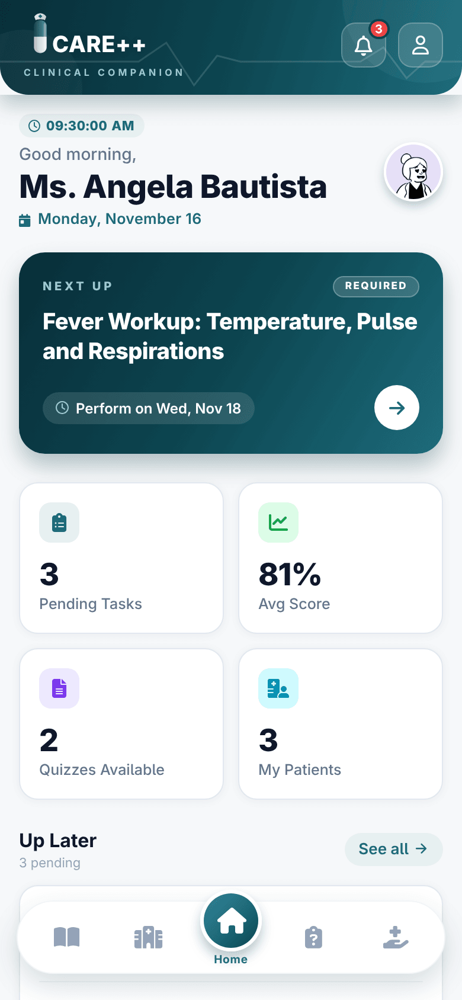

*Figure 1. The Home tab with the next Patient Case to perform, the four figures and the list of what comes after it.*

> [!NOTE]
> The "Next up" card shows the item your instructor assigned most recently, not the one you perform soonest, so look at the dates in **Up Later** too. The **Pending Tasks** number on Home counts Patient Cases and Return Demonstrations; the **Pending Tasks** list in the Clinic tab counts Patient Cases and Case Presentations, so the two numbers can differ.

## Patient Cases in the Clinic tab

A Patient Case is a simulated patient on the ward, with a list of clinical tasks. You perform the tasks in person while your instructor watches, and your instructor grades each task on the web as you do it.

The Clinic tab has, from top to bottom:

- **Room Layout**: the ward's floor plan.
- **Pending Tasks**: the Patient Cases and Case Presentations you still have to do. This list starts open.
- **Graded Patient Cases**: your finished Patient Cases. It appears once one is graded.
- **Hospital Cases**: your Case Presentations (see [Case Presentations](#case-presentations)).

### Find your patient on the ward

The floor plan shows where your patient is, so you can walk to the right room.

**Before you start**

- Your instructor has assigned you a Patient Case with a patient on the ward ([Assign a Patient Case](instructor.md#assign-a-patient-case)).

To find your patient:

1. Tap **Clinic** (the hospital icon). The Clinic tab opens on **Room Layout**, with the room that holds your patient marked "You", for example "Rm 201 · You".

   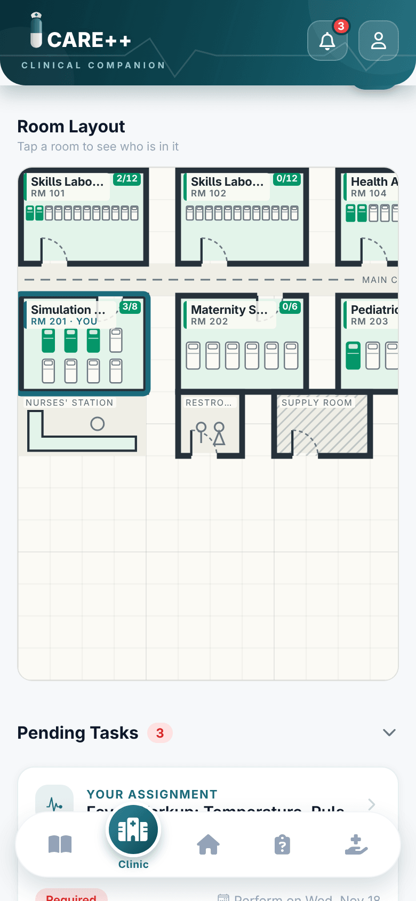

   *Figure 2. The Clinic tab with the ward's floor plan and, below it, Pending Tasks.*

2. If the plan is wider than your screen, slide it sideways to see the other rooms. It opens on your room.
3. Tap your room. The room's screen shows its name, its number and beds, for example "Room 201 · 3/4 beds", and a badge: **Available**, **Crowded** or **Full**.
4. Tap the patient marked **Yours**. Your Patient Case opens (see [Perform a Patient Case](#perform-a-patient-case)).

**Result:** You know which room and bed to go to.

Other patients on the ward are marked **View only**. Tapping one shows "This patient is not part of a patient case assigned to you. Your instructor assigns the patient you are responsible for." Rooms that aren't on the floor plan yet appear under "Not on the plan yet" as cards you swipe through.

### Perform a Patient Case

You perform the Patient Case's tasks while your instructor watches. Pressing **Start** starts a timer, and your instructor grades each task as you do it.

**Before you start**

- Your instructor has assigned you the Patient Case. You got the notification "New patient case assigned", which says the day you perform it.
- Your instructor is with you on the ward and ready to watch.

To perform a Patient Case:

1. Open the Patient Case from any of these places:
   - the "Next up" card or the **Up Later** list on Home;
   - in the Clinic tab, the **Your assignment** card under **Pending Tasks**;
   - the "New patient case assigned" notification;
   - your patient's room on the floor plan (see [Find your patient on the ward](#find-your-patient-on-the-ward)).

   The **Before you start** screen opens. It shows the case's title, your patient and room, how many tasks you'll demonstrate, the day you perform it, and **What to do**.

   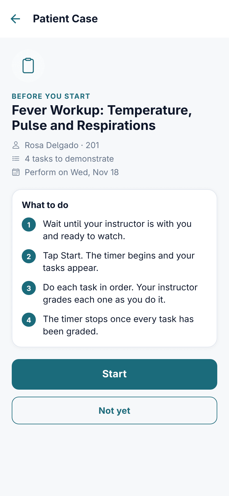

   *Figure 3. The Before you start screen, with the four steps under What to do.*

2. Read **What to do**. If your instructor isn't with you yet, tap **Not yet** to go back.

> [!IMPORTANT]
> Tap **Start** only when your instructor is with you and ready to watch. The timer starts at once and runs until your instructor has graded the last task, even if you leave the screen.

3. Tap **Start**. The timer starts, and the Patient Case screen shows your patient, the time running, the case description and learning objectives, and the **Clinical Tasks**.

   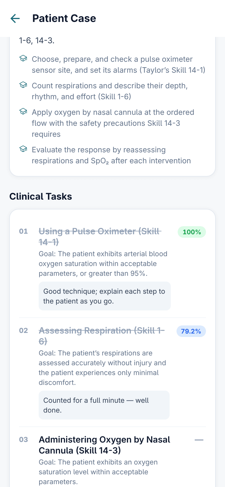

   *Figure 4. A Patient Case in progress: the timer, two graded tasks and two tasks still to do.*

4. Do each task in order while your instructor watches. A task shows "—" until your instructor saves its grade. Then the task is struck through and shows its grade and any remark from your instructor. While the screen is open, new grades appear within a few seconds.
5. Keep going until your instructor has graded every task.

**Result:** When your instructor finishes grading, the timer stops and the screen shows your **Score** and **Time**. The case moves from **Pending Tasks** to **Graded Patient Cases**.

If the case can't start, the message "Unable to start" explains why, for example "This patient case has already been graded".

A Patient Case with no patient on the ward works the same way. After **Start**, its screen says "Graded by your instructor", shows the timer with "Running until your instructor grades the last task.", and has **Back to Clinic** at the bottom.

**Who is notified:** Nobody is notified when you tap **Start**. Your instructor is meant to be with you.

**What happens next:** Your instructor grades each task on the web ([Grade a Patient Case](instructor.md#grade-a-patient-case)). See [See your grade](#see-your-grade).

### Ask your instructor for help

If you need help during a Patient Case, you can let your instructor know from the case's screen.

**Before you start**

- You have tapped **Start** and the Patient Case isn't graded yet. The button shows only then.

To ask for help:

1. On the Patient Case screen, scroll below **Clinical Tasks** and tap **Request instructor assistance** (the raised hand). A confirmation box asks "Request instructor assistance?"
2. Tap **Yes, I need help**. The message "Instructor notified" appears: "Your instructor has been told you need help and will come to you."

**Result:** The button becomes a card that reads "Help requested" and "Your instructor has been notified.", with the link **I no longer need help**. If you're offline, the message is "Saved offline", and the request is sent as soon as your phone reconnects.

> [!NOTE]
> The request stays open until you tap **I no longer need help**, and you can have only one open at a time. If you're not in a group yet, no instructor receives the request, even though the app says "Instructor notified", so tell your instructor in person.

To close the request when you no longer need help, tap **I no longer need help**. A confirmation box asks "Cancel your request?" Tap **I no longer need help** again, or **Keep it** to leave the request open.

**Who is notified:** The instructor who supervises your group gets the notification "Angela Bautista needs assistance" (with your name), and you appear as "Asked for help" on their Overview.

### See your grade

Once your instructor has graded every task, you can see your score, your time and the grade for each task.

> [!NOTE]
> You get no notification when a Patient Case or Return Demonstration is graded. Open it to see whether it has been graded.

To see the grade of a Patient Case:

1. Tap **Clinic**.
2. Tap **Graded Patient Cases** to open the list. Each card shows its grade, for example "Graded · 88%".
3. Tap the Patient Case. The **Result** card shows your **Score**, your **Time** from **Start** to the end of grading, and the date it was **Finalized**. Under **Clinical Tasks**, each task shows its grade and your instructor's remark.

**Result:** You see your grade and how you did on each task.

How the grade is worked out:

- Your instructor rates each step of each task: **Excellent** earns 3 points, **Satisfactory** 2 and **Needs Practice** 1. A step rated **N/A** isn't done in Philippine practice and doesn't count either way.
- Your grade is the share of the possible points you earned, placed on a scale from 37.5% to 100%.
- In words, 83% and up is Excellent, 50% to 82% is Satisfactory, and under 50% is Needs Practice.

If your instructor needs to change a saved grade, their Dean or Program Chair has to approve it first.

## Return Demonstrations

In a Return Demonstration you show your instructor skills from the Taylor's skill checklists, step by step. There's no patient, no **Start** button and no timer. Your instructor rates each step on the web.

When your instructor assigns one, you get the notification "New Return Demonstration", which says the day you demonstrate it. Return Demonstrations are in the **Demos** tab, titled **Return Demos**, under **To perform** (soonest first) and **Graded**. Each one has a badge:

- **Scheduled**: you perform it on a later day.
- **Today**: you perform it today.
- **Waiting for grade**: your instructor has started rating it.
- **Graded · 85%**: it is graded, with your score.

### Get ready for a Return Demonstration

Before the day, look over the skills you'll demonstrate and study any you're unsure of.

**Before you start**

- Your instructor has assigned you the Return Demonstration.

To get ready:

1. Tap **Demos** (the hand holding a medical cross). The **Return Demos** list opens.
2. Tap the Return Demonstration. Its screen shows the title, the day you perform it and how many skills you'll demonstrate, for example "Perform on Thu, Nov 19 · 4 skills to demonstrate".

   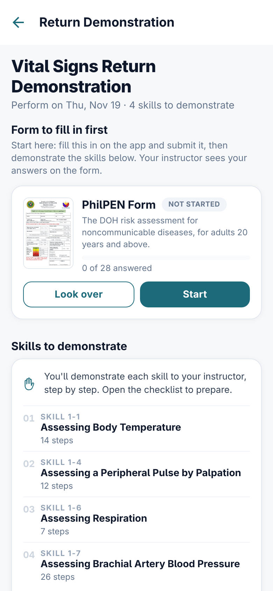

   *Figure 5. A Return Demonstration with a form to fill in first and, below it, the skills to demonstrate.*

3. If the screen shows **Form to fill in first**, fill the form in before the day (see [Fill in a form](#fill-in-a-form)).
4. Under **Skills to demonstrate**, tap **Open the skills checklist**. The **Skills checklist** opens full screen with every step of every skill. Tap **Close** (the X) to go back.
5. Optional: If a **Before you demonstrate** card appears, one of the skills is less than 70% mastered, for example "Skill 1-7 … is 62% mastered. Review it first." Tap **Study it in the Library** to open the Library tab and study it (see [Open study materials](#open-study-materials)).
6. On the day, demonstrate each skill to your instructor in person.

**Result:** You're ready to demonstrate. While the screen is open, your ratings appear within a few seconds of your instructor saving them.

**Who is notified:** Nobody.

**What happens next:** Your instructor rates each step on the web ([Assign and grade a Return Demonstration](instructor.md#assign-and-grade-a-return-demonstration)). See [See your ratings](#see-your-ratings).

### Fill in a form

Some Return Demonstrations come with a form, such as the PhilPEN Form, that you fill in on the app before you demonstrate. Your instructor sees your answers written on the form.

**Before you start**

- Your instructor has added a form to the Return Demonstration. It shows under **Form to fill in first** (or **Forms to fill in first**).

To fill in a form:

1. Open the Return Demonstration (see [Get ready for a Return Demonstration](#get-ready-for-a-return-demonstration)). The form's card shows its name, a badge (**Not started**, **Draft** or **Submitted**), a short description and how many questions you have answered, for example "0 of 24 answered".
2. Optional: Tap **Look over** to see the printed form. Tap **Start filling in** there to go on.
3. Tap **Start** (or **Continue** for a draft). The form opens full screen, in numbered sections. For the PhilPEN Form these are Client, Measurements, History, Blood pressure (1st encounter), Lifestyle, and Risk and management. Required questions are marked with a red *.
4. Answer the questions.
5. Optional: Tap **Save draft** to save your answers and carry on later.
6. Tap **Submit**. If a required question is empty, a message names it, for example "Fill in … before submitting the PhilPEN Form."

**Result:** The message "Submitted. Your instructor can see your answers on the form now." appears, and the badge reads **Submitted**. If you close the form with changes you haven't saved, they are kept as a draft: "Draft saved. Continue any time before your instructor grades it."

You can tap **Edit answers** to change a submitted form until your instructor grades the Return Demonstration. After that the screen says "Your instructor has graded this, so the forms are closed.", and **View on the form** shows your answers.

**Who is notified:** Nobody. Your instructor sees your answers when they grade the Return Demonstration.

### See your ratings

Once your instructor has graded the Return Demonstration, you can see your score and the rating of each step.

> [!NOTE]
> You get no notification when a Patient Case or Return Demonstration is graded. Open it to see whether it has been graded.

To see your ratings:

1. Tap **Demos**. Graded Return Demonstrations are under **Graded**, with a badge such as "Graded · 85%".
2. Tap the Return Demonstration. A ring shows your **Score**, with "Graded by your instructor. Open the checklist to see how you did on each step." Each skill shows its own percentage.
3. Tap **See your ratings**. Each step shows its rating (**Excellent**, **Satisfactory**, **Needs Practice** or **N/A**), and each skill shows your instructor's note.

**Result:** You see how you did on every step. The grade is worked out the same way as for a Patient Case (see [See your grade](#see-your-grade)).

## Case Presentations

A Case Presentation is a presentation your group gives to your instructor. Your group leader uploads the group's slides in the app, and your instructor grades the group as a whole: every member gets the group's score.

When your instructor assigns one, every member gets the notification "New case presentation assigned". The leader's says to upload the group's slides when they're ready; the other members' says the leader uploads them.

> [!NOTE]
> Case Presentations are in the Clinic tab under **Hospital Cases**, and the screen of each one is titled "Case Presentation" (see [Names you will see on screen](README.md#names-you-will-see-on-screen)). A Case Presentation marked "Handed in" in the list reads "Awaiting grading" on its own screen. The note "Write up a patient from your duty — initials only" at the top of the **Hospital Cases** list is left over from an older feature; ignore it.

Each Case Presentation shows one of these:

- **Not handed in**: the slides aren't uploaded yet.
- **Handed in** in the list, **Awaiting grading** on its screen: the slides are in, waiting for your instructor.
- **Graded**: your instructor has graded the group.
- **Late**: the slides were handed in after the due date. They are still accepted.

### Upload your group slides

The group leader uploads the group's slides so that the group and the instructor can open them.

**Before you start**

- You are your group's leader: the Case Presentation shows "You are the group leader", and your name has the **Leader** badge.
- Your slides are on your phone as a PowerPoint (.pptx) or PDF file of up to 50 MB.

To upload your group's slides:

1. Tap **Clinic**, then open the Case Presentation from **Pending Tasks**, or tap **Hospital Cases** to open that list and tap it there. The Case Presentation opens with its due date, your group and section, and your instructor's instructions.

   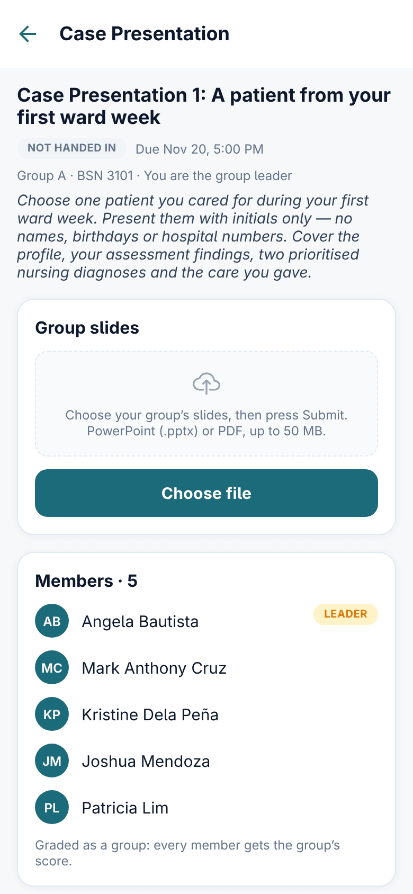

   *Figure 6. A Case Presentation seen by the group leader, before the slides are uploaded.*

2. Under **Group slides**, tap **Choose file** and pick the file on your phone. The file's name appears under "Ready to submit".
3. Tap **Submit**.

**Result:** The message "Submitted. Your group and your instructor can open it now." appears. The badge reads **Awaiting grading**, and the screen says "Handed in — waiting for your instructor to grade it." Tap **Check again** to look for the grade.

If the file is the wrong type or too large, the message is "Pick a PowerPoint (.pptx) or PDF file." or "Files can be at most 50 MB."

To replace the slides before they are graded, tap **Replace file**, pick the new file and tap **Submit**. The screen warns "Submitting replaces “…” for your whole group." Once the group is graded, the slides can't be changed.

**Who is notified:** The first time you submit, your group's instructor and the instructor who made the Case Presentation get "Case presentation handed in", and the other members get "Group slides uploaded". When you replace the file, the other members get "Group slides updated".

**What happens next:** Your instructor grades the group ([Grade a group](instructor.md#grade-a-group)).

### Open the slides and see your grade

Every member can open the group's slides once they are in, and see the group's grade once it is given.

To open the slides and see the grade:

1. Open the Case Presentation: tap the "Group slides uploaded" or "Case presentation graded" notification, or open it from **Hospital Cases** in the Clinic tab.
2. Under **Group slides**, the slides load on the screen. Tap **Open full screen** to see them larger. If they don't load, tap **Try again**.
3. Scroll down to **Members** to see your group, with the leader marked **Leader**.
4. Once the group is graded, read **Your group’s grade** at the top. It shows the score in figures and words, for example "88% · Excellent". Each criterion shows the points you earned, for example "15 of 20 points", a level (**Excellent**, **Proficient**, **Developing** or **Beginning**) and your instructor's remarks, followed by your instructor's overall remark.

**Result:** You see the slides and the group's grade. A Case Presentation grade is final once your instructor finalizes it.

If you're not in a group for the Case Presentation, the screen says "You are not in a group for this case presentation." Ask your instructor. Slides need a connection: offline, the screen says "Connect to the internet to open the slides."

**Who is notified:** When your instructor grades the group, every member gets "Case presentation graded", with the group's score.

## Quizzes

Quizzes test what you know about a skill. They run in strict mode: full screen, and you stay in iCARE++ until you submit.

- **Your grade** for a quiz is the average of your graded tries.
- **Tries:** you get one try, unless your instructor allows more.
- **Pass mark:** 75%.
- **Review quiz:** when your graded tries are used up, the quiz reopens as a review quiz with only the questions you got wrong. A review quiz never changes your grade.

### Find a quiz

The Quizzes tab lists every quiz you can take.

To find a quiz:

1. Tap **Quizzes** (the clipboard with a question mark). The **Quizzes** screen opens with two tabs, **On going** and **Completed**, each with a count.

> [!NOTE]
> "On going" lists the quizzes you haven't submitted yet. **Completed** lists the ones you have, with your grade and flashcards.

2. On the **On going** tab, find the quiz. Each row shows the title, the number of questions, the time limit (or "Untimed") and who set it. Tags show **Required**, the due date (for example "Due Nov 20") or "Not started", and the quiz's category.

   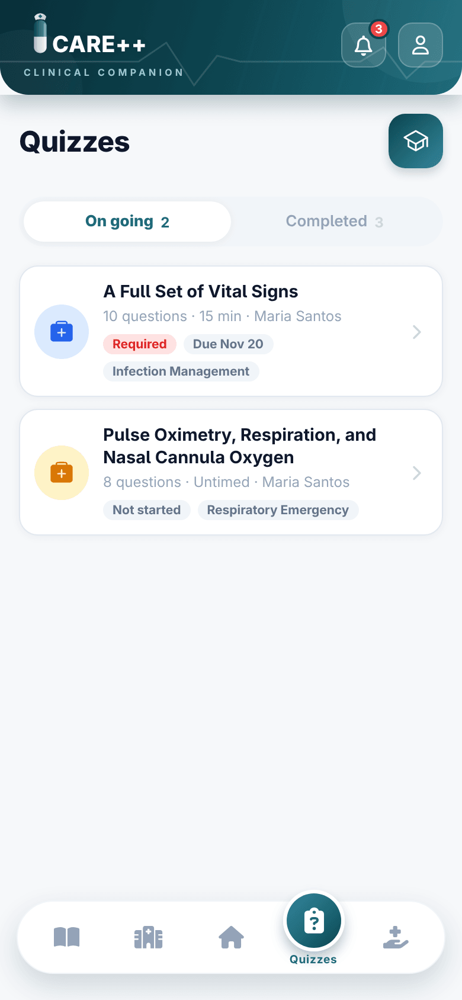

   *Figure 7. The On going tab of Quizzes, with each quiz's questions, time limit and due date.*

3. Tap the quiz. Its details open (see [Take a quiz](#take-a-quiz)).

**Result:** You see the quiz's details. On the **Completed** tab, each row shows how many tries you made, for example "1 attempt", and a ring with your grade.

When your instructor publishes a quiz for your section you get the notification "New quiz available"; when they assign one to you, "New quiz assigned". Tapping either opens the quiz's details.

### Take a quiz

Taking a quiz uses one of your tries. Make sure you have time and a connection before you start.

**Before you start**

- You have a working connection. Quizzes need one to start.
- You have enough time. A timed quiz submits itself when the time is up.

To take a quiz:

1. Open the quiz (see [Find a quiz](#find-a-quiz)). The details show the number of **Questions**, the **Time limit** and **Tries used**, for example "0/1", and a note that you can skip a question and come back to it.

   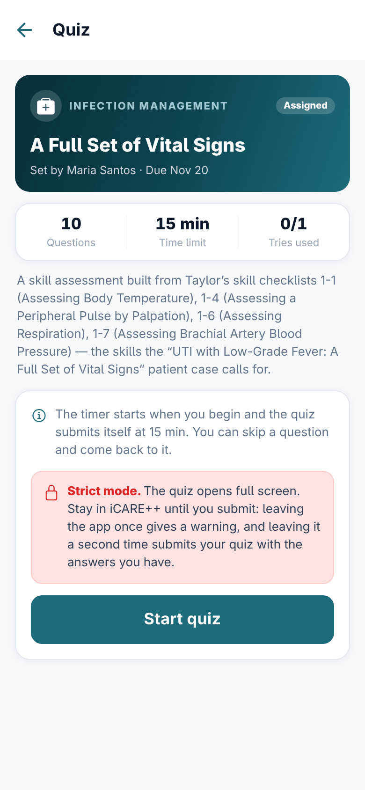

   *Figure 8. A quiz's details, with the Strict mode note above Start quiz.*

2. Read the **Strict mode** note: "The quiz opens full screen. Stay in iCARE++ until you submit: leaving the app once gives a warning, and leaving it a second time submits your quiz with the answers you have."

> [!IMPORTANT]
> Tapping **Start quiz** starts your try at once; there's no second question. After that the only way out is to submit. Leaving the app twice submits the quiz with the answers you have so far.

3. Tap **Start quiz**. The quiz opens full screen. A bar at the top shows the title and "Strict mode", and a timer shows how long is left on a timed quiz.
4. Read the question and tap your answer. For a question with a box instead of choices, type your answer in the **Type your answer** box.

   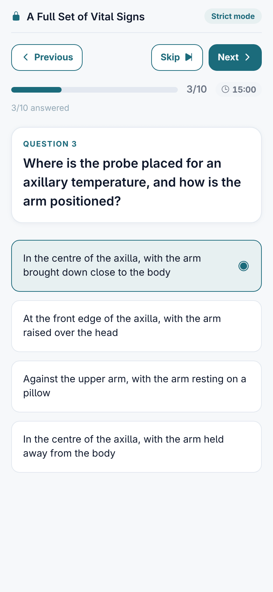

   *Figure 9. A quiz question in strict mode, with Previous, Skip and Next above it.*

> [!NOTE]
> **Next** stays off until you answer the question. To leave a question for later, tap **Skip**, then come back to it with **Previous**.

5. Tap **Next**. Under the progress bar, a line counts your answers, for example "3/10 answered · 1 skipped".
6. On the last question, tap **Submit**. A confirmation box titled "Submit Quiz" asks "Submit all 10 answers?", or tells you how many questions are unanswered and asks "Submit anyway?"
7. Tap **Submit**.

**Result:** Your answers are graded at once and your result opens (see [See your result and missed questions](#see-your-result-and-missed-questions)).

While you take the quiz:

- **Back:** pressing Back or swiping back asks "Leave the quiz?": "Leaving submits your quiz with the answers you have now, and it counts as this attempt." Tap **Stay** to go on, or **Submit and leave**.
- **Leaving the app:** the first time, "You left the quiz" warns you, and the top bar reads "Left the app 1/2". The second time, the quiz submits itself.
- **Time limit:** when the time runs out, "Time's up" appears and your answers are submitted.
- **If the app closes:** open the quiz again to carry on with the same questions and the same clock. A try left open past its time limit is closed and still uses up a try; the message "New attempt" explains this.

**Who is notified:** Nobody. Your result goes into your instructor's analytics.

### See your result and missed questions

Right after you submit, the result screen shows your score and lets you look at the questions you missed.

To read your result:

1. Read the result. A dial shows "Passed" or "Not passed", your score and how many you got right, for example "8 of 10 correct". Below it are **Time Spent**, **Score**, **Min. Passing Score**, **Date Finished** and **Attempt**, for example "1 of 1".

   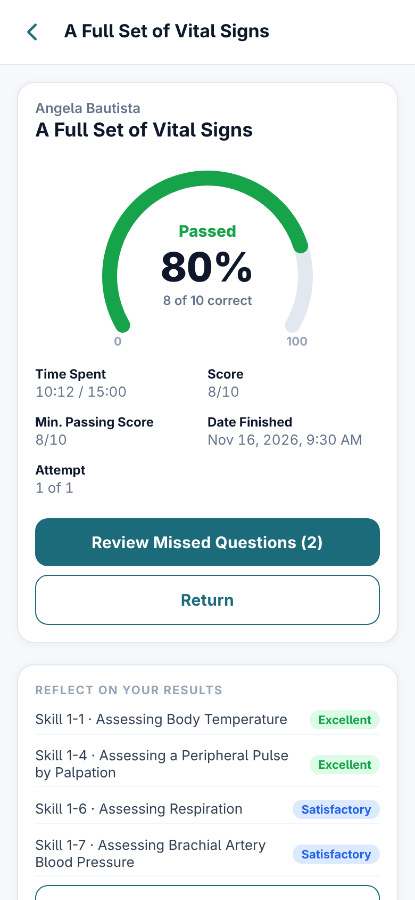

   *Figure 10. A quiz result with the pass dial, the details and Review Missed Questions.*

   A note may explain how the quiz ended, for example "Submitted automatically because you left the app 2 times during the quiz."
2. Tap **Review Missed Questions** (the number in brackets counts them). Under **Missed questions**, each question shows a **Skipped** tag if you skipped it, your answer marked ✗, the right answer marked ✓, and an explanation.
3. Scroll down to **Reflect on your results** and write your reflection now (see [Reflect on your results](#reflect-on-your-results)).

> [!IMPORTANT]
> Write your reflection before you tap **Return**. Once you leave the result screen, the reflection can't be opened again.

4. Tap **Return**. The quiz's details open again.

**Result:** You know your score and what you got wrong.

### Reflect on your results

After a graded quiz you can get feedback, write a short reflection and set yourself up to three goals. Your goals then appear in your Profile.

**Before you start**

- You have just submitted a graded quiz and are still on its result screen. A review quiz has no reflection.

To reflect on your results:

1. On the result screen, scroll to **Reflect on your results**. Each skill in the quiz shows your level and any remark from your instructor.

   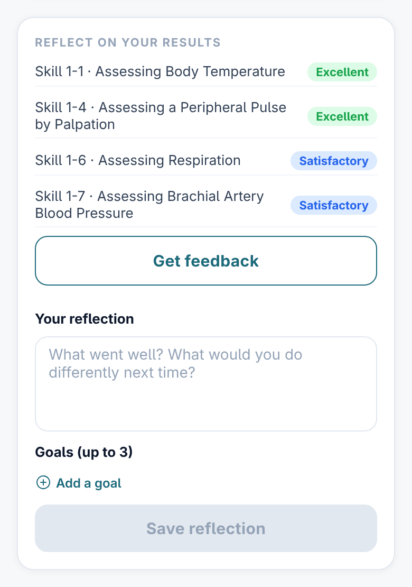

   *Figure 11. The Reflect on your results card below a quiz result.*

2. Optional: Tap **Get feedback**. After "Reading your results…", a short summary appears with **Strengths**, **To improve** and suggested goals marked "+". Tap a suggested goal to add it to your goals.
3. In the **Your reflection** box, enter what went well and what you would do differently next time.
4. Under **Goals (up to 3)**, enter a goal, for example "Count every irregular pulse for a full minute". Tap **Add a goal** for another.
5. Tap **Save reflection**.

**Result:** Your reflection and goals show on the card, with **Edit reflection** to change them while you're still on the result screen. Your goals appear under **My Goals** in your Profile (see [Your goals and performance history](#your-goals-and-performance-history)).

With AI features on, the feedback is written by AI from your scores and your instructor's remarks. With them off, the feedback comes straight from your grades (see [Turn AI features on or off](#turn-ai-features-on-or-off)).

**Who is notified:** Nobody.

### Take a quiz again or a review quiz

After your first try, the quiz's details show your grade and what you can do next.

The details of a quiz you have taken show a ring with your grade, "Passed" or "Keep practicing", and a line such as "1 attempt · last on Nov 6. Passing mark is 75%." The button below depends on your tries:

- **Take it again**: you have tries left. The new try works like the first one (see [Take a quiz](#take-a-quiz)). Your grade becomes the average of your graded tries. A try that ran out of time counts as a try but has no score, so it isn't in the average.
- **Take review quiz**: your graded tries are used up. The note says, for example, "Your graded try is used up. This review quiz has only the 2 questions you got wrong, weakest skills first. It won't change your grade of 82%." A review quiz runs in strict mode like any other, with a "Review · not graded" tag, and its result says "Review quiz, not graded. Your grade stays 82%." You can take review quizzes as often as you like while wrong answers are left.
- **Nothing to review**: your tries are used up and you have no wrong answers left: "You have no wrong answers left on this quiz. Ask your instructor if you need another try."
- **No tries left**: you have used every try on a quiz you never submitted. Ask your instructor if you need another try.

Only your instructor can give you another try ([Assign a Quiz](instructor.md#assign-a-quiz)). You aren't notified when they do: the quiz's **Tries used** shows the new number.

### Study with flashcards

Flashcards turn a quiz you have taken into question-and-answer cards.

To study with flashcards:

1. Open a quiz on the **Completed** tab of Quizzes.
2. Tap **Study flashcards**. The first card shows "Question", with "Card 1 of 10" above it.
3. Read the question, then tap the card to see the answer and its explanation.
4. Tap **Got it** if you knew it, or **Still learning** if you didn't. The next card appears.
5. At the end, "Round complete" shows how many you got. Tap **Review the 3 still learning** (the number varies) to go over the ones you missed, **Restart all 10 cards**, or **Back to the quiz**.

**Result:** You have gone through the quiz's questions at your own pace. Flashcards don't count toward your grade.

## Library

The Library holds the study materials your instructors publish for each skill: videos, notes, handouts (PDF files and slides) and links. Below them, **Recommendations & study tips** points you to the skills you haven't mastered yet.

### Open study materials

Study materials are grouped by chapter and skill, following the Taylor's skill checklists.

To open a study material:

1. Tap **Library** (the open book). The **Library** opens. Under its title it counts the materials and how many are new, for example "6 materials · 2 new".

   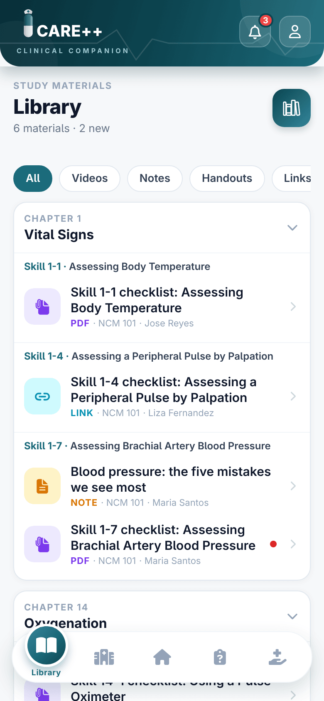

   *Figure 12. The Library with the type filters and Chapter 1's skills and materials.*

2. Optional: Tap a filter to show one type only: **All**, **Videos**, **Notes**, **Handouts** or **Links**.
3. Find the skill. Each chapter lists its skills, for example "Skill 1-7 · …". Tap a chapter's heading to close or open it. Each material shows its type, its course code and who shared it. A red dot marks one you haven't opened yet.
4. Tap the material. It opens with its type at the top, its title, its skill, "Shared by" and its description:
   - a video plays on the screen;
   - a note shows its text;
   - a link shows **Open page**;
   - a PDF or slides show the file on the screen, with **Open full screen**. If it doesn't load, tap "The file could not be opened. Tap to try again."
5. Optional: Tap **Skill checklist** to see the skill's steps and its goal.

**Result:** You have the material open, and its red dot is gone.

When an instructor publishes a material for one of your courses, you get a notification such as "New study note in the Library". Tapping it opens the material. If an instructor removes a material, it reads "This material is no longer available."

### Recommendations and study tips

**Recommendations & study tips** shows how well you know each skill and suggests what to study first. With AI features on, it also gives you a study tip for each skill.

To read your recommendations and study tips:

1. In the Library, scroll below the materials to **Recommendations & study tips**. Its heading sums up where you stand, for example "74% overall mastery · 2 skills to improve".
2. Tap the heading to open it. It starts closed, unless iCARE++ has marked you as Low performing; then it starts open.

   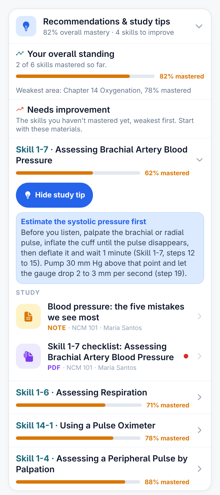

   *Figure 13. Recommendations and study tips, with one weak skill open and its study tip shown.*

3. Read **Your overall standing**: how many skills you have mastered so far and your weakest area.
4. Under **Needs improvement**, find a skill. The skills you haven't mastered yet are listed weakest first, each with a bar showing how well you know it. 95% counts as mastered.
5. Tap the skill to open it.
6. Tap **Study tip** to show the tip. While it is being written, the button reads "Writing your study tip…". Tap **Hide study tip** to close it.
7. Under **Study**, tap a material to open it.

**Result:** You know which skills to work on and what to study for each.

If AI features are off, the panel says "AI study tips are off. You can turn them on in Profile, under Settings." The recommendations still show. See [Turn AI features on or off](#turn-ai-features-on-or-off). The panel doesn't appear until you have results to show.

## Performance

Performance shows your quiz average, your skill area scores, how well you know each skill and your quiz history.

> [!NOTE]
> Performance opens only from Home: tap the **Avg Score** card.

The **Performance** screen shows:

- **Overall Score** and **Quizzes Taken**: the average of all your graded quiz tries, and how many tries you have made.
- **By Skill Area**: a bar for each skill area your instructor has scored. Until then it reads "No skill area scores yet — they appear as your instructor validates your work." You get the notification "Skill area score recorded" when a score is added.
- **Skill Mastery (BKT)**: how likely it is that you know each skill. It is updated after every quiz answer and every finished Patient Case or Return Demonstration, and lists your weakest skills first, the same order a review quiz follows. 95% counts as mastered. Tap **Show 6 more** (the number varies) to see the rest.
- **Quiz History**: each quiz with your latest score. Tap a quiz you have taken more than once to see each try.

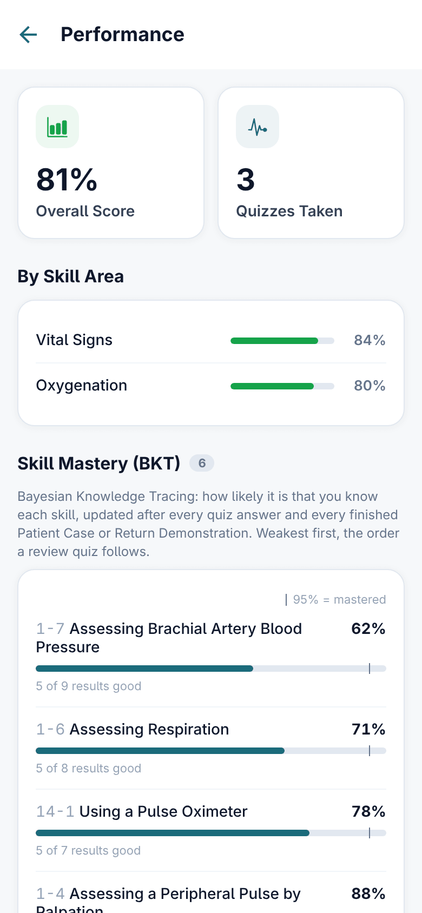

*Figure 14. The Performance screen with Overall Score, skill areas and skill mastery.*

> [!NOTE]
> **Avg Score** on Home and **Overall Score** here average every graded try of every quiz, so a quiz you took three times counts three times. A quiz's own grade is the average of that quiz's tries. The pass mark for a quiz is 75%.

## Notifications

Notifications tell you about new work, uploads, grades for Case Presentations, Library materials and messages from the iCARE++ team.

To read your notifications, tap **Notifications** (the bell) in the app header. The **Notifications** screen opens. At the top it counts your unread notifications, for example "3 unread messages", with **Mark all read**. When everything is read, it shows "Live" while new notifications arrive as they're sent.

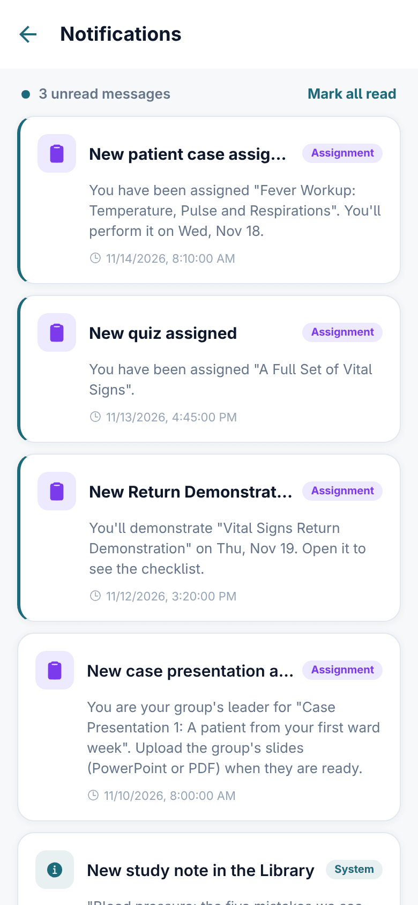

*Figure 15. The Notifications screen, with three unread notifications at the top.*

Each notification shows a type badge, such as **Assignment**, **Validated**, **Support** or **Announcement**, its message and when it came. Tap a notification to mark it read and open what it is about:

| Notification | When it comes | Tapping it opens |
|---|---|---|
| "New patient case assigned" | Your instructor assigns you a Patient Case | The Patient Case |
| "New Return Demonstration" | Your instructor assigns you a Return Demonstration | The Return Demonstration |
| "New quiz available" or "New quiz assigned" | Your instructor publishes a quiz for your section, or assigns one to you | The quiz's details |
| "New case presentation assigned" | Your instructor assigns your group a Case Presentation | The Case Presentation |
| "Group slides uploaded" or "Group slides updated" | Your group leader uploads or replaces the slides | The Case Presentation |
| "Case presentation graded" | Your instructor grades your group | The Case Presentation |
| "New study note in the Library" (or video, handout, presentation or link) | An instructor publishes a study material | The material |
| "Skill area score recorded" | Your instructor scores one of your skill areas | Nothing; see [Performance](#performance) |
| "Support replied: …" and "Support request resolved: …" | The iCARE++ team answers your Help & Support message | Nothing; the full reply is in your email |
| Announcements | The iCARE++ team sends a message to everyone | Nothing |

There is no notification when a Patient Case or a Return Demonstration is graded. Open it to look for your grade.

> [!NOTE]
> Tapping a notification banner that your phone shows outside the Notifications screen opens the Notifications list, not the item. Tap the notification again in the list to open it.

While the app is closed, notifications arrive on your phone as banners if the **Notifications** switch is on (see [Notifications and camera](#notifications-and-camera)).

## Profile and settings

Your Profile holds your goals, your performance history, your settings, Help & Support and **Logout**. To open it, tap **Profile** (the person icon) in the app header, or tap your picture on Home.

At the top, a card shows your picture, your name, your email, your section (for example "Section BSN 3101") and your role, "Student".

### Your goals and performance history

**My Goals** lists the goals you set when you reflect on a quiz, and **Performance history** shows how your mastery of each skill has changed.

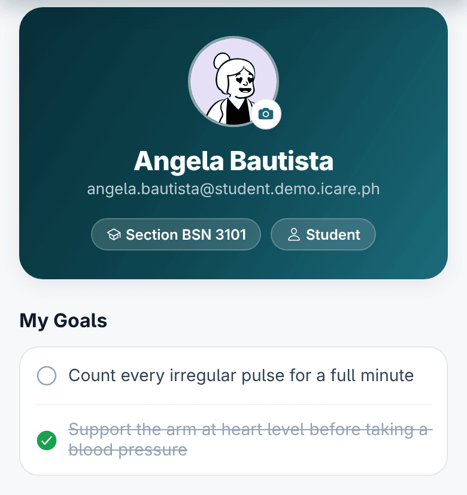

*Figure 16. The Profile, with the student's card and My Goals.*

To use your goals and history:

1. Open your Profile.
2. Under **My Goals**, tap a goal once you have met it. It gets a green tick and is struck through. Tap it again to reopen it.
3. Scroll to **Performance history**. The **Average mastery** chart shows your mastery across the skills you have practised. Below it, each chapter shows how many of its skills you have mastered, for example "2 of 4 skills mastered".
4. Optional: Tap a chapter or a skill to see its own chart. A skill shows "Mastered" or how many points it still needs, for example "8 points to mastered". Tap **Show all 5 chapters** (the number varies) to see the rest.

**Result:** You can follow your progress over time.

If you haven't set any goals yet, **My Goals** says "Set goals when you reflect on a graded patient case or quiz." In the app, you set goals on a quiz's result screen (see [Reflect on your results](#reflect-on-your-results)).

### Change your name or photo

Your photo shows on your Home and to your instructor. You can also correct your name.

To change your photo:

1. Open your Profile and tap your picture. You can also tap **Account** under **Settings**, then **Change photo** (or **Add photo**).
2. In the box titled "Profile photo", tap **Take photo** or **Choose from library**.
3. Take or pick the photo. It is cropped to a square and uploaded.

**Result:** Your new photo shows on your Profile, on Home and to your instructor.

To change your name:

1. Open your Profile and, under **Settings**, tap **Account**.
2. In the **Full name** box, enter your name.
3. Tap **Save changes**. The message "Saved" confirms "Your name has been updated."

**Result:** Your new name shows in the app and to your instructors.

**Account details** shows your email, role and section, with "Email, role, and section are managed by your administrator." To change any of these, ask your instructor.

### Change your password

You change your password with a code sent to your email.

**Before you start**

- You can open your email on this phone or another device.

To change your password:

1. Open your Profile and, under **Settings**, tap **Account**.
2. Under **Security**, tap **Change password**. The **Verify it’s you** screen opens and a code is emailed to you.

> [!NOTE]
> The code is emailed as soon as the screen opens. The screen says "If this account exists, a reset code has been sent." even though you're signed in; the code still comes to your email.

3. In the **Verification code** box, enter the 6-digit code from the email. If it doesn't come, tap **Didn’t get a code? Resend**.
4. Tap **Verify code**. The **Choose a new password** step opens.
5. In the **New password** box, enter a password of at least 8 characters.
6. In the **Confirm new password** box, enter it again.
7. Tap **Update password**. "Password updated" appears.
8. Tap **Done**.

**Result:** Your new password works from your next sign-in. This phone stays signed in; any other phone signed in to your account is signed out.

### Choose light or dark

You can match your phone's setting or keep the app light or dark.

To choose, open your Profile and, under **Settings**, find **Appearance** and tap **System**, **Light** or **Dark**. The app changes at once.

### Turn AI features on or off

AI features write your study tips, give feedback on your graded work and let your instructor ask for an AI summary of your progress. You chose whether to allow them at your first sign-in ([Answer the AI question](setup-1-getting-started.md#answer-the-ai-question)); you can change your answer here.

When AI features are on, iCARE++ sends your scores, skill ratings and your instructor's remarks to Anthropic, the company that makes the Claude AI. Your name, email and password are never sent. When they're off, nothing more goes to the AI: you get no AI study tips, your feedback comes straight from your grades, and your instructor can't ask for an AI summary of your work ([Get an AI summary of a student](instructor.md#get-an-ai-summary-of-a-student)).

To turn AI features on or off:

1. Open your Profile.
2. Under **Settings**, find **AI features**.
3. Turn the switch on or off. Turning it off asks "Turn off AI features?" Tap **Turn off** to confirm, or **Cancel**.

> [!NOTE]
> Turning AI features off deletes the study tips and feedback already saved for you. Your grades and coursework stay the same.

**Result:** The switch shows your choice. The Library's study tips follow it the next time you open the Library.

### Notifications and camera

Two switches control whether iCARE++ can send you notifications and use your camera.

To change them:

1. Open your Profile.
2. Under **Settings**, turn **Notifications** on or off. Turned on, it lets the app tell you "the moment a grade, a new case or an instructor's message comes in". Your phone may ask for permission first.
3. Turn **Camera** on or off. The camera is used to take a profile picture or a photo for a Help & Support message. Choosing a photo from your gallery needs no permission.

**Result:** The switches show your choice.

If you refused a permission earlier, your phone won't ask again, and the app shows "Turn on notifications in Settings" (or the camera's version). Tap **Open Settings** to change it in your phone's settings. To take camera access away, your phone also sends you to its own settings: "Your phone only lets you take away camera access in its Settings."

### Clear cached data

The app keeps copies of your data on the phone so you can see it offline. Clearing them frees space or fixes data that looks out of date.

To clear cached data:

1. Open your Profile.
2. Under **Settings**, tap **Clear cached data**. A confirmation box says "Offline copies of your data will be removed from this device. Anything not yet synced stays queued, and you remain signed in."
3. Tap **Clear**. The message "Cache cleared" says "Pull to refresh on any screen to load the latest data."

**Result:** The copies are gone. You stay signed in, and anything waiting to be sent is still sent.

## Help and Support

Use Help & Support to report a problem with the app or ask the iCARE++ team a question. The team replies by email.

**Before you start**

- Never send a password in a message.

To send a message to the iCARE++ team:

1. Open your Profile and, under **Help & Legal**, tap **Help & Support**.
2. Under **What is this about?**, tap a topic: **Something isn't working**, **How do I…?**, **Account or sign-in**, **Suggestion** or **Something else**.
3. In the **Subject** box, enter a few words that sum it up.
4. In the **Message** box, describe what you were trying to do and what happened instead.
5. Optional: Under **Images (optional)**, tap **Add** to attach a screenshot or photo, then **Take photo** or **Choose from library**. You can attach up to 4.
6. Tap **Send**.

**Result:** "Message sent" appears: "The team will reply to" your email address, and a copy of your message is on its way there too. Tap **Write another message** to send another. Your name, role and email are attached for you.

**Who is notified:** The iCARE++ team gets "Support request from Angela Bautista" (with your name).

**What happens next:** The team replies by email. You also get the notification "Support replied: …" with your subject, and "Support request resolved: …" when the team closes your request. If something is still wrong after that, send a new message.

If you'd rather write an email, the bottom of the screen gives the team's address after "Prefer email? Write to".

## Signing in and out

The app is for Students and Instructors. To sign in for the first time, see [Sign in to the app for the first time](setup-1-getting-started.md#sign-in-to-the-app-for-the-first-time).

To sign in after that, open the app, enter your **Email** and **Password**, and tap **Sign In**. **Remember me** is ticked, so you stay signed in when you close the app. If the email or password is wrong, the message is "Invalid email or password". After too many tries, wait a few minutes before trying again.

### Forgot your password

If you can't remember your password, you can set a new one with a code sent to your email.

To reset your password:

1. On the sign-in screen, tap **Forgot Password?**. The **Reset your password** screen opens.
2. In the **Email** box, enter your email, for example `angela.bautista@student.demo.icare.ph`.
3. Tap **Send reset code**. The **Check your inbox** step opens with "If this account exists, a reset code has been sent."
4. In the **Reset Code** box, enter the 6-digit code from the email. The code lasts 10 minutes. If it doesn't come, tap **Didn't get a code? Resend**.
5. Tap **Verify code**. The **Choose a new password** step opens.
6. In the **New Password** box, enter a password of at least 8 characters.
7. In the **Confirm Password** box, enter it again.
8. Tap **Reset password**. "Password updated" appears.
9. Tap **Go to sign in** and sign in with your new password.

**Result:** Your password is changed, and you're signed out on every phone where you were signed in.

### Log out of the app

Log out when you hand your phone to someone else or stop using the app.

To log out:

1. Open your Profile.
2. Scroll to the bottom and tap **Logout**. A confirmation box asks "Are you sure you want to logout?"
3. Tap **Logout**.

**Result:** The sign-in screen opens, and the phone stops getting your notifications.

### One phone at a time

Your account can be signed in on one phone at a time. The newest sign-in wins.

> [!NOTE]
> Signing in on another phone signs this one out, with no message: the next time this phone loads something, it goes back to the sign-in screen. If you untick **Remember me** when you sign in, closing the app signs you out.

### Working offline

Most screens still open without a connection, showing the last copy they loaded.

- When the connection drops, a grey "Offline" pill appears at the top of the screen. When it comes back, "Back online" shows for a moment.
- The Clinic tab shows "Offline — showing the last synced ward".
- If something you did offline is waiting to be sent, Home shows "Offline — 1 change waiting to sync". Back online, the banner reads "1 change waiting to sync", with **Sync now** to send it straight away. A help request made offline is sent this way (see [Ask your instructor for help](#ask-your-instructor-for-help)).
- A screen you never opened online shows "Network unreachable" or "Request timed out" instead.
- Quizzes need a connection to start: "Quizzes need a connection to start — try again when you are back online." If you lose the connection while submitting, "Submission failed" tells you your answers are still there; try again in a moment.
- Case Presentation slides need a connection to open.

> [!NOTE]
> If you try to sign in without a connection, the error "Cannot reach the iCARE++ server." shows extra technical text under it. Ignore that text: make sure your phone is connected and try again.

### App updates

Most updates download by themselves. The app looks for one each time it starts and when you come back to it.

When an update has downloaded, the box "Update ready" says "A new version of iCARE++ has downloaded. Restart now to use it, or it will load the next time you open the app. Restarting closes anything you haven't saved."

- Tap **Restart** to use the new version now.
- Tap **Later** if you're in the middle of something, such as a quiz or a form. The update loads the next time you open the app.

Some updates need a new copy of the app instead. Install it from the same download link as before (see [Install the iCARE++ app](setup-1-getting-started.md#install-the-icare-app)).
